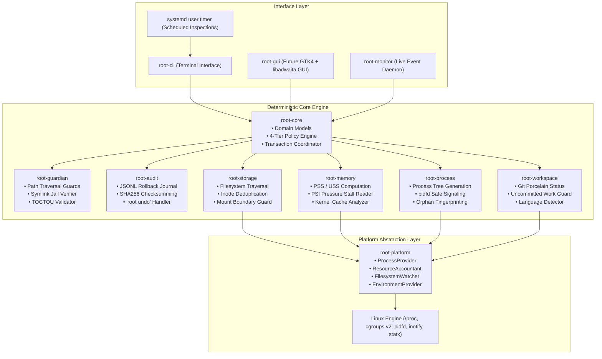
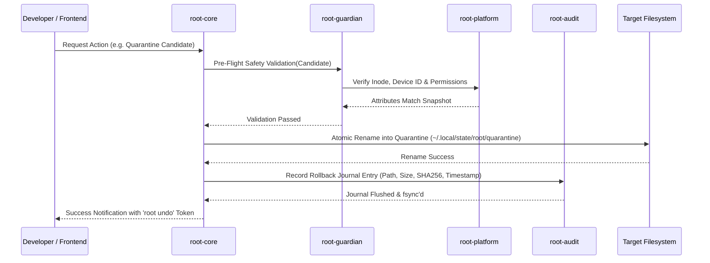

# Root System Architecture

## 1. Architectural Blueprint

Root is architected as a local-first, modular, deterministic resource management system implemented in Rust. It provides deep, surgical visibility into developer workstations, enabling safe recovery of storage and memory consumed by agentic coding workflows.



---

## 2. Component Directory & Crate Topology

Root is organized as a unified Cargo workspace. In Phase 00, the architecture is documented and established before crate initialization in Phase 01:

```
crates/
├── root-core/          # Pure domain logic, policy rules, classification types
├── root-platform/      # Cross-platform traits (ProcessProvider, FilesystemWatcher, etc.)
│   └── src/linux/      # Linux-specific implementation (/proc, cgroups v2, pidfd)
├── root-guardian/      # Security engine, path canonicalization, symlink jail enforcement
├── root-audit/         # Rollback journaling, SHA256 integrity, transaction logs
├── root-storage/       # Filesystem scanner, hardlink deduplication, directory walk
├── root-memory/        # PSS/USS computation, PSI memory pressure monitoring
├── root-process/       # Process tree inspection, orphan detection, safe signaling
├── root-workspace/     # Git repository state, branch checking, project detectors
├── root-cli/           # Terminal UI, interactive prompts, formatted output
├── root-monitor/       # (Future) Lightweight inotify / cgroup event daemon
└── root-gui/           # (Future) Native GNOME GTK4 + libadwaita desktop interface
```

---

## 3. Transactional Execution Lifecycle

Every mutating operation in Root follows a strict 6-stage transactional lifecycle:



### The 6 Stages:
1. **Identification**: Scanners collect candidates and calculate PSS/USS or storage bytes.
2. **Classification**: `root-core` evaluates rules, assigning one of four tiers (`STRICTLY_PROTECTED`, `USER_CONFIRM_REQUIRED`, `OBSOLETE_TRANSIENT`, `SAFE_RECOVERABLE`).
3. **Pre-Flight Validation**: `root-guardian` ensures paths do not cross mount boundaries, escape via symlinks, or violate git safety invariants.
4. **Interactive Consent**: User reviews findings with transparent "Why" explanations; explicit confirmation required for non-transient items.
5. **Atomic Quarantine**: Candidates are moved using `renameat2(RENAME_NOREPLACE)` into isolated quarantine storage.
6. **Journaling**: `root-audit` records cryptographic hashes and path maps, guaranteeing complete reversibility via `root undo`.

---

## 4. Concurrency & Synchronization Model

- **Advisory File Lock**: Single-writer model via `$XDG_STATE_HOME/root/root.lock` (`flock`). Prevents conflicting concurrent mutations between CLI, scheduled timer, and GUI.
- **Asynchronous Non-Blocking Scanning**: Traversal and `/proc` parsing run on dedicated worker threads using Rust's `tokio` or threadpools, streaming results to frontends via bounded channels with backpressure.
- **Zero UI Freezing**: Frontends (CLI progress spinners and GTK main loops) are never blocked by filesystem I/O or process inspection.
