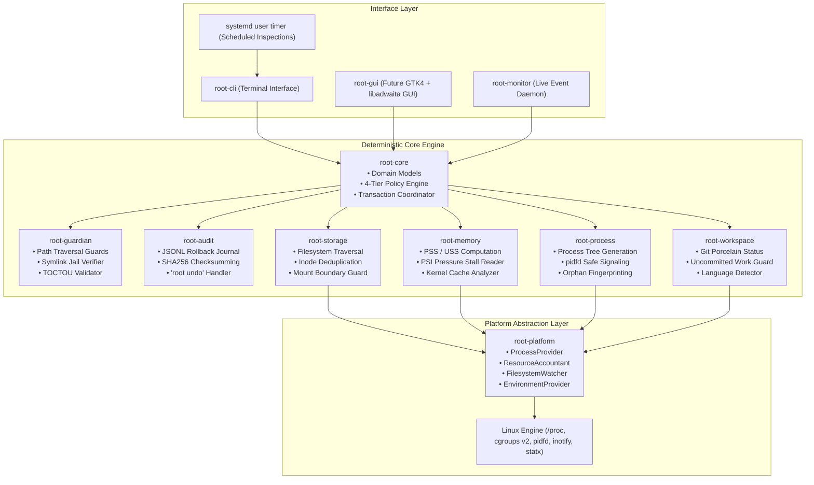
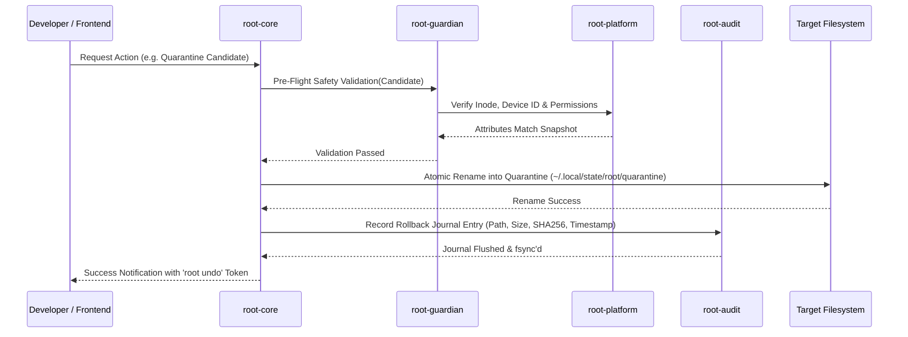
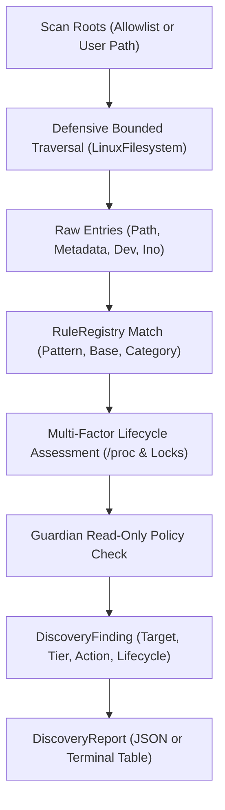
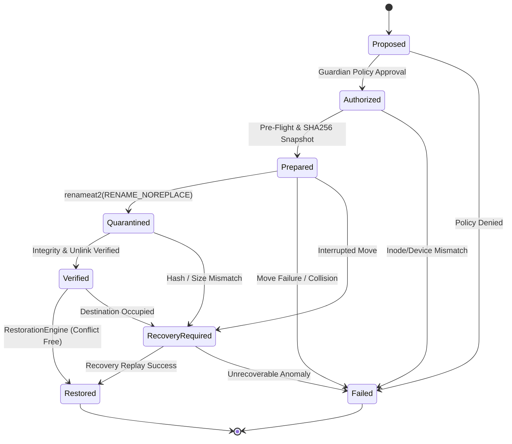

# Root System Architecture

## 1. Architectural Blueprint

Root is architected as a local-first, modular, deterministic resource management system implemented in Rust. It provides deep, surgical visibility into developer workstations, enabling safe recovery of storage and memory consumed by agentic coding workflows.



---

## 2. Component Directory & Crate Topology

Root is organized as a unified Cargo workspace. In Phase 00, the architecture is documented and established before crate initialization in Phase 01:

```
crates/
├── root-core/          # Pure domain logic, policy rules, classification types
├── root-platform/      # Cross-platform traits (ProcessProvider, FilesystemWatcher, etc.)
│   └── src/linux/      # Linux-specific implementation (/proc, cgroups v2, pidfd)
├── root-guardian/      # Security engine, path canonicalization, symlink jail enforcement
├── root-audit/         # Rollback journaling, SHA256 integrity, transaction logs
├── root-storage/       # Filesystem scanner, hardlink deduplication, directory walk
├── root-memory/        # PSS/USS computation, PSI memory pressure monitoring
├── root-process/       # Process tree inspection, orphan detection, safe signaling
├── root-workspace/     # Git repository state, branch checking, project detectors
├── root-cli/           # Terminal UI, interactive prompts, formatted output
│   ├── args.rs         # Clap argument parsing, subcommands, and flags
│   ├── doctor.rs       # Platform audit and kernel interface diagnostics
│   ├── status.rs       # Concise system overview, memory pressure, and scan history
│   ├── scan.rs         # Directory artifact scanning with dry-run protection
│   ├── discover.rs     # AI coding agent and toolchain footprint discovery
│   ├── inspect.rs      # Subsystem inspection (memory, proc, storage statvfs, transaction journals)
│   ├── explain.rs      # Explainability engine detailing provenance, uncertainty, and Guardian decisions
│   ├── report.rs       # Consolidated diagnostic and audit reporting
│   ├── interactive.rs  # Read-only interactive terminal navigation
│   ├── terminal.rs     # NO_COLOR adherence, POSIX terminal width detection, tabular formatting
│   └── history.rs      # XDG-compliant persistent scan history records
├── root-monitor/       # (Future) Lightweight inotify / cgroup event daemon
└── root-gui/           # (Future) Native GNOME GTK4 + libadwaita desktop interface
```

---

## 3. Transactional Execution Lifecycle

Every mutating operation in Root follows a strict 6-stage transactional lifecycle:



### The 6 Stages:
1. **Identification**: Scanners collect candidates and calculate PSS/USS or storage bytes. Verified facts (paths, metadata, inodes) are kept strictly separate from inferred classifications.
2. **Classification**: `root-core` evaluates rules, assigning one of four tiers (`STRICTLY_PROTECTED`, `USER_CONFIRM_REQUIRED`, `OBSOLETE_TRANSIENT`, `SAFE_RECOVERABLE`).
3. **Pre-Flight Validation**: `root-guardian` ensures paths do not cross mount boundaries, escape via symlinks, or violate git safety invariants. Ownership (UID/GID) and process/filesystem identities are independently validated.
4. **Interactive Consent**: User reviews findings with transparent "Why" explanations; explicit confirmation required for non-transient items.
5. **Quarantine Movement**: Candidates are moved using `renameat2(RENAME_NOREPLACE)` on the same filesystem. For cross-filesystem operations, atomic rename is impossible; a verified copy-check-unlink transaction is required with complete metadata preservation.
6. **Journaling & Recovery Tracking**: `root-audit` records cryptographic hashes, path maps, ownership, permissions, and timestamps. Note that recovery cannot be guaranteed in every circumstance (e.g. occupied destination, unmounted mounts, deleted parent trees).

---

## 4. Concurrency & Synchronization Model

- **Advisory File Lock**: Single-writer model via `$XDG_STATE_HOME/root/root.lock` (`flock`). Prevents conflicting concurrent mutations between CLI, scheduled timer, and GUI.
- **Asynchronous Non-Blocking Scanning**: Traversal and `/proc` parsing run on dedicated worker threads using Rust's `tokio` or threadpools, streaming results to frontends via bounded channels with backpressure.
- **Zero UI Freezing**: Frontends (CLI progress spinners and GTK main loops) are never blocked by filesystem I/O or process inspection.

---

## 5. Architectural Corrections & Physical Realities (Phase 01 Revisions)

Phase 01 introduces seven foundational corrections to refine earlier Phase 00 assumptions against concrete operating system realities:

1. **Cross-Filesystem Rename Non-Atomicity**:
   - `renameat2(2)` fails with `EXDEV` across mount points or different filesystems.
   - Moving data across filesystem boundaries requires a multi-step sequence (streaming copy -> verification of bytes/hashes -> unlinking source). This sequence is inherently non-atomic and vulnerable to power failure, disk exhaustion, or concurrent interference.
2. **Quarantine Restoration Uncertainty**:
   - Restoration (`root undo`) cannot be guaranteed under all circumstances. The original path may become occupied by new user files, parent directory trees may have been unlinked, permissions on parent directories may have changed, or destination filesystems may be unmounted or out of space.
   - The transaction journal must explicitly support conflict detection and alternate recovery paths.
3. **Hard Link Unlinking Semantics**:
   - Unlinking a directory entry referencing a multi-linked inode (`st_nlink > 1`) decrements the link count and leaves all remaining hard links pointing to valid, intact data.
   - Removing a hard link does **not** corrupt remaining links. The genuine risks are:
     - Mutating a multi-linked file in-place (corrupts all other hard links referencing the same inode).
     - Incorrectly assuming that unlinking one link frees storage (disk space is only freed when `st_nlink` reaches 0).
4. **Process Parentage (PPID == 1) Nuances**:
   - A process re-parented to PID 1 is **not** automatically abandoned.
   - Daemons, systemd user services, background compilers, and detached interactive tasks (`nohup`, `tmux`, `daemon()`) legitimately have `PPID == 1`.
   - Abandonment requires multi-factor corroboration: absence of controlling TTY, dead session leader, inactive IPC pipes, absence of parent agent sessions, and process lifetime heuristics.
5. **Agent File Lifecycle Evidence**:
   - Agent-generated files (scratchpads, worktrees, test directories) must **never** be classified as disposable without sufficient corroborating lifecycle evidence.
   - Users may have edited files within agent scratchpads or saved intentional work. Deletion requires closed sessions, clean git trees, age thresholds, and explicit user consent.
6. **Independent Identity and Ownership Validation**:
   - Filesystem identity (`(st_dev, st_ino)` + canonical path + UID), process identity (PID + `starttime` + executable inode + UID + `pidfd`), and resource ownership must be independently authenticated before any action.
   - Root strictly verifies UID match to prevent acting on resources belonging to other users.
7. **Transactional Robustness & Metadata Preservation**:
   - Any mutation must preserve complete metadata: POSIX file modes, ownership UID/GID (where permitted), timestamps (mtime, atime), and extended attributes (xattrs).
   - The engine must gracefully abort and roll back if files are modified concurrently during execution.

---

## 6. Discovery Engine & Resource Classification (Phase 03)

Phase 03 implements the read-only discovery engine (`root_core::discovery`) coordinating rule evaluation, lifecycle assessment, and Guardian safety validation across AI coding agents and development tooling:



### Architectural Guarantees:
- **Discovery Does Not Imply Deletion**: Discovering a transient or obsolete artifact does not grant cleanup authorization.
- **Uncertainty Resolves to Protection**: Any resource with inconclusive evidence, recent modification (<1h), or conflicting ownership is categorized as `Unknown` / `StrictlyProtected` and preserved in place.
- **Zero Content Inspection**: Discovery operates solely on path structure, file attributes, inode metadata, and process table telemetry. File contents, conversation histories, tokens, and encryption keys are strictly ignored.
- **Shared Package Store Safety**: Content-addressable package stores using hard links across projects (pnpm) are identified as `StrictlyProtected` with `ProposedAction::Ignore` to prevent workspace corruption.

---

## 7. Guardian Security Engine & Quarantine Rollback (Phase 04)

Phase 04 establishes the core transaction and rollback mechanics required for resource management, strictly constrained to isolated synthetic fixture sandboxes:



### Architectural Guarantees:
- **Sandbox Boundary Enforcement**: Mutations are restricted to verified `FixtureSandbox` instances. Any attempt to touch files outside the sandbox returns an immediate `SandboxViolation`.
- **Atomic Same-Filesystem Relocation**: Files are relocated via `SYS_renameat2` with `RENAME_NOREPLACE`. If the target destination already exists, the kernel prevents overwriting.
- **Cross-Filesystem Safety**: Cross-device moves (`EXDEV`) are detected and rejected prior to mutation.
- **Conflict-Aware Restoration**: Restoring a resource never overwrites an existing file at the original path. Destination collisions halt restoration, preserving the quarantined copy intact.
- **Self-Contained Integrity Verification**: File integrity is verified using a pure-Rust SHA-256 implementation with zero third-party crate dependencies.
