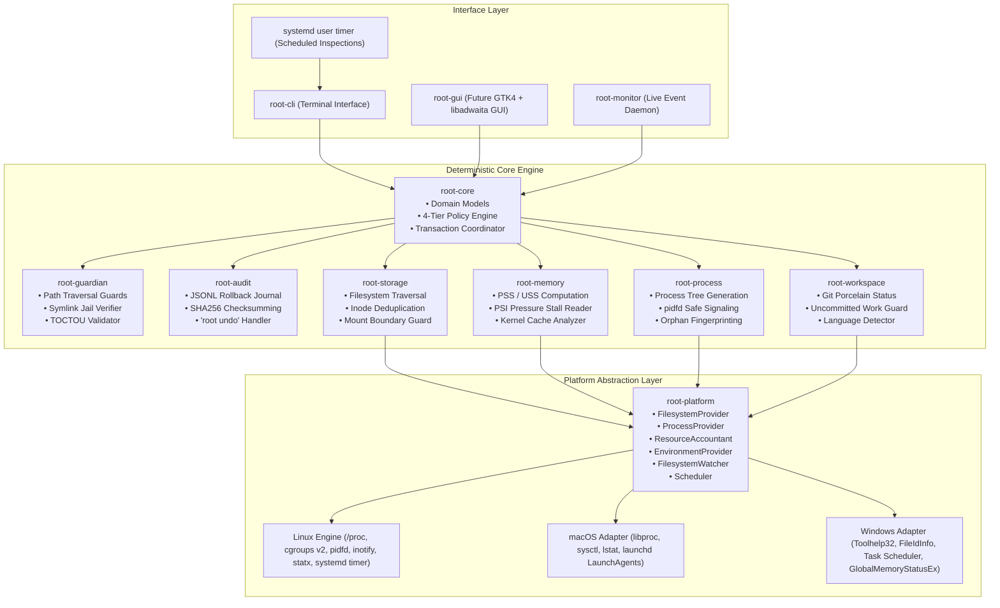
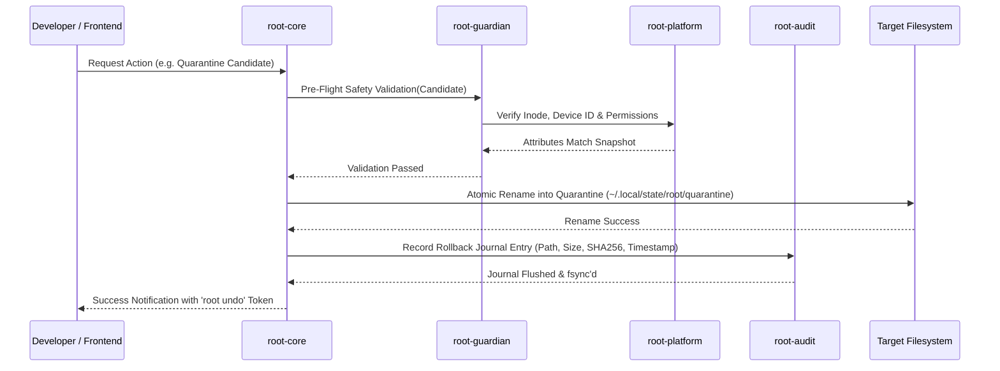
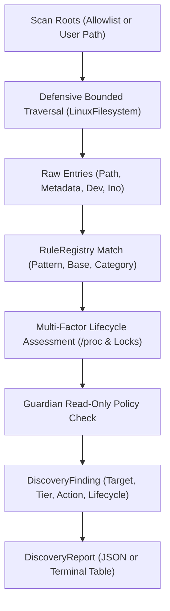
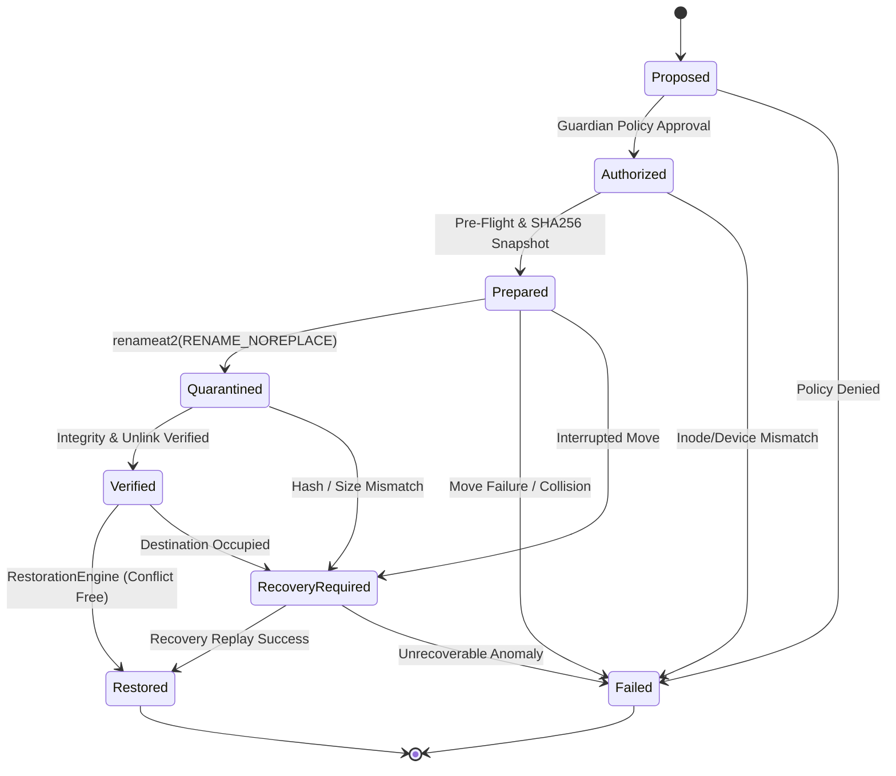
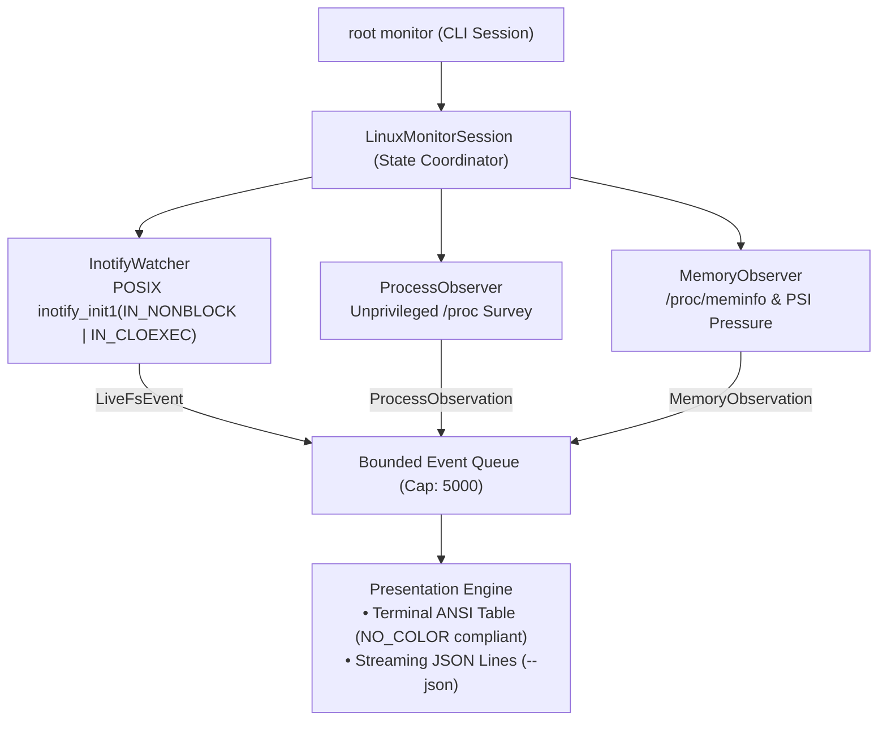
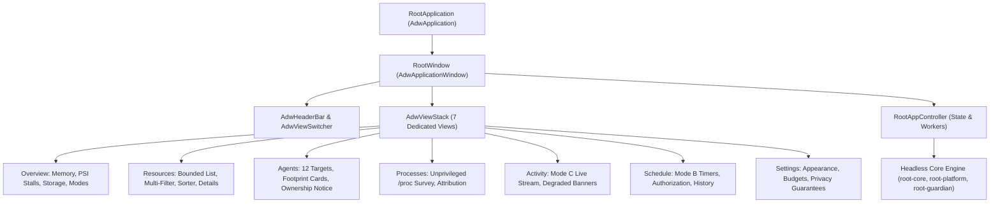
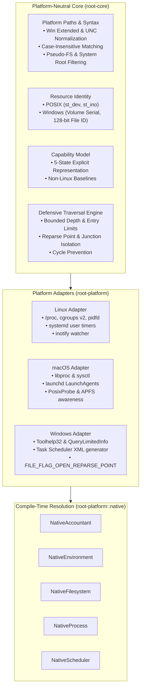

# Root System Architecture

## 1. Architectural Blueprint

Root is architected as a local-first, modular, deterministic resource management system implemented in Rust. It provides deep, surgical visibility into developer workstations, enabling safe recovery of storage and memory consumed by agentic coding workflows.



---

## 2. Component Directory & Crate Topology

Root is organized as a unified Cargo workspace. In Phase 00, the architecture is documented and established before crate initialization in Phase 01:

```
crates/
├── root-core/          # Pure domain logic, policy rules, classification types
│   ├── src/model/platform_paths.rs # PlatformKind, path syntax, pseudo-fs & system directory prefixes
│   ├── src/model/identity.rs       # Platform-neutral FileIdentity & IdentityKind
│   ├── src/model/capabilities.rs   # 5-state explicit CapabilityStatus & PlatformCapabilities
│   ├── src/model/schedule.rs       # ScheduleConfig, ScheduleInterval, ScheduleStatus models
│   └── src/model/monitor.rs        # LiveFsEvent, ProcessObservation, MonitorBudget, DegradedReason
├── root-platform/      # Cross-platform traits and read-only platform adapters
│   ├── src/traits.rs   # FilesystemProvider, ProcessProvider, ResourceAccountant, Scheduler, etc.
│   ├── src/native.rs   # Compile-time selection of Native* platform adapters
│   ├── src/traversal.rs# Defensive, bounded traversal engine with cycle & symlink jail protection
│   ├── src/lock.rs     # Portable advisory lock (flock on POSIX, LockFileEx on Windows)
│   ├── src/notify.rs   # Cross-platform desktop notification dispatcher & privacy fingerprinting
│   ├── src/linux/      # Linux-specific implementation (/proc, cgroups v2, pidfd, inotify, systemd timer)
│   ├── src/macos/      # macOS read-only adapter (libproc, sysctl, launchd LaunchAgents, APFS clone awareness)
│   ├── src/windows/    # Windows read-only adapter (Toolhelp32, FileIdInfo, Task Scheduler XML, GlobalMemoryStatusEx)
│   └── src/mock/       # In-memory mock platform for deterministic testing
├── root-guardian/      # Security engine, path canonicalization, symlink jail enforcement
├── root-audit/         # Rollback journaling, SHA256 integrity, transaction logs
├── root-storage/       # Filesystem scanner, hardlink deduplication, directory walk
├── root-memory/        # PSS/USS computation, PSI memory pressure monitoring
├── root-process/       # Process tree inspection, orphan detection, safe signaling
├── root-workspace/     # Git repository state, branch checking, project detectors
├── root-cli/           # Terminal UI, interactive prompts, formatted output
│   ├── args.rs         # Clap argument parsing, subcommands, and flags
│   ├── doctor.rs       # Platform audit, kernel interface, and systemd scheduler diagnostics
│   ├── status.rs       # Concise system overview, memory pressure, scan history, and schedule status
│   ├── scan.rs         # Directory artifact scanning with dry-run protection
│   ├── discover.rs     # AI coding agent and toolchain footprint discovery
│   ├── inspect.rs      # Subsystem inspection (memory, proc, storage statvfs, transaction journals)
│   ├── explain.rs      # Explainability engine detailing provenance, uncertainty, and Guardian decisions
│   ├── report.rs       # Consolidated diagnostic and audit reporting
│   ├── schedule.rs     # Mode B systemd scheduling management, run orchestration, and notification
│   ├── monitor.rs      # Mode C live event monitoring presentation and signal orchestration
│   ├── interactive.rs  # Read-only interactive terminal navigation
│   ├── terminal.rs     # NO_COLOR adherence, POSIX terminal width detection, tabular formatting
│   └── history.rs      # XDG-compliant persistent scan history records
├── root-monitor/       # (Future) Standalone monitoring daemon crate if split from platform
└── root-gui/           # Native GNOME GTK4 + libadwaita desktop interface
    ├── model/          # Navigation, AppState, Designing-Skills formatters (tnum, middle truncation)
    ├── view_model/     # Decoupled view models (Overview, Resources, Agents, Processes, Activity, Schedule, Settings)
    ├── worker/         # Non-blocking InspectionWorker with cancellation and generation fencing
    ├── gtk/            # Native GTK4/libadwaita windows and views (feature = "gtk")
    ├── app.rs          # Central application coordinator
    └── main.rs         # Desktop binary entry point
```

---

## 3. Transactional Execution Lifecycle

Every mutating operation in Root follows a strict 6-stage transactional lifecycle:



### The 6 Stages:
1. **Identification**: Scanners collect candidates and calculate PSS/USS or storage bytes. Verified facts (paths, metadata, inodes) are kept strictly separate from inferred classifications.
2. **Classification**: `root-core` evaluates rules, assigning one of four tiers (`STRICTLY_PROTECTED`, `USER_CONFIRM_REQUIRED`, `OBSOLETE_TRANSIENT`, `SAFE_RECOVERABLE`).
3. **Pre-Flight Validation**: `root-guardian` ensures paths do not cross mount boundaries, escape via symlinks, or violate git safety invariants. Ownership (UID/GID) and process/filesystem identities are independently validated.
4. **Interactive Consent**: User reviews findings with transparent "Why" explanations; explicit confirmation required for non-transient items.
5. **Quarantine Movement**: Candidates are moved using `renameat2(RENAME_NOREPLACE)` on the same filesystem. For cross-filesystem operations, atomic rename is impossible; a verified copy-check-unlink transaction is required with complete metadata preservation.
6. **Journaling & Recovery Tracking**: `root-audit` records cryptographic hashes, path maps, ownership, permissions, and timestamps. Note that recovery cannot be guaranteed in every circumstance (e.g. occupied destination, unmounted mounts, deleted parent trees).

---

## 4. Concurrency & Synchronization Model

- **Advisory File Lock**: Single-writer model via `$XDG_STATE_HOME/root/root.lock` (`flock`). Prevents conflicting concurrent mutations between CLI, scheduled timer, and GUI.
- **Asynchronous Non-Blocking Scanning**: Traversal and `/proc` parsing run on dedicated worker threads using Rust's `tokio` or threadpools, streaming results to frontends via bounded channels with backpressure.
- **Zero UI Freezing**: Frontends (CLI progress spinners and GTK main loops) are never blocked by filesystem I/O or process inspection.

---

## 5. Architectural Corrections & Physical Realities (Phase 01 Revisions)

Phase 01 introduces seven foundational corrections to refine earlier Phase 00 assumptions against concrete operating system realities:

1. **Cross-Filesystem Rename Non-Atomicity**:
   - `renameat2(2)` fails with `EXDEV` across mount points or different filesystems.
   - Moving data across filesystem boundaries requires a multi-step sequence (streaming copy -> verification of bytes/hashes -> unlinking source). This sequence is inherently non-atomic and vulnerable to power failure, disk exhaustion, or concurrent interference.
2. **Quarantine Restoration Uncertainty**:
   - Restoration (`root undo`) cannot be guaranteed under all circumstances. The original path may become occupied by new user files, parent directory trees may have been unlinked, permissions on parent directories may have changed, or destination filesystems may be unmounted or out of space.
   - The transaction journal must explicitly support conflict detection and alternate recovery paths.
3. **Hard Link Unlinking Semantics**:
   - Unlinking a directory entry referencing a multi-linked inode (`st_nlink > 1`) decrements the link count and leaves all remaining hard links pointing to valid, intact data.
   - Removing a hard link does **not** corrupt remaining links. The genuine risks are:
     - Mutating a multi-linked file in-place (corrupts all other hard links referencing the same inode).
     - Incorrectly assuming that unlinking one link frees storage (disk space is only freed when `st_nlink` reaches 0).
4. **Process Parentage (PPID == 1) Nuances**:
   - A process re-parented to PID 1 is **not** automatically abandoned.
   - Daemons, systemd user services, background compilers, and detached interactive tasks (`nohup`, `tmux`, `daemon()`) legitimately have `PPID == 1`.
   - Abandonment requires multi-factor corroboration: absence of controlling TTY, dead session leader, inactive IPC pipes, absence of parent agent sessions, and process lifetime heuristics.
5. **Agent File Lifecycle Evidence**:
   - Agent-generated files (scratchpads, worktrees, test directories) must **never** be classified as disposable without sufficient corroborating lifecycle evidence.
   - Users may have edited files within agent scratchpads or saved intentional work. Deletion requires closed sessions, clean git trees, age thresholds, and explicit user consent.
6. **Independent Identity and Ownership Validation**:
   - Filesystem identity (`(st_dev, st_ino)` + canonical path + UID), process identity (PID + `starttime` + executable inode + UID + `pidfd`), and resource ownership must be independently authenticated before any action.
   - Root strictly verifies UID match to prevent acting on resources belonging to other users.
7. **Transactional Robustness & Metadata Preservation**:
   - Any mutation must preserve complete metadata: POSIX file modes, ownership UID/GID (where permitted), timestamps (mtime, atime), and extended attributes (xattrs).
   - The engine must gracefully abort and roll back if files are modified concurrently during execution.

---

## 6. Discovery Engine & Resource Classification (Phase 03)

Phase 03 implements the read-only discovery engine (`root_core::discovery`) coordinating rule evaluation, lifecycle assessment, and Guardian safety validation across AI coding agents and development tooling:



### Architectural Guarantees:
- **Discovery Does Not Imply Deletion**: Discovering a transient or obsolete artifact does not grant cleanup authorization.
- **Uncertainty Resolves to Protection**: Any resource with inconclusive evidence, recent modification (<1h), or conflicting ownership is categorized as `Unknown` / `StrictlyProtected` and preserved in place.
- **Zero Content Inspection**: Discovery operates solely on path structure, file attributes, inode metadata, and process table telemetry. File contents, conversation histories, tokens, and encryption keys are strictly ignored.
- **Shared Package Store Safety**: Content-addressable package stores using hard links across projects (pnpm) are identified as `StrictlyProtected` with `ProposedAction::Ignore` to prevent workspace corruption.

---

## 7. Guardian Security Engine & Quarantine Rollback (Phase 04)

Phase 04 establishes the core transaction and rollback mechanics required for resource management, strictly constrained to isolated synthetic fixture sandboxes:



### Architectural Guarantees:
- **Sandbox Boundary Enforcement**: Mutations are restricted to verified `FixtureSandbox` instances. Any attempt to touch files outside the sandbox returns an immediate `SandboxViolation`.
- **Atomic Same-Filesystem Relocation**: Files are relocated via `SYS_renameat2` with `RENAME_NOREPLACE`. If the target destination already exists, the kernel prevents overwriting.
- **Cross-Filesystem Safety**: Cross-device moves (`EXDEV`) are detected and rejected prior to mutation.
- **Conflict-Aware Restoration**: Restoring a resource never overwrites an existing file at the original path. Destination collisions halt restoration, preserving the quarantined copy intact.
- **Self-Contained Integrity Verification**: File integrity is verified using a pure-Rust SHA-256 implementation with zero third-party crate dependencies.

---

## 8. Scheduled Inspections & systemd User Timers (Phase 06, Mode B)

Phase 06 introduces Mode B—optional, scheduled periodic inspections implemented cleanly without persistent background daemons:

```mermaid
flowchart LR
    Timer["systemd User Timer<br>(root-inspect.timer)"] -->|OnCalendar| Service["systemd User Service<br>(root-inspect.service)"]
    Service -->|ExecStart oneshot| CLI["root schedule run"]
    CLI -->|flock| LockFile["schedule.lock<br>(Concurrency Guard)"]
    CLI -->|Read-Only Walk| Discovery["Discovery Engine<br>(root-core)"]
    CLI -->|Store Run (0o600)| History["schedule_history.json<br>(Pruned to 50 records)"]
    CLI -->|Summary Only| Notify["Desktop Notification<br>(notify-send / D-Bus)"]
```

### Architectural Guarantees:
- **Zero Background Daemons**: Execution relies entirely on native Linux user timers (`systemd --user`). Between scheduled triggers, zero Root processes reside in memory.
- **Strictly Read-Only Guarantee**: Scheduled runs execute read-only traversals, lifecycle categorizations, and storage accounting. Guardian policy unconditionally blocks all mutations (`Quarantine`, `Prune`, `Restore`).
- **Concurrency Serialization**: Non-blocking `flock` on `$XDG_STATE_HOME/root/schedule.lock` ensures simultaneous manual scans and scheduled runs do not collide or degrade storage performance.
- **Privacy-Preserving Notifications**: FreeDesktop notifications emit aggregate counts only, never leaking filenames, project paths, usernames, or sensitive metadata.
- **Bounded State Retention**: Schedule run history stored at `$XDG_STATE_HOME/root/schedule_history.json` with mode `0o600` is strictly capped at 50 records via automatic chronological pruning.

---

## 9. Lightweight Live Event Monitoring (Phase 07, Mode C)

Phase 07 introduces Mode C—optional, lightweight, strictly read-only live event monitoring observing filesystem mutations, agent process lifecycles, and memory pressure during active development sessions:



### Architectural Guarantees:
- **Explicit Activation**: Mode C is disabled by default and requires explicit invocation with an approved target scope (`--path`, `--agent`, `--processes`, `--memory`). Unsafe targets (`/`, `/proc`, `/sys`, `/etc`) are strictly rejected.
- **Strictly Read-Only Guarantee**: Monitoring is purely observational. Under no circumstances does Mode C quarantine files, delete resources, prune directories, or send process termination signals. Guardian policy unconditionally blocks all mutations during monitoring.
- **Non-Blocking inotify Watcher**: Uses non-blocking descriptors (`IN_NONBLOCK | IN_CLOEXEC`), recursive directory walking, and strict symlink non-follow protection (`IN_DONT_FOLLOW`). Dynamic child directories are watched as they are created.
- **Kernel Queue Overflow Resilience**: Detects `IN_Q_OVERFLOW` (`wd == -1`), transitioning the session to `Degraded` with `DegradedReason::QueueOverflow` and logging diagnostic warnings without crashing.
- **Rapid Write Event Coalescing**: Consecutive `Modified` events targeting the same file within a 150ms window are deduplicated, suppressing terminal jitter and memory consumption during build bursts.
- **PID Reuse Resilience**: Distinguishes true process lifecycles from PID recycling by tracking immutable `start_time_ticks` from field 22 of `/proc/[pid]/stat`.
- **Memory Pressure Sampling**: Samples `/proc/meminfo` and kernel PSI pressure metrics (`/proc/pressure/memory`), flagging `DegradedReason::MemoryPressureElevated` when 10-second stall percentages exceed 40.0%.
- **Zero Daemon Overhead**: Root runs as an interactive foreground process or finite duration session, terminating immediately on `SIGINT` (Ctrl+C) or timeout. Zero resident background daemons.
- **Concurrency Independence**: Mode C live monitoring does not acquire `schedule.lock`, allowing Mode B scheduled inspections and Mode C live monitoring to coexist without mutual locking contention.
- **Privacy by Design**: File contents, developer credentials, tokens, session transcripts (`transcript.jsonl`), and process command-line arguments are never opened or logged.

---

## 10. Native Desktop Application Architecture (Phase 08, GTK4 + libadwaita)

Phase 08 establishes Root's first native Linux desktop application (`root-gui`), providing a modern, fluid, and accessible interface adhering to GNOME Human Interface Guidelines and Emil Kowalski Designing-Skills reference design (`2d228630ba1446365f614a108cb8252f1feda202`):



### Architectural Guarantees:
- **Headless Core Isolation**: Core crates (`root-core`, `root-platform`, `root-guardian`) remain 100% headless with zero GTK, display, or GUI dependencies.
- **Strictly Read-Only Guarantee**: The GUI exposes zero mutation controls. File cleanup, quarantine, directory pruning, and process termination are permanently rejected by Root Guardian.
- **Designing-Skills Reference Compliance**:
  - **Tabular Figures (`tnum`)**: Numeric measurements enforce tabular digits (`tnum=1`), eliminating horizontal layout jitter during real-time telemetry updates.
  - **Middle Truncation**: Filesystem paths preserve project roots and leaf filenames (`format_path_middle`), preventing layout breaks on narrow viewports.
  - **Instant Keyboard Navigation**: Shortcuts (`<Control>1` through `<Control>7`, `<Control>R`, `<Control>Q`) switch tabs instantaneously without animation delays.
  - **Purposeful Transitions**: UI view transitions utilize sub-250ms cubic ease-out animations.
- **Responsive Off-Thread Traversal**: Blocking filesystem scans execute exclusively on background threads (`InspectionWorker`).
- **Cancellation & Stale-Result Fencing**: Atomic `CancellationToken` enables responsive cancellation, while monotonic generation IDs ensure outdated scan results never overwrite newer state.
- **Dual Compilation Flexibility**: Headless view-model compilation by default; full native graphical window activation via `--features gtk` when host development libraries (`libgtk-4-dev`, `libadwaita-1-dev`) and `pkg-config` are installed.

---

## 11. Cross-Platform Inspection Engine (Phase 10: macOS & Windows)

Phase 10 establishes a platform-neutral core inspection architecture and introduces native read-only platform adapters for macOS and Windows, maintaining complete isolation from Linux-specific mechanisms while preserving strict deterministic safety.



### Architectural Guarantees:
- **Single Crate Architecture**: Platform adapters are organized as sibling modules within `root-platform` (`src/linux/`, `src/macos/`, `src/windows/`, `src/mock/`), maintaining unified trait abstractions without fragmented crate dependencies.
- **Platform-Neutral Resource Identity**: Identifiers avoid assuming POSIX `(device, inode)` pairs globally. Windows targets use 32-bit volume serial numbers paired with 128-bit file identifiers (`FILE_ID_INFO`), while POSIX platforms retain device/inode pairs.
- **Explicit 5-State Capability Representation**: Replaces boolean capability assumptions with explicit statuses: `SupportedAndAccessible`, `PermissionRestricted`, `Unavailable`, `Unsupported`, and `NotTested`. Unsupported measurements are never reported as zero.
- **Non-Linux Compile-Time Read-Only Safety**: The fixture mutation engine (`root-guardian::engine`, quarantine, restore) is gated behind `#[cfg(target_os = "linux")]`. Non-Linux builds contain zero mutation code paths at compile time.
- **Reparse Point & Junction Isolation**: On Windows, every filesystem node is inspected using `FILE_FLAG_OPEN_REPARSE_POINT`. Junctions, volume mounts, symlinks, and cloud storage placeholders are inspected as leaf nodes and never descended into.
- **APFS Clones & Extent Sharing Awareness**: On macOS, `st_blocks` allocated space does not represent reclaimable bytes due to APFS copy-on-write clones (`clonefile`) and shared extents. Storage measurements document this distinction explicitly.
- **PID Reuse Detection Across Operating Systems**: On Linux, `/proc/[pid]/stat` start ticks prevent PID recycling. On macOS, BSD process start ticks (`pbi_start_tvsec`/`usec`) provide identity anchoring. On Windows, 64-bit creation `FILETIME` via `GetProcessTimes` validates process continuity.
- **Advisory Locking Without File Deletion**: Replaces raw `libc::flock` calls with portable `AdvisoryLock` (`flock` on POSIX, `LockFileEx` on Windows). Lock files are never deleted to release locks, avoiding inode desynchronization races.
- **Unprivileged User Schedulers**: Schedulers on all platforms operate strictly within unprivileged user space: systemd user units on Linux, `~/Library/LaunchAgents` on macOS, and unprivileged user tasks (`<LogonType>InteractiveToken</LogonType>`) on Windows Task Scheduler. All schedulers are disabled by default.
