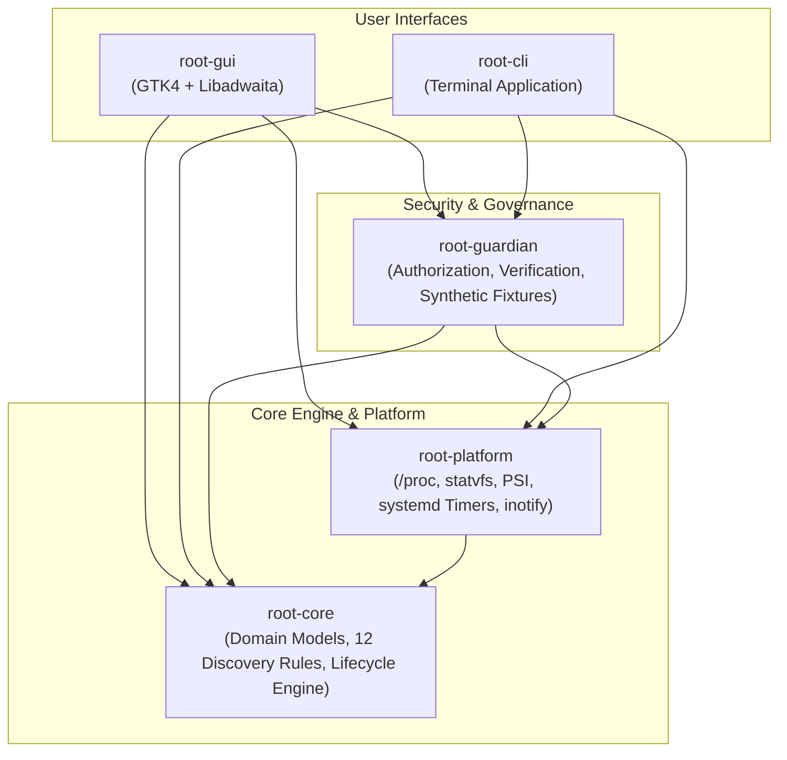

# Root: Secure System Resource Inspection

[](LICENSE)
[%20%7C%20macOS%20%26%20Windows%20(Tier%203)-red.svg)](docs/phase-12-platform-readiness.md)
[](ARCHITECTURE.md)
[](docs/reports/final-v0.1.0-rc.1-evidence-reconciliation.md)
[](docs/reports/final-v0.1.0-rc.1-evidence-reconciliation.md)

**Root** is a deterministic, lightweight, security-first system utility engineered to help developers understand, audit, and safely inspect system resources accumulated through agentic and conversational coding workflows.

Unlike traditional system cleaners, Root operates without AI runtimes or cloud telemetry, requires zero elevated privileges (`sudo` or administrative elevation), respects virtual memory dynamics, and enforces a strict read-only security boundary in production releases.

---

## What Root Does

Autonomous AI coding agents (such as Google Antigravity, Claude Code, OpenAI Codex, Gemini CLI, and Aider) and modern developer toolchains (Node.js/npm, pnpm, Rust/Cargo, Python) generate significant ephemeral storage and background processes:

1. **Agent Scratchpads and Worktrees**: Cloned repositories, test sandboxes, and transient worktrees that accumulate across iterative coding sessions.
2. **Diagnostic Logs and Traces**: Multi-megabyte raw execution outputs, rotated CLI logs, and telemetry caches.
3. **Leaked Shell Environments**: Orphaned UUID directory structures and captured environment wrappers.
4. **Orphaned Background Daemons**: Abandoned development servers (Vite, Next.js) and language servers (`rust-analyzer`, `tsserver`, `pyright`) left running under init after terminal closures.

Root identifies, classifies, and audits these resources deterministically—providing developers and system administrators with complete visibility into agentic footprints.

---

## Local-First and Offline Guarantees

- **100% Offline**: Root never communicates over external networks. There are zero remote API calls, zero cloud telemetry pipelines, and zero analytics pings.
- **Deterministic and Algorithmic**: Resource classification derives entirely from explicit, audited rules. Root uses zero heuristic AI models or non-deterministic scoring.
- **Privacy-Preserving Metadata Inspection**: Root inspects filesystem metadata (paths, sizes, timestamps, inodes, permissions) only. It never reads, logs, or indexes private user documents, conversation histories (`transcript.jsonl`), authentication tokens, or credential files.
- **Zero Elevated Privileges**: Root executes entirely in unprivileged user space. It never requests `sudo`, never runs `setuid`, and never writes to system-wide directories.

---

## Platform Support Strategy

Root categorizes platform support into three operational tiers:

| Tier | Platforms | Packaging & Delivery | Interface Support | Validation Status |
|---|---|---|---|---|
| **Tier 1: Validated Release** | Linux (x86_64)<br>Debian, Kali, Ubuntu, Fedora, Arch | Debian package (`.deb`), portable archive (`.tar.gz`), source | Headless CLI (`root`) and native desktop GUI (`root-gui`) | **Verified**: Tested on Kali Linux with GNOME 47 / Wayland |
| **Tier 2: Experimental Package** | None in v1.0 | None | None | N/A |
| **Tier 3: Source Support Only** | macOS (Darwin x86_64 / arm64)<br>Windows 11 (x86_64) | Build from source via Cargo | Headless CLI (`root`) platform adapters | **Verified in CI**: Platform adapters compile and pass unit tests |

For full platform matrix and capability breakdown, see [docs/phase-12-platform-readiness.md](docs/phase-12-platform-readiness.md).

---

## Installation Methods

### Method 1: Debian / Ubuntu / Kali Linux (`.deb` Package)

The Debian package installs both the headless CLI (`/usr/bin/root`) and native desktop GUI (`/usr/bin/root-gui`), along with desktop launchers, scalable icons, and manual pages.

```bash
# Verify cryptographic checksum
sha256sum -c SHA256SUMS

# Install via apt or dpkg
sudo apt install ./dist/root_0.1.0-rc.1-1_amd64.deb
# or
sudo dpkg -i dist/root_0.1.0-rc.1-1_amd64.deb
```

### Method 2: Portable Standalone Tarball (Unprivileged)

The portable distribution requires zero elevated privileges and can be installed into any custom directory (default: `~/.local`):

```bash
# Unpack the archive
tar -xzf dist/root-v0.1.0-rc.1-x86_64-unknown-linux-gnu.tar.gz
cd root-v0.1.0-rc.1-x86_64-unknown-linux-gnu

# Install to ~/.local
./install.sh --prefix ~/.local

# Optional: Verify installation
~/.local/bin/root doctor
```

To remove:
```bash
./uninstall.sh --prefix ~/.local
```

### Method 3: Building from Source

```bash
# Clone the repository
git clone https://github.com/realmadede/Root.git
cd Root

# Build optimized production release binaries
cargo build --release

# Headless CLI only (zero GTK dependencies, suitable for servers/containers)
cargo build --release -p root-cli
```

For complete installation details and troubleshooting, see [docs/installation.md](docs/installation.md) and [docs/uninstallation.md](docs/uninstallation.md).

---

## Basic Usage

### Command Line Interface (`root`)

Root provides a comprehensive headless CLI supporting plain text tables, JSON formatting (`--json`), and adherence to the `NO_COLOR` standard.

```bash
# Check host system health, memory pressure, and safety boundaries
root status

# Audit platform interfaces, kernel capabilities, and scheduler status
root doctor

# Deterministically scan an explicit workspace directory
root scan --path /path/to/project

# Discover AI coding agent and development tool artifacts across user directories
root discover --agents --tools

# Launch interactive terminal discovery browser
root discover --interactive

# Inspect filesystem allocations and physical storage geometry
root inspect storage

# Inspect kernel memory distribution (PSS/USS, swap, PSI pressure stalls)
root inspect memory

# Inspect active processes with credential sanitization
root inspect processes --user-only

# Explain resource provenance, classification rule, and safety decision
root explain <rule-id-or-path>

# Generate a comprehensive diagnostic and resource audit report
root report

# Check status of opt-in scheduled inspection service
root schedule status

# Launch live event monitoring terminal dashboard
root monitor
```

For detailed command options and examples, see [docs/cli-reference.md](docs/cli-reference.md).

### Native Desktop Application (`root-gui`)

Root includes a native GNOME desktop application built with GTK4 and Libadwaita adhering to the [Designing-Skills](https://github.com/realmadede/Designing-Skills.git) reference foundation. It features a persistent left vertical sidebar with mutually coordinated page navigation and an operational safety status indicator:

```bash
# Launch the desktop graphical interface
root-gui
```

The desktop interface provides seven dedicated navigation views:
- **Overview**: System memory metrics, swap utilization, PSI pressure stalls, storage gauges, and operational status.
- **Resources**: Bounded resource explorer with explicit folder selection, multi-criteria filtering, and Guardian safety badges.
- **Agents**: Inventory and footprint breakdown across 12 AI coding agents and development toolchains.
- **Processes**: Real-time `/proc` process inspection with attribution confidence and credential redaction.
- **Activity**: Live monitoring dashboard displaying circular event queues and system alerts.
- **Schedule**: User-controlled scheduled inspection interface managing `systemd --user` timers.
- **Settings**: System appearance configuration (light/dark mode), resource budget thresholds, and security policy guarantees.

---

## Security Model and Production Invariants

Root v1.0 enforces an uncompromising security architecture:

1. **Strict Read-Only Production Boundary**: Production releases contain zero filesystem deletion, zero production quarantine, and zero process termination capabilities. All production commands are strictly read-only inspection and monitoring routines.
2. **Guardian Authorization Architecture**: Root's internal Guardian engine (`root-guardian`) enforces an 11-stage authorization pipeline, parent directory pinning, and cryptographic transaction logging. Mutation routines are isolated to synthetic test fixtures and permanently disabled in production builds.
3. **Safe Target Selection**: Root requires explicit target selection for scans (`root scan --path <DIR>` or native file chooser in GUI). It never defaults silently to the current working directory or creates synthetic fixtures during production scans.
4. **Unprivileged Scheduling**: Background scheduling operates strictly as an opt-in `systemd --user` service. It runs under the unprivileged user account and never executes without explicit operator configuration.
5. **Dynamic Link Isolation**: The headless CLI executable (`root`) links exclusively to standard system libraries (`libc`), ensuring zero display server or GTK runtime dependencies on servers or containers.

For comprehensive security analysis, see [SECURITY.md](SECURITY.md), [docs/threat-model.md](docs/threat-model.md), and [docs/phase-12-security-review.md](docs/phase-12-security-review.md).

---

## Current Limitations

- **Read-Only Invariant**: Production cleanup, automated pruning, and process termination are disabled in v1.0. Root audits and reports resources; it does not delete them.
- **Desktop Display Requirements**: The desktop GUI (`root-gui`) requires a functional Wayland or X11 display server with GTK 4.12+ and Libadwaita 1.4+. On headless environments, use the standalone `root` CLI.
- **macOS and Windows Binaries**: Native packages (`.pkg`, `.msi`) and native desktop GUIs for macOS and Windows are deferred to future releases. macOS and Windows are supported via source builds of headless platform adapters.
- **Filesystem Traversal Bounds**: Traversal is defensively bounded to 250,000 entries and a maximum recursion depth of 64 levels to prevent memory exhaustion on massive filesystems.

---

## Workspace Architecture

Root is architected as a modular Cargo workspace cleanly separating domain policies, platform bindings, security boundaries, and user interfaces:



| Crate | Responsibility | Dependencies |
|---|---|---|
| [**`root-core`**](crates/root-core) | Domain models (`ResourceCandidate`, `ClassificationTier`), catalog of 12 discovery rules, multi-factor lifecycle engine, and synthetic test fixtures. | Minimal (pure Rust, `serde`) |
| [**`root-platform`**](crates/root-platform) | Platform abstraction layer: Linux `/proc`, `statvfs`, PSI, `systemd --user` timers, and `inotify`; pinned directory descriptor abstraction (`PinnedDirectory`, `openat2`); macOS `libproc`, `sysctl`, and `launchd`; Windows Toolhelp32, Task Scheduler XML, and reparse points; bounded traversal engine. | `libc`, POSIX syscalls, `windows-sys` (Windows) |
| [**`root-guardian`**](crates/root-guardian) | Security enforcement: 11-stage authorization pipeline, descriptor-pinned directory relocation, framed recovery journal with CRC-32 integrity and durability, read-only crash reconciler, synthetic fault injection framework, and over 200 adversarial and fault-injection tests. | `root-core`, `root-platform` |
| [**`root-cli`**](crates/root-cli) | Terminal application providing status overview, capability diagnostics (`doctor`), resource inspection, discovery browsing, schedule configuration, explainability, reports, and live monitoring. | `root-core`, `root-platform`, `root-guardian`, `clap` |
| [**`root-gui`**](crates/root-gui) | Native desktop application built with GTK4 and Libadwaita adhering to Designing-Skills reference design. Features 7 dedicated navigation views and headless compilation support. | Optional `gtk4`, `libadwaita` |

---

## Automated Verification and Quality Gates

Root maintains a comprehensive automated test suite and invariant enforcement pipeline:

```bash
# Run all 433 headless workspace tests
cargo test --workspace --all-targets

# Run native GTK GUI test suite (31 tests)
cargo test --features gtk -p root-gui

# Run unit tests for continuous assurance invariant rules
python3 .github/scripts/test_invariants.py

# Verify repository continuous assurance invariants
python3 .github/scripts/check_invariants.py
```

All 434 unique Rust tests and all 12 continuous assurance invariants pass cleanly.

---

## Reporting Bugs and Vulnerabilities

- **Security Vulnerabilities**: For vulnerabilities or security concerns, review [SECURITY.md](SECURITY.md) and report directly to the security contact. Do not open public issues for undisclosed security flaws.
- **Functional Bugs and Feature Requests**: Report general bugs, regressions, or documentation errors via GitHub Issues at [https://github.com/realmadede/Root/issues](https://github.com/realmadede/Root/issues). Please include platform details (`root doctor` output) and reproduction steps.

---

## Documentation Index

### Core Specifications & Policies
| Document | Purpose |
|---|---|
| [**ARCHITECTURE.md**](ARCHITECTURE.md) | High-level system architecture, crate boundaries, and transactional lifecycle. |
| [**SECURITY.md**](SECURITY.md) | Security policy, least-privilege guarantees, and vulnerability reporting. |
| [**REQUIREMENTS.md**](REQUIREMENTS.md) | Functional, non-functional, and platform requirements. |
| [**CONTRIBUTING.md**](CONTRIBUTING.md) | Contribution workflow, code standards, and setup instructions. |
| [**docs/threat-model.md**](docs/threat-model.md) | Deep threat model (path traversal, TOCTOU, symlinks, PID reuse, mount escapes). |
| [**docs/cleanup-policy.md**](docs/cleanup-policy.md) | Classification policy, Git safety invariants, and quarantine semantics. |
| [**docs/maintenance-safety-contract.md**](docs/maintenance-safety-contract.md) | Foundational maintenance safety contract, explicit consent, and state preservation. |

### Packaging & Release Documentation
| Document | Purpose |
|---|---|
| [**docs/installation.md**](docs/installation.md) | Complete installation instructions for Debian `.deb`, tarball, and source. |
| [**docs/uninstallation.md**](docs/uninstallation.md) | Clean removal instructions for all package and user formats. |
| [**docs/release-process.md**](docs/release-process.md) | Repeatable release workflow, quality gates, and checksum verification. |
| [**docs/reports/final-v0.1.0-rc.1-release-validation.md**](docs/reports/final-v0.1.0-rc.1-release-validation.md) | Comprehensive release validation, test metrics, and packaging audit. |
| [**docs/reports/final-v0.1.0-rc.1-evidence-reconciliation.md**](docs/reports/final-v0.1.0-rc.1-evidence-reconciliation.md) | Final evidence reconciliation, boundary verification, and authorization gate. |

### Milestone Completion Reports
- [Phase 00 Completion Report](docs/phase-00-report.md): Foundation, Research, Architecture & Threat Model
- [Phase 01 Completion Report](docs/phase-01-report.md): Core Models, Platform Traits & Synthetic Fixtures
- [Phase 02 Completion Report](docs/phase-02-report.md): Linux Platform Engine (/proc, statvfs, PSS/USS)
- [Phase 03 Completion Report](docs/phase-03-report.md): Agent & Development Tool Discovery Engine
- [Phase 04 Completion Report](docs/phase-04-report.md): Guardian Security Engine & Quarantine Rollback
- [Phase 05 Completion Report](docs/phase-05-report.md): Command Line Interface & Inspection Experience
- [Phase 06 Completion Report](docs/phase-06-report.md): Scheduled Inspections & systemd User Units (Mode B)
- [Phase 07 Completion Report](docs/phase-07-report.md): Live Event Monitoring Engine (Mode C)
- [Phase 08 Completion Report](docs/phase-08-report.md): Native Desktop Application Architecture (GTK4/Libadwaita)
- [Phase 09 Completion Report](docs/phase-09-report.md): Desktop Usability & Integration Validation
- [Phase 10 Completion Report](docs/phase-10-report.md): Cross-Platform Expansion (macOS & Windows)
- [Phase 11 Completion Report](docs/phase-11-report.md): Production Mutation Security Architecture & Adversarial Validation
- [Phase 12 Completion Report](docs/phase-12-report.md): Production Hardening, Packaging, and Distribution
- [Phase 13 Completion Report](docs/reports/phase-13-read-only-hardening.md): Read-Only Correctness, Classification Safety, and User Experience
- [Phase 14 Completion Report](docs/reports/phase-14-evidence-attribution-readiness.md): Evidence Quality, Resource Attribution, and Maintenance Readiness
- [Phase 14 Review Reconciliation](docs/reports/phase-14-review-reconciliation.md): Safety Contract Corrections and Test-Count Reconciliation
- [Phase 15 Filesystem Safety Plan](docs/reports/phase-15-filesystem-safety-plan.md): Guardian Architecture and Filesystem Safety Plan
- [Work Package 15.1 Report](docs/reports/wp-15.1-pinned-directory-abstraction.md): Pinned Directory Descriptor Abstraction (`openat2`)
- [Work Package 15.2 Report](docs/reports/wp-15.2-descriptor-pinned-guardian-pipeline.md): Descriptor-Pinned Guardian Pipeline and Race-Resistance Verification
- [Work Package 15.3 Report](docs/reports/wp-15.3-journal-durability-reconciliation.md): Framed Recovery Journal, Durability, and Crash-State Reconciliation
- [Work Package 15.4 Report](docs/reports/wp-15.4-adversarial-verification.md): Synthetic Fault-Injection Framework and Adversarial Verification
- [Work Package 15.5 Report](docs/reports/wp-15.5-continuous-assurance-audit.md): Continuous Assurance Audit and Security Gate

---

## License

Root is open-source software licensed under the [MIT License](LICENSE).
