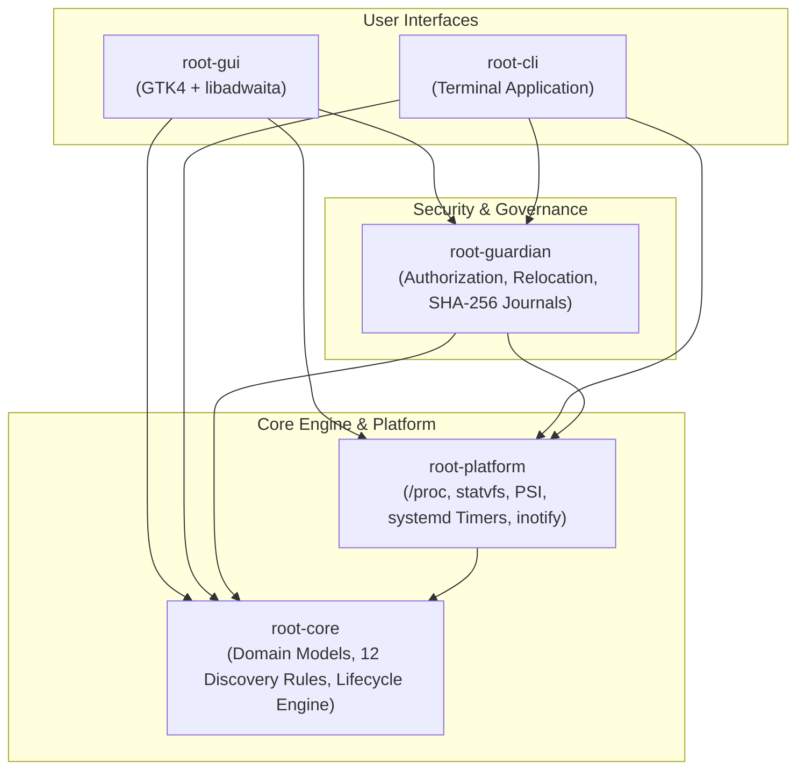
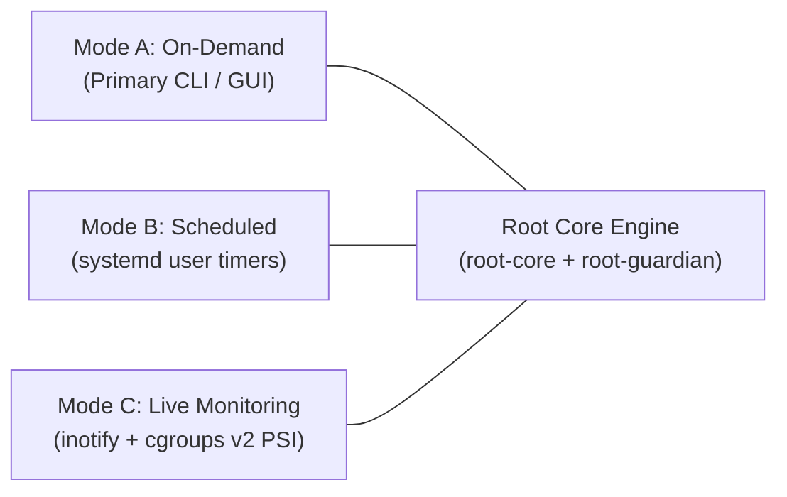

# Root: Secure System Resource Management

[](LICENSE)
[](docs/platform-abstraction.md)
[](ARCHITECTURE.md)
[](docs/phase-09-report.md)
[](docs/phase-09-report.md)

**Root** is a deterministic, lightweight, security-first Linux system utility engineered to help developers understand, audit, and safely inspect system resources accumulated through agentic and conversational coding workflows.

Unlike traditional sweepers, Root operates without AI runtimes or cloud telemetry, requires zero elevated privileges (`sudo`), respects Linux virtual memory dynamics, and provides a reversible, auditable quarantine model—recovering resources without guesswork.

---

## The Problem: Resource Accumulation in Agentic Development

Autonomous AI coding agents (such as Google Antigravity, Claude Code, OpenAI Codex, Gemini CLI, and Aider) and modern developer toolchains (Node.js/pnpm, Rust/Cargo, Python) introduce distinct categories of resource waste and instability:

1. **Unbounded Agent Scratchpads and Worktrees**: Cloned repositories, test suites, and temporary live worktrees that balloon to hundreds of megabytes per session—often left abandoned once the conversation concludes.
2. **Truncated Step Outputs and Diagnostic Logs**: Multi-megabyte raw stdout and stderr dumps, rotated CLI logs, and telemetry cache accumulating across sessions.
3. **Leaked Command Environments**: Orphaned UUID directory structures and captured shell environment scripts.
4. **Orphaned Background Daemons and Language Servers**: Abandoned development servers (Vite, Next.js) and language servers (`rust-analyzer`, `tsserver`, `pyright`) left running under PID 1 after agent or terminal crashes—silently consuming CPU cycles and gigabytes of RAM.

---

## Core Guarantees

- **Zero Elevated Privileges**: Root runs entirely in unprivileged user space. It never invokes `sudo`, requests `root`, or modifies system-wide files.
- **Deterministic and Algorithmic**: Root uses zero AI models, cloud heuristics, or telemetry frameworks. Every decision derives from explicit, testable rules.
- **Respect for Linux Memory Subsystems**: Root does not clear page caches (`drop_caches`) or swap. It measures process memory using Proportional Set Size (PSS) and Unique Set Size (USS)—preventing shared-memory double counting.
- **Strict Protection of Developer Context**: Agent conversation histories (`transcript.jsonl`, `sessions/*.json`), authentication credentials (`oauth_creds.json`, `.key` files), and Git repositories with uncommitted changes are strictly protected.
- **Quarantine-First and Reversible**: Mutations use same-filesystem atomic relocation (`SYS_renameat2` with `RENAME_NOREPLACE`) paired with a cryptographic SHA-256 rollback journal (`root inspect transactions`).
- **Headless Core Engine Isolation**: Core engines compile and run on headless servers with zero GTK or display dependencies. The desktop GUI is strictly an optional visualization layer.

---

## Workspace Architecture

Root is architected as a modular Cargo workspace cleanly separating domain policies, platform bindings, security boundaries, and user interfaces:



| Crate | Responsibility | Dependencies |
|---|---|---|
| [**`root-core`**](crates/root-core) | Domain models (`ResourceCandidate`, `ClassificationTier`), catalog of 12 discovery rules, multi-factor lifecycle engine, and Level 1 synthetic test fixtures. | Minimal (pure Rust, `serde`) |
| [**`root-platform`**](crates/root-platform) | Safe Linux unprivileged kernel interfaces: `/proc` parser, `statvfs` capacity, bounded traversal engine (depth limit 64, entry limit 250,000), PSI pressure sampling, non-blocking `inotify` watcher, and `systemd --user` scheduler. | `libc`, POSIX syscalls |
| [**`root-guardian`**](crates/root-guardian) | Security enforcement: 8-factor authorization engine, 8-state transaction state machine, atomic same-filesystem relocation (`RENAME_NOREPLACE`), durable recovery journal, and self-contained SHA-256 integrity verification. | `root-core`, `root-platform` |
| [**`root-cli`**](crates/root-cli) | Terminal application providing status overview, capability diagnostics (`doctor`), resource inspection, interactive discovery browsing, schedule configuration, and live monitoring output. | `root-core`, `root-platform`, `root-guardian`, `clap` |
| [**`root-gui`**](crates/root-gui) | Native desktop application built with GTK4 and libadwaita adhering to Designing-Skills reference design. Features 7 dedicated navigation views and headless compilation support. | Optional `gtk4`, `libadwaita` |

---

## Hybrid Operating Architecture

Root supports three operating modes powered by a single shared analysis and policy engine—ensuring identical safety rules apply across all execution paths:



1. **Mode A (On-Demand)**: Manual user-initiated inspection and discovery via terminal CLI (`root-cli`) or native desktop application (`root-gui`)—with zero background resource overhead.
2. **Mode B (Scheduled)**: Periodic passive background inspection managed via native `systemd --user` timers. Dispatches non-intrusive desktop notifications via D-Bus when resource thresholds are exceeded, utilizing POSIX `flock` to prevent overlapping runs. Strictly read-only; never deletes automatically.
3. **Mode C (Live Monitoring)**: Event-driven watcher leveraging Linux `inotify` and cgroups v2 Pressure Stall Information (PSI). Features 150ms write coalescing to mitigate event storms and robust PID reuse tracking via process start ticks.

---

## Getting Started

### Prerequisites

- **Operating System**: Linux with kernel 5.8+ (Kali Linux, Debian, Ubuntu, Fedora, Arch).
- **Rust Toolchain**: Rust 1.85+ (`stable`).
- **Optional Desktop GUI Dependencies**: `libgtk-4-dev`, `libadwaita-1-dev`, `pkg-config`.

### Building from Source

```bash
# Clone the repository
git clone https://github.com/realmadede/Root.git
cd Root

# Build all workspace crates (including native GTK4 GUI)
cargo build --workspace

# Build headless CLI only (zero GTK dependencies, suitable for servers/CI)
cargo build -p root-cli
```

### Running Automated Tests

Root maintains a comprehensive automated test suite across synthetic sandboxes, simulated adversarial filesystems, and view models:

```bash
# Run all 169 workspace tests
cargo test --workspace

# Run headless tests without display server dependencies
cargo test -p root-gui --no-default-features
```

---

## Command Line Usage

Root provides a comprehensive CLI suite (`root-cli`) with rich tabular formatting, middle truncation for deep paths, and full adherence to the `NO_COLOR` standard.

```bash
# Check host system health, memory pressure, and safety policy
cargo run -p root-cli -- status

# Audit host platform capabilities, kernel interfaces, and systemd user services
cargo run -p root-cli -- doctor

# Inspect filesystem capacity and physical storage allocations
cargo run -p root-cli -- inspect storage

# Inspect kernel memory distribution (RAM, swap, reclaimable cache, PSI pressure)
cargo run -p root-cli -- inspect memory

# Inspect active processes with privacy-preserving command-line sanitization
cargo run -p root-cli -- inspect processes --user-only

# Discover AI coding agent and development tool artifacts
cargo run -p root-cli -- discover --agents --tools

# Launch interactive terminal discovery browser
cargo run -p root-cli -- discover --interactive

# Explain classification rules and Guardian safety evaluation for a resource
cargo run -p root-cli -- explain antigravity-scratch

# Audit Mode B scheduled inspection status
cargo run -p root-cli -- schedule status

# Launch Mode C live event monitoring dashboard
cargo run -p root-cli -- monitor
```

---

## Native Desktop Application

Root includes a native GNOME desktop application (`root-gui`) built directly with GTK4 and libadwaita, adhering to the [Designing-Skills](https://github.com/realmadede/Designing-Skills.git) reference design.

```bash
# Launch the desktop graphical interface
cargo run -p root-gui
```

The desktop application provides seven dedicated views:
- **Overview**: System memory metrics, swap utilization, PSI pressure stalls, storage gauges, and operating mode statuses.
- **Resources**: Bounded resource explorer (capped at 500 rows) with multi-criteria filtering, middle path truncation, and Guardian decision badges.
- **Agents**: Footprint inventory and classification cards across 12 AI coding agents and development toolchains.
- **Processes**: Real-time `/proc` process inspection with attribution confidence and credential redaction.
- **Activity**: Mode C live monitoring dashboard displaying circular event queues and degraded state banners.
- **Schedule**: Mode B scheduled inspection interface displaying systemd user timer status, execution budgets, and historical run logs.
- **Settings**: System appearance configuration (`AdwStyleManager` light/dark theme switching), safety policy guarantees, and resource budget thresholds.

---

## Repository Documentation Index

### Core Specifications
| Document | Purpose |
|---|---|
| [**ARCHITECTURE.md**](ARCHITECTURE.md) | High-level system architecture, crate boundaries, and transactional lifecycle. |
| [**SECURITY.md**](SECURITY.md) | Security policy, least-privilege guarantees, and vulnerability reporting. |
| [**REQUIREMENTS.md**](REQUIREMENTS.md) | Functional, non-functional, and platform requirements. |
| [**CONTRIBUTING.md**](CONTRIBUTING.md) | Contribution workflow, code standards, and setup instructions. |

### Policies & Platform Architecture
| Document | Purpose |
|---|---|
| [**docs/threat-model.md**](docs/threat-model.md) | Deep threat model (path traversal, TOCTOU, symlinks, PID reuse, mount escapes). |
| [**docs/cleanup-policy.md**](docs/cleanup-policy.md) | 4-tier classification policy, Git safety invariants, and quarantine semantics. |
| [**docs/platform-abstraction.md**](docs/platform-abstraction.md) | Cross-platform traits (`ProcessProvider`, `ResourceAccountant`, `FilesystemWatcher`). |
| [**docs/testing-strategy.md**](docs/testing-strategy.md) | 3-level sandboxed testing strategy (Synthetic Fixtures, Containers, Disposable VMs). |
| [**docs/hybrid-architecture.md**](docs/hybrid-architecture.md) | Detailed architecture of On-Demand, Scheduled, and Live Monitoring modes. |
| [**docs/cli-reference.md**](docs/cli-reference.md) | Comprehensive command-line interface manual and terminal architecture. |
| [**docs/schedule-architecture.md**](docs/schedule-architecture.md) | Architecture specification for Mode B scheduled inspections and systemd user timers. |
| [**docs/monitor-architecture.md**](docs/monitor-architecture.md) | Architecture specification for Mode C live event monitoring and inotify pipelines. |
| [**docs/gui-architecture.md**](docs/gui-architecture.md) | Native desktop application architecture (GTK4 + libadwaita). |
| [**docs/design-foundation.md**](docs/design-foundation.md) | Native GNOME GUI design foundation adapted from Designing-Skills (commit `2d22863`). |

### Implementation Roadmap & Milestone Reports
| Document | Purpose |
|---|---|
| [**docs/roadmap.md**](docs/roadmap.md) | Phased implementation plan from Phase 00 through 1.0 release. |
| [**docs/phase-00-report.md**](docs/phase-00-report.md) | Phase 00 Completion Report: Research, Foundation, Architecture & Threat Model. |
| [**docs/phase-01-report.md**](docs/phase-01-report.md) | Phase 01 Completion Report: Domain Models, Platform Traits & Synthetic Fixtures. |
| [**docs/phase-02-report.md**](docs/phase-02-report.md) | Phase 02 Completion Report: Linux Platform Engine (/proc, statvfs, PSS/USS). |
| [**docs/phase-03-report.md**](docs/phase-03-report.md) | Phase 03 Completion Report: Agent & Development Tool Discovery Engine. |
| [**docs/phase-04-report.md**](docs/phase-04-report.md) | Phase 04 Completion Report: Guardian Security Engine & Quarantine Rollback. |
| [**docs/phase-05-report.md**](docs/phase-05-report.md) | Phase 05 Completion Report: Command Line Interface & Inspection Experience. |
| [**docs/phase-06-report.md**](docs/phase-06-report.md) | Phase 06 Completion Report: Scheduled Inspections & systemd User Units (Mode B). |
| [**docs/phase-07-report.md**](docs/phase-07-report.md) | Phase 07 Completion Report: Live Event Monitoring Engine (Mode C). |
| [**docs/phase-08-report.md**](docs/phase-08-report.md) | Phase 08 Completion Report: Native Desktop Application Architecture (GTK4/libadwaita). |
| [**docs/phase-09-report.md**](docs/phase-09-report.md) | Phase 09 Completion Report: Desktop Usability & Integration Validation. |

### Research Library
- [Linux Resource Management Research](docs/research/linux-resource-management.md)
- [AI Coding Agent Storage Behavior](docs/research/agent-storage-behavior.md)
- [Deep Dive: Google Antigravity](docs/research/antigravity.md)
- [Deep Dive: Claude Code](docs/research/claude-code.md)
- [Deep Dive: OpenAI Codex & Priority 2 Agents](docs/research/codex.md)
- [Deep Dive: Development Tooling Artifacts](docs/research/development-artifacts.md)

---

## Current Status: Phase 09 Complete

Root has completed **Phase 09: Native Desktop Integration, Usability and Security Validation**.

All core platform engines, discovery rules, security authorization layers, scheduled background timers, live event monitoring watchers, and native GTK4/libadwaita graphical views are fully implemented, verified, and backed by 169 passing automated tests.

The project is currently positioned at the Phase 09 review gate, with work preparing for **Phase 10: Cross-Platform Expansion (macOS & Windows)** and **Phase 11: 1.0 Production Hardening, Packaging & SHA-256 Distribution**.

Under Phase 11, users will no longer need to clone the repository or maintain a local Rust toolchain; pre-compiled standalone release binaries will be published directly to GitHub Releases alongside official `SHA256SUMS` manifests and cryptographic signatures for deterministic integrity verification.

---

## License

Root is open-source software licensed under the [MIT License](LICENSE).
