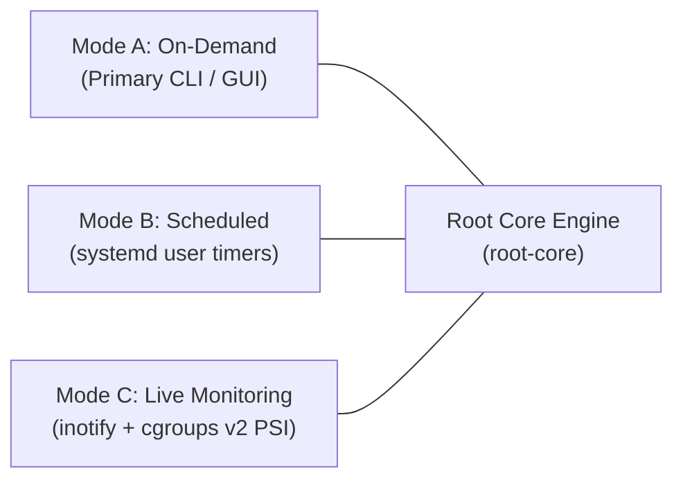

# Root: Secure System Resource Management

**Root** is a deterministic, lightweight, security-first Linux system utility engineered to help developers understand, audit, and safely recover system resources accumulated through agentic and conversational coding workflows.

Unlike traditional cache cleaners or system sweepers, Root operates without AI runtimes, requires no privileged `root` access, respects Linux kernel virtual memory dynamics, and provides a 100% reversible, auditable quarantine model.

---

## The Problem: Resource Accumulation in Agentic Development

Autonomous AI coding agents (such as Google Antigravity, Claude Code, and Aider) and modern developer toolchains (Node.js/pnpm, Rust/Cargo, Python) introduce new categories of resource waste and instability:
1. **Unbounded Agent Scratchpads & Worktrees**: Cloned repositories, test suites, and temporary live worktrees that balloon to hundreds of megabytes per session and are never purged upon conversation closure.
2. **Truncated Step Outputs & Diagnostic Logs**: Multi-megabyte raw stdout/stderr dumps and rotated CLI logs accumulating across sessions.
3. **Leaked Command Environments**: Orphaned UUID directory structures and captured shell environment scripts.
4. **Orphaned Background Daemons & LSPs**: Abandoned development servers (Vite, Next.js) and language servers (`rust-analyzer`, `tsserver`) left running under PID 1 after agent or terminal crashes, silently consuming CPU cycles and gigabytes of RAM.

---

## Core Guarantees & Philosophy

- **Zero Elevated Privileges**: Root runs entirely in unprivileged user space. It never invokes `sudo`, requests `root`, or modifies system-wide files.
- **Deterministic & Algorithmic**: Root uses zero AI models, cloud heuristics, or telemetry. Every decision is based on explicit, testable, deterministic rules.
- **Respect for Linux Memory Subsystems**: Root does not clear page caches (`drop_caches`) or swap. It accurately accounts for process memory using Proportional Set Size (PSS) and Unique Set Size (USS), preventing shared-memory double-counting.
- **Strict Protection of Developer Context**: Agent conversation histories (`transcript.jsonl`, `sessions/*.json`), authentication credentials (`oauth_creds.json`, `.key` files), and Git repositories with uncommitted changes are strictly protected.
- **Quarantine-First & Reversible**: Mutations are performed as atomic renames into a local quarantine directory with a cryptographic rollback journal (`root undo`).
- **World-Class Native Desktop Experience**: Built with GTK4 and libadwaita following the [Designing-Skills](https://github.com/realmadede/Designing-Skills.git) framework.

---

## Hybrid Operating Architecture

Root supports three operating modes powered by a single shared analysis and policy engine:

1. **Mode A (On-Demand)**: Manual user-initiated inspection and quarantine via CLI or desktop GUI. (Zero background footprint).
2. **Mode B (Scheduled)**: Periodic passive inspection using `systemd --user` timers. Dispatches non-intrusive desktop notifications via D-Bus when resource thresholds are exceeded. Never deletes automatically.
3. **Mode C (Live Monitoring)**: Optional event-driven watcher leveraging Linux `inotify` and cgroups v2 Pressure Stall Information (PSI) for active agent swarms, with zero busy-wait CPU polling.

---

## Repository Documentation Index

| Document | Purpose |
|---|---|
| [**AGENTS.md**](AGENTS.md) | **Mandatory operating invariants and development rules for AI coding agents.** |
| [**ARCHITECTURE.md**](ARCHITECTURE.md) | High-level system architecture, crate boundaries, and transactional lifecycle. |
| [**SECURITY.md**](SECURITY.md) | Security policy, least-privilege guarantees, and vulnerability reporting. |
| [**REQUIREMENTS.md**](REQUIREMENTS.md) | Functional, non-functional, and platform requirements. |
| [**CONTRIBUTING.md**](CONTRIBUTING.md) | Contribution workflow, code standards, and setup instructions. |
| [**docs/threat-model.md**](docs/threat-model.md) | Deep threat model (path traversal, TOCTOU, symlinks, PID reuse, mount escapes). |
| [**docs/cleanup-policy.md**](docs/cleanup-policy.md) | 4-tier classification policy, Git safety invariants, and quarantine semantics. |
| [**docs/platform-abstraction.md**](docs/platform-abstraction.md) | Cross-platform traits (`ProcessProvider`, `ResourceAccountant`, `FilesystemWatcher`). |
| [**docs/hybrid-architecture.md**](docs/hybrid-architecture.md) | Detailed architecture of On-Demand, Scheduled, and Live Monitoring modes. |
| [**docs/testing-strategy.md**](docs/testing-strategy.md) | 3-level sandboxed testing strategy (Synthetic Fixtures, Containers, Disposable VMs). |
| [**docs/design-foundation.md**](docs/design-foundation.md) | Native GNOME GUI design foundation adapted from Designing-Skills (commit `2d22863`). |
| [**docs/roadmap.md**](docs/roadmap.md) | Phased implementation plan from Phase 00 through 1.0 release. |
| [**docs/phase-00-report.md**](docs/phase-00-report.md) | Comprehensive Phase 00 Completion and Research Report. |

### Research Library
- [Linux Resource Management Research](docs/research/linux-resource-management.md)
- [AI Coding Agent Storage Behavior](docs/research/agent-storage-behavior.md)
- [Deep Dive: Google Antigravity](docs/research/antigravity.md)
- [Deep Dive: Claude Code](docs/research/claude-code.md)
- [Deep Dive: OpenAI Codex & Priority 2 Agents](docs/research/codex.md)
- [Deep Dive: Development Tooling Artifacts](docs/research/development-artifacts.md)

---

## Current Status: Phase 00 Complete

Root is currently in **Phase 00: Foundation, Research, Architecture, Security and Design Foundation**.

No production application code has been introduced. All research has been empirically grounded on Linux systems, the threat model and cleanup policies have been established, and the project is positioned for Phase 01.

---

## License

Root is open-source software licensed under the [MIT License](LICENSE).
