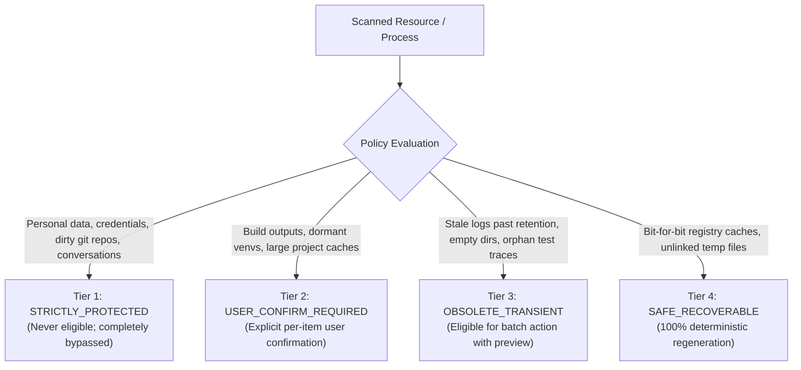

# Root Cleanup Eligibility & Resource Classification Policy

## 1. Foundational Governance Principles

Root is governed by strict deterministic rules. It does not use heuristics based on guessing, heuristics based on file size alone, or probabilistic AI models.

### Three Axioms of Resource Recovery
1. **Never classify an artifact as safe solely because it is old, hidden, large, or located in a cache directory.**
2. **Never destroy an artifact if its loss results in unrecoverable user work, lost conversation context, or corrupted identity credentials.**
3. **Every mutation must be explainable, predictable, auditable, and reversible wherever technically possible.**

---

## 2. Four-Tier Classification Hierarchy

Root categorizes all discovered filesystem entities and processes into four deterministic tiers:



### 2.1 Tier 1: `STRICTLY_PROTECTED`
- **Definition**: Files, directories, and processes critical to user privacy, identity, work continuity, or OS stability.
- **Root Action**: **NEVER TOUCH**. Completely excluded from recovery proposals. Never moved to quarantine; never signaled.
- **Includes**:
  - Personal directories: `~/Documents`, `~/Desktop`, `~/Pictures`, `~/Downloads`, etc.
  - Configuration & Credentials: `~/.ssh/`, `~/.gnupg/`, `~/.config/`, `~/.gemini/oauth_creds.json`, `~/.claude/sessions/*.key`, `~/.claude.json`.
  - Conversation histories: Antigravity `transcript*.jsonl`, Claude Code `sessions/*.json`, Aider `.aider.chat.history.md`.
  - Active Git Repositories with uncommitted changes or unpushed work (`git status --porcelain` is non-empty).
  - System directories: `/bin`, `/usr`, `/lib`, `/etc`, `/boot`, `/sys`, `/proc`, `/dev`.
  - Any path or process where identity, ownership, or purpose is unknown or ambiguous.

### 2.2 Tier 2: `USER_CONFIRM_REQUIRED`
- **Definition**: Artifacts that occupy significant disk space and are safe to rebuild, but whose deletion incurs non-trivial CPU time, battery usage, or network bandwidth to recreate.
- **Root Action**: Highlighted in reports, accompanied by detailed impact explanations. **Requires explicit interactive confirmation** before any action.
- **Includes**:
  - Project build artifacts: `target/` (Cargo), `node_modules/` (npm/yarn), `.next/` (Next.js), `dist/`, `build/`.
  - Python virtual environments: `.venv/`, `venv/`, `env/` (where `requirements.txt` or `pyproject.toml` exists).
  - Dormant agent scratchpads: Antigravity `brain/<uuid>/scratch/` where the conversation is closed.
  - Aider AST cache: `.aider.tags.cache.v3` (rebuilding requires CPU-heavy AST parsing).
  - Docker containers and podman rootless volumes associated with closed projects.

### 2.3 Tier 3: `OBSOLETE_TRANSIENT`
- **Definition**: Temporary execution residue, diagnostic traces, and abandoned metadata that serve no ongoing purpose once their originating task has completed.
- **Root Action**: Eligible for batch quarantine with a clear preview and default opt-in.
- **Includes**:
  - Stale diagnostic logs: Antigravity `log/cli-*.log` older than 14 days; Claude shell snapshots older than 7 days.
  - Truncated step outputs: Antigravity `.system_generated/steps/<step_id>/output.txt` for closed conversations.
  - Leaked empty directory trees: Claude Code `~/.claude/session-env/<uuid>/`.
  - Crash dumps: `crash_*.log` older than 7 days.
  - Orphaned IPC sockets and temporary lock files in `/tmp` where the holding process has exited.

### 2.4 Tier 4: `SAFE_RECOVERABLE`
- **Definition**: Downloaded upstream package tarballs and pre-compiled wheels that can be downloaded bit-for-bit from public package registries without state loss.
- **Root Action**: Safely reclaimable via package manager pruning interfaces or quarantine movement.
- **Includes**:
  - npm download cache: `~/.npm/_cacache/`.
  - pip wheel cache: `~/.cache/pip/`.
  - Cargo crate archive cache: `~/.cargo/registry/cache/*.crate`.
  - Unlinked temporary files with no open file descriptors in `/tmp`.

---

## 3. The Git Safety Invariant

Autonomous coding agents frequently make uncommitted file modifications, create temporary branches, or leave unstaged edits across workspaces.

> [!IMPORTANT]
> **The Git Safety Invariant**:
> Before Root proposes any recovery action on a directory residing within a Git repository:
> 1. Root checks for the presence of `.git`.
> 2. Root invokes `git status --porcelain` on the repository.
> 3. If any tracked files are modified, staged, or conflicted, or if untracked files reside within the candidate path, the candidate is automatically classified as **STRICTLY_PROTECTED**.
> 4. Root checks for unpushed commits (`git log @{u}..HEAD`). If unpushed commits exist, the workspace is treated as actively in progress.

Root will **never** delete build outputs in a dirty repository without explicit, unambiguous user override.

---

## 4. Age Thresholds and Retention Windows

To prevent race conditions with actively running tasks, Root enforces minimum dormancy windows:

| Resource Type | Minimum Dormancy Window | Check Verification Mechanism |
|---|---|---|
| **Session Logs** | 14 days | `mtime` older than 14 days AND not open by any active process |
| **Crash Reports** | 7 days | `mtime` older than 7 days |
| **Empty Directories** | 24 hours | `mtime` older than 24 hours AND entry count == 0 |
| **Agent Scratchpads** | 7 days | Parent conversation closed > 7 days AND no active subagent |
| **Project Build Dirs** | 14 days | Git commit mtime > 14 days AND no file edits > 14 days |
| **Package Caches** | 30 days | Cache access time (`atime` / metadata) > 30 days |

---

## 5. The Quarantine-First Mandate & Reversibility

Root implements a zero-data-loss architecture:

### 5.1 Quarantine Staging Directory
- Paths moved for cleanup are relocated to:
  `$XDG_STATE_HOME/root/quarantine/<timestamp>-<recovery-id>/`
- Default path: `~/.local/state/root/quarantine/`
- Permissions: Enforced `0700` (readable and writable solely by the invoking user).

### 5.2 Quarantine Movement & Cross-Filesystem Realities
- **Same-Filesystem Moves**: When the target directory and the quarantine staging directory reside on the same filesystem (`target.st_dev == quarantine.st_dev`), Root uses `renameat2(..., RENAME_NOREPLACE)` for atomic movement.
- **Cross-Filesystem Moves (`EXDEV`)**:
  - Atomic rename is not supported across filesystem boundaries (`renameat2` returns `-EXDEV`).
  - Cross-device movement requires a 3-step sequence: (1) full recursive copy preserving metadata (mode, timestamps, ownership), (2) cryptographic validation comparing SHA256 hashes and byte counts, and (3) recursive unlinking of the source.
  - **Non-Atomicity Acknowledgment**: Cross-filesystem moves are inherently non-atomic. A system crash, power failure, or disk quota exhaustion mid-transfer can leave partial files. The transaction journal must record partial transfer states to enable clean recovery or rollback.

### 5.3 Restoration Uncertainty & Conflict Management
> [!WARNING]
> Quarantine restoration (`root undo`) **cannot be guaranteed in every circumstance**.
> Potential restoration failure modes:
> 1. The original path has since been re-occupied by new user files or recreated directories.
> 2. The enclosing parent directory tree was deleted or had its permissions changed (`EACCES`).
> 3. The target filesystem is currently unmounted or mounted read-only (`EROFS`).
> 4. The target volume has insufficient free disk space.
> 
> Root handles restoration conflicts gracefully: if the original path is occupied, Root halts restoration, presents a visual diff/conflict report, and offers to restore to an alternate location (`original_path.restored.<id>`).

### 5.4 Hard Link Mechanics & Inode Safety
- **Unlinking Mechanics**: Unlinking one directory entry referencing a multi-linked inode (`st_nlink > 1`) simply decrements the link count. The remaining links continue to reference intact, valid data.
- **True Inode Hazards**:
  1. *In-place mutation*: Writing to a hard-linked file mutates all other hard links referencing the same inode. Root strictly avoids in-place modification.
  2. *Accounting error*: Deleting a file with `st_nlink > 1` does **not** free disk space because the inode and data blocks remain allocated until `st_nlink == 0`. Root does not report disk reclamation until the last link is scheduled for removal.

### 5.5 Process Parentage & Abandonment Verification
- A process with `PPID == 1` is **not automatically abandoned**.
- Background user services (systemd user units), daemonized tools (`daemon()`, `nohup`), long-running build jobs, and terminal multiplexers (`tmux`, `screen`) legitimately run under PID 1.
- Abandonment classification requires multi-factor corroboration:
  - Process PPID is 1 AND controlling terminal (`/proc/[pid]/stat` field 7 `tty_nr`) is 0 (detached).
  - Process executable matches known agent or ephemeral toolchain signatures.
  - No active parent agent session or IDE session owns or tracks the process.
  - Associated workspace or pipe sockets are closed or unlinked.

### 5.6 Agent File Lifecycle Evidence
- Agent-created artifacts (scratchpads, worktrees, test files) must **never** be treated as disposable without verifiable lifecycle evidence.
- An agent directory is eligible for recovery only when:
  1. The parent agent session has definitively closed and archived.
  2. The workspace Git status is verified clean (`git status --porcelain` is empty).
  3. No open file descriptors or active processes point to the directory.
  4. The directory has been dormant past the configured retention window (default: 7 days).
  5. The user gives explicit interactive confirmation (`USER_CONFIRM_REQUIRED`).

### 5.7 Independent Identity and Ownership Validation
- Filesystem identity, process identity, and user ownership must be validated independently:
  - **Filesystem Identity**: Combination of `(st_dev, st_ino)`, canonical lexical path, and file type.
  - **Process Identity**: Combination of PID, `starttime` ticks from `/proc/[pid]/stat`, binary executable inode (`/proc/[pid]/exe`), and `pidfd`.
  - **Ownership Invariant**: Root strictly verifies that the resource's UID matches the invoking user's UID (`st_uid == getuid()`). Root never touches, modifies, or signals resources owned by other users or the system.

### 5.8 Audit Rollback Journal
- Every quarantine operation writes an entry into `$XDG_STATE_HOME/root/audit/journal.jsonl`:
  ```json
  {
    "id": "rec_01JC8Q...",
    "timestamp": "2026-10-20T09:00:00Z",
    "original_path": "/home/user/project/target",
    "quarantine_path": "/home/user/.local/state/root/quarantine/20261020-090000-target",
    "size_bytes": 1428571428,
    "sha256": "e3b0c44298fc1c149afbf4c8996fb92427ae41e4649b934ca495991b7852b855",
    "classification": "USER_CONFIRM_REQUIRED",
    "reason": "Dormant Cargo target directory; git status clean; last modified 42 days ago"
  }
  ```
- **Reversal**: The command `root undo <recovery-id>` reads the journal and moves the quarantined directory atomically back to `original_path`.

### 5.4 Permanent Purge Policy
- Quarantined items are **never deleted immediately**.
- Permanent deletion occurs only:
  1. When explicitly requested via `root purge <recovery-id>`.
  2. When a quarantined item exceeds the 30-day quarantine retention window, with explicit notification.

---

## 6. Required User Explanation Schema

Every proposed cleanup candidate must provide an audit explanation fulfilling these fields:

```
Candidate: /home/user/.gemini/antigravity-cli/brain/3bfcc449.../scratch
Classification: USER_CONFIRM_REQUIRED
Reclaimable Size: 254.2 MiB
Reason: Conversation closed 8 days ago. Contains temporary git clone.
Regeneration: Safe to remove. Re-running the agent task will recreate temporary scratch files if needed.
Associated Risks: If user manually saved scripts in this scratch directory, they will be quarantined.
Safety Verification: Verified Git status clean; no active processes holding open file descriptors.
Reversibility: 100% reversible via 'root undo'.
```
