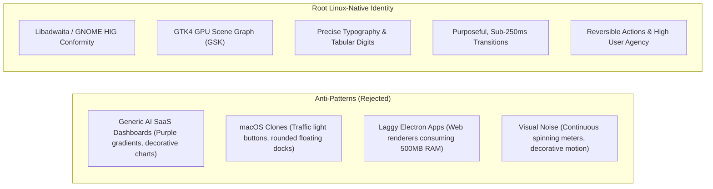
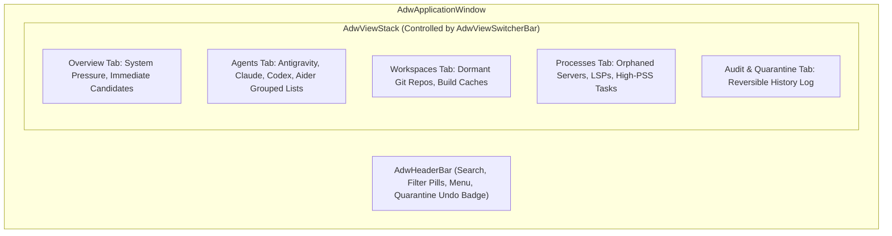

# Root Native Desktop Design Foundation & Interface Architecture

## 1. Design Reference & Git Provenance

This design foundation is directly informed by the official design reference repository:
- **Repository**: `https://github.com/realmadede/Designing-Skills.git`
- **Recorded Git Commit SHA**: `2d228630ba1446365f614a108cb8252f1feda202`
- **Primary Design Skills Analyzed**:
  - `skills/emil-design-eng/SKILL.md` (Emil Kowalski's design engineering philosophy)
  - `skills/animation-performance/SKILL.md` (Frame budget, render pipelines, GPU layers)
  - `skills/animate/SKILL.md` (Curves, durations, state transitions)
  - `skills/break-ui/SKILL.md` (Adversarial stress-testing with worst-case data)
  - `performance-cheatsheet.md` (Composite-only animations, layout avoidance)

---

## 2. Linux-Native Design Philosophy

Root firmly rejects the stereotype that powerful Linux system utilities must be visually chaotic, poorly spaced, or visually unstyled terminal ports.

At the same time, **Root rejects blind mimicry of macOS or generic AI-generated web dashboards**. Root does not attempt to look like an Apple product; it is an unapologetically **Linux-native, GNOME-first desktop application**.

### Core Design Tenets
1. **Taste is Trained, Not Innate**: Quality is the sum of invisible correctness—precise row alignments, tabular numbers that prevent jitter, origin-aware popovers, and effortless keyboard navigation.
2. **Beauty is Leverage**: A system utility that looks refined and behaves deterministically inspires trust. Developers hesitate to run destructive cleanups in tools that feel unstable or sloppy.
3. **Restraint over Decoration**: No gratuitous gradients, floating glassmorphism, or non-functional graphs. Every visual element conveys concrete system state.

---

## 3. Adapting Designing-Skills Principles to GNOME (GTK4 + libadwaita)

The core web and iOS design engineering principles from Emil Kowalski map directly to the Linux GTK4 / GSK (GTK Scene Kit) / libadwaita architecture:

| Emil Kowalski / Designing-Skills Principle | Web / CSS Expression | GTK4 + libadwaita Native Adaptation |
|---|---|---|
| **Never animate keyboard actions** | Skip animation on hotkeys and palette toggles | Accelerators and search activations trigger instant view switches without transition delays. |
| **Active button feedback** | `transform: scale(0.97)` on `:active` | GTK CSS `.button:active { -gtk-icon-transform: scale(0.97); }` or subtle background luminance shift. |
| **Sub-250ms UI transitions** | `transition: 150-200ms ease-out` | `AdwTimedAnimation` with duration 180ms, using `AdwEasing::EASE_OUT_CUBIC`. |
| **Physics-based gestures** | Springs with velocity preservation | `AdwSpringAnimation` for drawer sweeps, sheet dismissals, and card swipes. |
| **Avoid layout property animation** | Animate `transform`/`opacity`, not `width`/`height` | Animate GSK Render Nodes (transform and opacity nodes) via `GskTransform`; never trigger continuous widget re-allocations (`gtk_widget_queue_resize`). |
| **Adversarial Break-UI Resilience** | Tabular nums, middle truncation, pluralization | Pango markup `font_features="tnum=1"`, `PangoEllipsizeMode::Middle`, `gettext` plural rules (`ngettext`). |
| **Zero main-thread jank** | Offload animation from JS thread | Heavy I/O and `/proc` parsing run on worker threads (`tokio` / threadpool); UI updates stream over GLib channels (`glib::MainContext`). |

---

## 4. Typography & Information Hierarchy

Resource management is numbers-heavy: byte sizes, PIDs, file counts, memory addresses, and timestamps.

### 4.1 Typeface Selection
- **System Interface Text**: GNOME System Font (`Cantarell` or user GNOME preference).
  - Used for titles, descriptions, action labels, and navigation.
- **Data, Paths & Metrics**: System Monospace (`JetBrains Mono`, `Fira Code`, or `Source Code Pro`).
  - Used for file paths, PIDs, SHA256 hashes, terminal arguments, and memory counters.

### 4.2 The Tabular Numbers Requirement (`tnum`)
When live resource meters update (e.g., RSS ticking up or file counters increasing during a scan), proportional digits cause words and buttons to horizontally jitter, producing an amateur, unstable feel.
- **Rule**: All numeric data, byte counts, and PIDs must enable tabular figures (`font-variant-numeric: tabular-nums` or Pango `tnum=1`).
- Every digit occupies identical horizontal width, guaranteeing stable layout grids.

### 4.3 Middle-Truncation for Long Paths
- Agent paths (e.g. `/home/user/.gemini/antigravity-cli/brain/3bfcc449-0ed9-494d-99c3-fe7a0569d596/scratch/live-worktree/packages/core/src/index.ts`) easily exceed container widths.
- End-truncation (`/home/user/.gemini/...`) hides the filename and extension.
- Beginning-truncation (`.../packages/core/src/index.ts`) hides the workspace origin.
- **Rule**: All filesystem paths use **Middle Truncation** (`PangoEllipsizeMode::Middle`):
  `/home/user/.../scratch/.../src/index.ts`
  The full path is always exposed via copy button or tooltip.

---

## 5. Visual Hierarchy & Spacing Architecture

Root builds strictly on the standard libadwaita widget vocabulary:

### 5.1 Spacing & Grid System
Root adheres to the GNOME 6px/12px baseline spacing:
- **Tight (inner components)**: 6px padding.
- **Standard (card elements)**: 12px padding.
- **Relaxed (section separation)**: 18px / 24px margins.
- **Dialogs & Clamping**: Central content is wrapped in `AdwClamp` with maximum width 860px to prevent awkward wide-screen stretching on ultrawide monitors.

### 5.2 Libadwaita Component Patterns
- **Preference Groups**: `AdwPreferencesGroup` with `AdwActionRow` and `AdwExpanderRow` for collapsible scan categories.
- **Status Pages**: `AdwStatusPage` for clean zero-state views ("All agents dormant. System resources optimized.").
- **Toasts**: `AdwToastOverlay` and `AdwToast` for non-blocking feedback with explicit `Undo` buttons.
- **Pills**: Compact rounded badges indicating classification (`STRICTLY_PROTECTED`, `SAFE_RECOVERABLE`, `USER_CONFIRM_REQUIRED`).

---

## 6. The Animation Decision Framework for Root GUI

Following Emil Kowalski's framework:

### 6.1 Frequency vs Animation Matrix

| Action | Frequency | Animation Decision | Rationale |
|---|---|---|---|
| **Keyboard Navigation (`Ctrl+F`, `Tab`, `Esc`)** | 100+ times/day | **NO ANIMATION** | Keyboard operations must feel instantaneous and lag-free. |
| **Row Selection & Hover** | Tens of times/day | Instant or 80ms subtle color fade | Prevents mouse lag during rapid scanning. |
| **Category Expansion (`AdwExpanderRow`)** | Occasional | 160ms `ease-out` | Smooth reveal of nested artifacts. |
| **Quarantine / Undo Toast** | Occasional | 220ms spring translation | Spatial consistency; toast enters from bottom, swipes to dismiss. |
| **Destructive Confirmation Dialog** | Rare | 180ms scale (`0.95 -> 1.0`) + opacity | Deliberate, clear presentation. |

### 6.2 Reduced Motion Compliance
Root inspects `GtkSettings:gtk-enable-animations` and the GNOME desktop setting `org.gnome.desktop.interface enable-animations`.
- When reduced motion is requested, all durations are set to `0ms` (instant state swap), retaining only cross-fades where necessary for context continuity.

---

## 7. Light and Dark Theme Architecture

Root natively supports GNOME 4x theme switching via `AdwStyleManager`:
- Default: `ADW_COLOR_SCHEME_DEFAULT` (follows system day/night schedule automatically).
- Palette: Strict adherence to Adwaita semantic color tokens:
  - Background: `@window_bg_color`, `@view_bg_color`.
  - Borders: `@card_border_color` (subtle semi-transparent outline, never solid harsh lines).
  - Accent / Recoverable: `@accent_bg_color` (blue/teal).
  - Protected / Safe: `@success_color` (green).
  - Warning / User Confirmation: `@warning_color` (amber/orange).
  - Destructive / Purge: `@destructive_color` (red).

---

## 8. User Confidence & Pre-Action Transparency

Before any irreversible or quarantine action is executed in the GUI:
1. **The Pre-Flight Inspection Drawer**: Shows the exact list of files, sizes, last modified times, and holding processes.
2. **The "Why" Badge**: Every item displays an informative badge explaining why it was flagged (e.g. `Closed Conversation`, `Dormant Cargo Target`, `Orphaned Process`).
3. **The Immediate Reversibility Guarantee**: A prominent banner reminds the user:
   *"Quarantined items are stored in ~/.local/state/root/quarantine and can be restored at any time within 30 days."*
