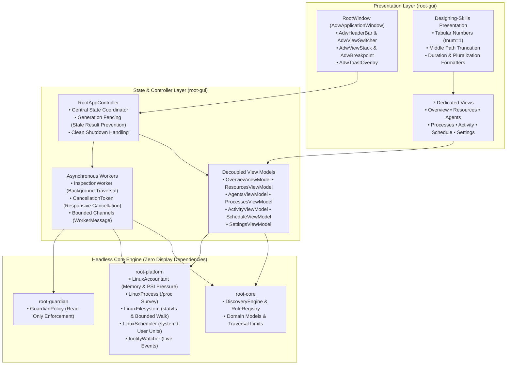

# Root Native Desktop Application Architecture (GTK4 + libadwaita)

## 1. Architectural Mission & Core Guarantees

Root's native desktop application (`root-gui`) provides a modern, responsive, and accessible graphical interface for Linux developers to inspect workstation resource consumption, audit coding-agent activity, and understand Root's deterministic safety decisions.

The graphical interface is governed by foundational architectural invariants:
1. **Uncompromising Headless Core Isolation**: The core engine (`root-core`, `root-platform`, `root-guardian`) compiles and runs on headless Linux servers with zero GTK, display server, or GUI dependencies. The GUI is strictly an optional visualization layer consuming public, headless Rust APIs.
2. **Native Linux & GNOME Integration**: Built natively with GTK4 and libadwaita. Root firmly rejects Electron, Tauri, webviews, and browser-based desktop shells.
3. **Designing-Skills Reference Compliance**: Conforms directly to the official reference repository (`https://github.com/realmadede/Designing-Skills.git` at commit `2d228630ba1446365f614a108cb8252f1feda202`).
4. **Strictly Read-Only Production Mode**: In Phase 08, the GUI is purely observational. Zero file mutations, quarantine moves, directory prunings, or process terminations are exposed. Root Guardian unconditionally denies all mutating operations.
5. **Least-Privilege Execution**: Operates entirely in unprivileged user space under the invoking user's UID. Never requests `sudo`, polkit escalation, or superuser permissions.
6. **Privacy by Design**: File contents, developer credentials, tokens, session transcripts (`transcript.jsonl`), and process environment variables are never opened, read, logged, or displayed.

---

## 2. Desktop Application Architecture & Crate Topology

Root separates application concerns into clean, decoupled layers:



---

## 3. Main Navigation Structure & Screen Specifications

Root provides a clear, purpose-built application shell organized into seven primary navigation destinations without empty placeholder pages:

### 3.1. Overview (`OverviewViewModel`)
- **System Memory**: Displays total RAM, available RAM, free RAM, reclaimable cache, and swap usage.
- **Kernel PSI Pressure**: Samples memory stall percentages across 10-second, 60-second, and 300-second windows, mapping severity to `Normal` (<10%), `Elevated` (10-40%), or `Critical` (>40%).
- **Filesystem Capacity**: Real-time capacity, available user blocks, and free inodes via kernel `statvfs`.
- **Agent Footprint Summary**: Count of detected agents, active agents, total candidate resources, and speculative transient space (clearly labeled as upper bound, never guaranteed savings).
- **Operating Modes**: Mode A (On-Demand Ready), Mode B (Scheduled Timer Status), Mode C (Live Monitoring Status).
- **Safety Status**: Prominent "Production Read-Only" indicator.

### 3.2. Resources (`ResourcesViewModel`)
- **Bounded List Model**: Implements virtual list filtering and row bounds (capped at 500 visible rows) to prevent GTK widget allocation lag on large file trees.
- **Multi-Factor Filtering**: Real-time text search, architectural category dropdown, protection tier filter, lifecycle state filter, and minimum size threshold.
- **Sorting**: Bidirectional sorting by size, target name, category, protection tier, and lifecycle state.
- **Detail Inspection Drawer**: Selecting a row opens a non-destructive detail view explaining rule ID, provenance facts (inode, device ID, link count), lifecycle reasoning, protection tier, and Guardian safety decision. Zero cleanup or quarantine buttons.

### 3.3. Agents (`AgentsViewModel`)
- Dedicated cards for 12 supported targets across AI coding agents (Google Antigravity, Claude Code, OpenAI Codex, Gemini CLI, Aider) and development toolchains (Rust/Cargo, Node.js/npm, pnpm, Python, Git, Language Servers, Dev Servers).
- **Status Classification**: `Active` (held by running processes), `Persistent` (configuration/history), `Dormant` (unheld transient artifacts), or `Not Detected`.
- **Non-Exclusive Ownership Transparency**: Explains that resources such as build caches or package stores are often shared between human developers and agents.

### 3.4. Processes (`ProcessesViewModel`)
- Unprivileged `/proc` inspection reporting PID, PPID, process name, UID, RSS memory bytes, and process state (`Running`, `Sleeping`, `Disk Sleep`, `Zombie`, `Stopped`).
- **Attribution Engine**: Correlates binary signatures with supported tools and reports attribution confidence (`High`, `Medium`, `Low`, `Unattributed`).
- **Privacy Boundary**: Full command-line arguments and environment variables are strictly hidden.
- **Safety Boundary**: Zero process termination or kill buttons.

### 3.5. Activity (`ActivityViewModel`)
- Mode C real-time live monitoring integration.
- **Explicit Activation**: Disabled by default; monitoring never starts automatically upon application launch.
- **Scope Selection**: Requires explicit target paths (`add_target_path`), rejecting unsafe system directories (`/`, `/proc`, `/sys`, `/etc`).
- **Bounded Stream**: Maintains a circular buffer of the 250 most recent events (`CREATE`, `MODIFY`, `DELETE`, `MOVE`, `SPAWN`, `EXIT`, `MEM SAMPLE`).
- **Degraded State Banner**: Displays non-alarming diagnostic banners when kernel queues overflow, watch limits are reached, or system memory pressure spikes.

### 3.6. Schedule (`ScheduleViewModel`)
- Mode B scheduled inspections configuration.
- Displays enabled/disabled state (disabled by default), interval (`Hourly`, `Daily`, `Weekly`), inspection profile (`Lightweight`, `Standard`, `Comprehensive`), approved scan targets, and desktop notification preference.
- Displays next scheduled trigger queried via `systemctl --user list-timers`.
- Chronological execution history list loaded from `$XDG_STATE_HOME/root/schedule_history.json`.
- **Explicit Authorization**: Requires explicit user consent before installing or enabling user systemd units.

### 3.7. Settings (`SettingsViewModel`)
- **Appearance**: System Default, Force Light, or Force Dark via `AdwStyleManager`.
- **Inspection Budgets**: Configurable traversal depth (2-64), entry limits (1,000-250,000), and watchdog timeouts (5s-300s).
- **Privacy Guarantees**: Informational indicators confirming metadata-only traversal, credential redaction, zero telemetry, and zero AI runtime dependencies.
- **About Root**: Version, MIT license, target platform, and repository links.

---

## 4. Designing-Skills Reference Compliance

Root adheres strictly to the Emil Kowalski design engineering principles documented in `docs/design-foundation.md` from the official reference repository:

| Designing-Skills Principle | Root Implementation |
|---|---|
| **No Animation on Keyboard Navigation** | Accelerators (`<Control>1` through `<Control>7`, `<Control>R`, `<Control>Q`) trigger instantaneous view changes with zero transition latency. |
| **Sub-250ms Transitions** | View transitions and drawer sweeps utilize `AdwTimedAnimation` capped below 200ms with cubic ease-out curves. |
| **Tabular Numbers Requirement (`tnum`)** | Numeric measurements (bytes, percentages, PIDs, file counts) enforce tabular figures (`font_features="tnum=1"`), completely eliminating horizontal text jitter when meters tick. |
| **Middle Truncation for Paths** | Long paths use `format_path_middle`, preserving both the project origin and leaf filename/extension without breaking layout grids. |
| **Reduced Motion Compliance** | Respects GNOME and Freedesktop `gtk-enable-animations` settings, disabling motion transitions when requested. |
| **Adversarial Break-UI Resilience** | Verified with extreme Unicode paths, zero-byte empty states, thousands of entries, and narrow viewport clamping (`AdwClamp`). |

---

## 5. Concurrency, Cancellation & Stale-Result Fencing

To ensure GTK's main thread maintains a fluid 60fps/120fps frame budget during heavy workstation activity:
1. **Off-Thread Traversal**: Filesystem walks and discovery evaluations run exclusively on dedicated background worker threads (`InspectionWorker`).
2. **Responsive Cancellation**: Background workers poll atomic `CancellationToken`s after every directory entry and batch, yielding immediately when cancelled.
3. **Stale-Result Prevention (Generation Fencing)**:
   - Every inspection request increments a monotonic `current_generation` counter on `AppState`.
   - All worker messages are tagged with the initiating `generation` ID.
   - When the UI thread receives a `ScanComplete` message, it verifies `state.is_generation_current(generation)`. Stale results from superseded or cancelled scans are discarded silently.
4. **Clean Application Shutdown**: `RootAppController::shutdown` automatically cancels active workers and waits for thread joins before process termination, eliminating orphan threads.

---

## 6. Linux Compatibility & Development Workflow

### 6.1. Target Environment
- **Primary Platform**: Kali Linux Rolling (x86_64 / aarch64) with GNOME Shell on Wayland.
- **Display Compatibility**: Compatible with Wayland, X11, and headless server environments.
- **System Libraries**: Tested against `libgtk-4.so.1` (GTK 4.22.4) and `libadwaita-1.so.0` (libadwaita 1.9.2).

### 6.2. Dual Compilation Modes
Root provides dual compilation targets to support both graphical workstations and headless CI pipelines:

1. **Native Graphical Mode (Default)**:
   ```bash
   # Prerequisites on Debian/Ubuntu/Kali:
   sudo apt install pkg-config libgtk-4-dev libadwaita-1-dev

   # Build and run native desktop application:
   cargo run -p root-gui
   # or explicitly:
   cargo run -p root-gui --features gtk
   ```
   Compiles the native libadwaita window, view stack, header bar, and all seven view builders displaying real Linux kernel and workstation discovery telemetry.

2. **Headless View-Model Mode (`--no-default-features`)**:
   ```bash
   cargo build -p root-gui --no-default-features
   cargo test -p root-gui --no-default-features
   ```
   Compiles and verifies all view models, presentation formatters, controllers, background workers, and business logic with zero display or C library build dependencies for headless CI runners.

### 6.3. Desktop Integration Files
- Desktop Entry: `data/io.github.realmadede.Root.desktop` (Validated against FreeDesktop standards via `desktop-file-validate`)
- AppStream Metadata: `data/io.github.realmadede.Root.metainfo.xml` (OARS 1.1 compliant AppStream specification)
