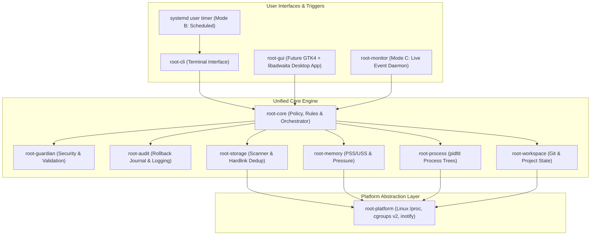

# Root Hybrid Architecture & Operating Modes

## 1. Architectural Philosophy

Root follows a **local-first, deterministic, library-centric architecture**.

Rather than introducing an always-running privileged background daemon or separate disparate tools, Root is structured as a collection of specialized Rust modules (eventually crates) unified around a single deterministic engine: `root-core`.

---

## 2. The Three Operating Modes

Root supports three operating modes, all powered by the exact same analysis rules and policy engine.

### 2.1 Mode A: On-Demand (Primary Operating Mode)
- **Invocation**: Triggered manually by the developer via the CLI (`root scan`, `root status`) or the future desktop GUI.
- **Behavior**:
  1. Scans configured development directories and agent cache paths.
  2. Identifies orphaned processes and dormant artifacts.
  3. Evaluates all candidates against `root-guardian` security rules.
  4. Presents an interactive, human-readable summary of reclaimable resources.
  5. Waits for user confirmation.
  6. Executes reversible quarantine actions and writes audit records.
- **Resource Footprint**: Zero background overhead. Runs to completion and immediately terminates.

### 2.2 Mode B: Scheduled (Passive Inspection via systemd User Timers)
- **Invocation**: Triggered periodically via standard `systemd --user` timers.
- **Activation**: **Disabled by default**. Requires explicit configuration (`root schedule enable`).
- **Behavior**:
  1. Executes a low-priority, non-interactive scan (`root scan --scheduled --json`).
  2. Evaluates resource thresholds (e.g. cumulative orphan RAM > 2 GiB or recoverable storage > 10 GiB).
  3. Writes findings to `$XDG_STATE_HOME/root/status.json`.
  4. If thresholds are exceeded, issues a non-intrusive desktop notification via D-Bus (`org.freedesktop.Notifications`) informing the developer that resources are ready for review.
  5. **Strict Safety Rule**: Scheduled mode **never deletes or modifies files automatically**. It only inspects and notifies.
- **Systemd Integration**:
  - `~/.config/systemd/user/root-inspect.service`
  - `~/.config/systemd/user/root-inspect.timer`

### 2.3 Mode C: Live Monitoring (Lightweight Event-Driven Monitoring)
- **Invocation**: Triggered as an optional user service (`root-monitor`).
- **Activation**: **Disabled by default**. Designed for developers actively running high-concurrency multi-agent swarms.
- **Behavior**:
  1. Leverages Linux `inotify` to watch targeted agent directories (e.g. `~/.gemini/antigravity-cli/brain/`, `~/.claude/session-env/`).
  2. Reads cgroups v2 Pressure Stall Information (`/sys/fs/cgroup/user.slice/.../memory.pressure`).
  3. Detects agent crashes in real-time when parent process pipes close.
  4. Maintains an in-memory cache of active vs abandoned resources without polling the entire filesystem.
- **Performance & Battery Rules**:
  - Zero busy polling (`sleep` loops are forbidden).
  - Immediate thread suspension via `epoll_wait` on event file descriptors.
  - Automatic sleep/coalescing when the system runs on battery power.

---

## 3. Core Component Boundaries & Responsibilities

| Component | Layer | Primary Responsibility | Dependencies |
|---|---|---|---|
| **`root-core`** | Domain Engine | Domain models, cleanup policies, classification engine, rule evaluation, transaction state machine. | None (pure Rust logic) |
| **`root-platform`** | Hardware/OS | OS abstraction traits (`ProcessProvider`, `ResourceAccountant`, `FilesystemWatcher`). Linux `/proc`, `sysfs`, `cgroups v2`. | OS syscalls (`libc`, `rustix`) |
| **`root-storage`** | Analysis | Filesystem traversal, cache size calculation, hard-link inode deduplication, mount point boundary checks. | `root-core`, `root-platform` |
| **`root-memory`** | Analysis | Memory parsing (`/proc/[pid]/smaps_rollup`), PSS/USS computation, PSI pressure calculation. | `root-core`, `root-platform` |
| **`root-process`** | Analysis | Process tree generation, agent fingerprinting, orphan detection, PID reuse protection via `pidfd`. | `root-core`, `root-platform` |
| **`root-workspace`** | Analysis | Git status inspection, branch tracking, untracked file safety verification, workspace language detection. | `root-core`, Git bindings |
| **`root-guardian`** | Security | Path traversal validation, symlink jail enforcement, TOCTOU mitigation, quarantine sandboxing. | `root-core`, `root-platform` |
| **`root-audit`** | Reliability | Append-only JSONL transaction journals, rollback logs, SHA256 hashing of quarantined entities. | `root-core` |
| **`root-cli`** | UI/Interface | Command-line parsing, terminal rendering, interactive confirmation prompts, progress indicators. | All core components |
| **`root-monitor`** *(Future)* | Daemon | Lightweight systemd user daemon for Mode C live monitoring. | `root-core`, `root-platform` |
| **`root-gui`** *(Future)* | UI/Interface | Native GNOME GTK4 + libadwaita desktop application. | `root-core`, GTK4 bindings |

---

## 4. Concurrency, Locking, and State Synchronization

To prevent race conditions between CLI commands, scheduled timers, and future GUI instances:

### 4.1 Local Advisory File Locking
- Every mutating command acquires an exclusive advisory lock on:
  `$XDG_STATE_HOME/root/root.lock`
- Implementation: POSIX `flock(fd, LOCK_EX | LOCK_NB)`.
- If another instance holds the lock, Root terminates immediately with a clear explanatory message:
  `"Root is currently executing another inspection or quarantine task (PID <holder_pid>). Exiting."`

### 4.2 Atomic State Updates
- Scan results and audit journals are written via atomic write-and-rename:
  1. Write to `$XDG_STATE_HOME/root/status.json.tmp.<uuid>`.
  2. Flush and `fsync()`.
  3. `rename()` over `$XDG_STATE_HOME/root/status.json`.
- Readers never observe partially written state files.
