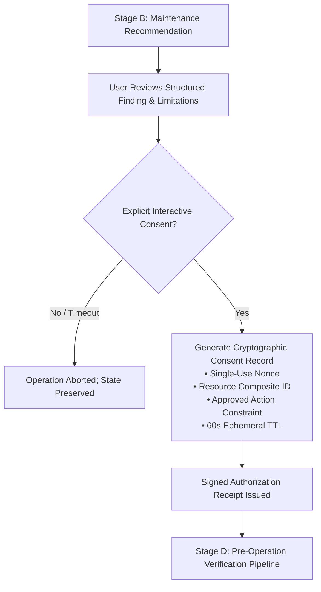

# Root — Future Maintenance Safety Contract & Pre-Operation Verification Specification

> [!IMPORTANT]
> **GOVERNANCE & SAFETY STATUS**: Phase 14 Architecture Specification.  
> This specification defines the rigorous, formal pre-conditions, engineering distinctions, and safety invariants required before any future maintenance, quarantine, or cleanup authority may be introduced into Root.  
> **Production builds of Root remain strictly read-only.** This document does not grant, expose, or implement production mutation authority.

---

## 1. Architectural Scope and Foundational Invariants

Root's long-term evolution envisions empowering developers to reclaim workstations from accumulating agentic scratchpads, build artifacts, and package caches through safe, explainable, and fully reversible maintenance workflows.

However, inspection correctness and evidence integrity must always precede maintenance authority. A system that cannot definitively prove resource state, ownership, and process quiescence must never be granted execution authority over developer files.

Every future maintenance capability in Root must satisfy eight non-negotiable architectural invariants:

1. **Strict Read-Only Production Baseline**: No mutating operation—including file quarantine, pruning, restoration, or process signaling—may be exposed in production builds until every stage of this safety contract is validated and explicitly authorized by the project owner.
2. **Deny-by-Default Execution**: Any operation where safety invariants cannot be empirically established, where evidence is ambiguous, or where verification checks fail or return unavailable status must be unconditionally refused.
3. **Quarantine-First Relocation (Zero Immediate Space Reclamation)**: Permanent, irreversible deletion (`unlink`, `rmdir`) of non-empty directory trees or user resources is permanently prohibited in production. Mutating maintenance consists strictly of atomic relocation into an isolated, user-scoped quarantine repository (`~/.local/state/root/quarantine/`, permissions `0700`). **Relocating a file into quarantine on the same filesystem releases zero bytes of storage to the filesystem.** Quarantining isolates the resource; physical storage is only freed if a quarantined resource is subsequently purged permanently under separate user confirmation and has no remaining hard links.
4. **Independent Identity Validation**: Resources must be identified and re-validated using kernel-level, platform-neutral composite identities (POSIX `st_dev` paired with `st_ino`; Windows 32-bit volume serial paired with 128-bit file ID) rather than mutable lexical paths.
5. **No Blind Shell or Script Execution**: Root must never execute package manager hooks, clean scripts, build utilities, or command strings derived from discovered paths (e.g. no execution of `cargo clean`, `npm run clean`, or arbitrary child processes).
6. **Zero External Inference Dependencies**: Classification, authorization, and verification must remain 100% deterministic, local, and algorithmic. Root must never query external LLM inference endpoints, cloud services, or heuristic classifiers to decide resource safety.
7. **Ephemeral, Cryptographically Bound Consent**: User authorization must be explicit, single-use, cryptographically bound to exact resource identities, and constrained by a strict time-to-live (TTL). Ambient or persistent authorization is architecturally rejected.
8. **Crash-Resilient Audit Journaling**: Every operational state transition must be recorded in an append-only, durable recovery journal flushed to disk before any physical filesystem modification begins.

---

## 2. Stage A: Discovery & Identity Prerequisites

Before any discovered entity may even be considered as a candidate for maintenance recommendations, it must pass through deterministic discovery verification:

### 2.1. Unambiguous Identity
- **Composite Key Required**: Every filesystem entity must possess a verified `FileIdentity` resolving to physical volume and object identifiers.
- **Lexical Canonicalization**: Paths must be normalized, resolved, and verified against null-byte injection, trailing separator anomalies, and relative escape sequences.
- **Lexical Boundary Containment**: The path must reside strictly within an explicitly designated target root and must not escape through parent traversal or directory substitution.

### 2.2. Verifiable Classification Evidence
- **Explicit Rule Match**: The resource must match an established, versioned rule in `RuleRegistry`.
- **Known Provenance**: The finding must record whether classification was derived from structural directory conventions, verified virtual filesystem tables, or specific tool signatures.
- **Preservation of Unknowns**: Unrecognized paths matching `default-unknown` or possessing `ResourceCategory::Unknown` must default unconditionally to `ProtectionTier::NonActionable` and `LifecycleState::Unknown`. File age or size alone must never convert an unknown resource into a maintenance candidate.

### 2.3. Exclusion of Ineligible & Protected Resources
- **Strictly Protected Tier Invariance**: Resources classified under `ProtectionTier::StrictlyProtected`—including active credentials, authentication tokens, SSH/GPG keys, Git repositories, session transcripts, and OS binaries—are permanently ineligible for maintenance recommendations or operations.
- **Active Session Invariance**: Resources actively held by running processes (`ProcessAttribution::Direct`), guarded by on-disk presence lockfiles (`session_active.lock`), or associated with active coding agent sessions are permanently excluded from maintenance candidates.
- **Indeterminate Window Deferral**: Resources modified within 1 hour, or residing within the 1h–48h indeterminate lifecycle window without definitive process correlation, must remain classified as `LifecycleState::Unknown` and ineligible for automated maintenance proposals.

---

## 3. Stage B: Recommendation & Uncertainty Transparency

Root's presentation layer must explain the foundation of every recommendation with absolute fidelity:

### 3.1. Explainability Contract
A maintenance recommendation presented to the user must explicitly provide:
1. **Target Identification**: Exact resource path, physical inode/volume identifiers, and owning tool or agent.
2. **Rule Provenance**: Matched rule ID, rule version, and pattern description.
3. **Protection Tier**: Explicit classification tier and Guardian safety decision.
4. **Lifecycle Evidence**: Observed timestamps, age calculations, presence lock status, and process correlation state.
5. **Process Attribution Categorization**: Clear disclosure of whether process correlation was `Direct` (command-line argument confirmation), `Inferred` (specialized binary running without path proof), `Inconclusive` (generic runtime match), `Unavailable` (restricted procfs), or `None`.
6. **Known Limitations**: Explicit disclosure of edge cases, symlink presence, multi-link sharing, or filesystem-specific constraints.

### 3.2. Candidate Space Integrity & Storage Taxonomy
To prevent misleading users regarding disk space reclamation, the system must strictly distinguish five distinct storage metrics:

1. **Logical File Size (`metadata.storage.bytes`)**: The apparent uncompressed length of the resource stream.
2. **Apparent Candidate Bytes**: The mathematical sum of logical file sizes across candidate items matching a query.
3. **Unique Allocated Storage**: The actual physical disk blocks occupied by candidate files (`allocated_bytes`), accounting for sparse files and deduplicating hard links.
4. **Bytes Moved to Quarantine**: The physical bytes relocated from project directories into quarantine staging. **This metric represents isolated clutter, NOT reclaimed disk space.**
5. **Storage Actually Released to the Filesystem**: Physical blocks freed on the storage device. This only occurs when a quarantined file is permanently purged (`unlink`) and no remaining hard links reference the inode. Because production permanent deletion is prohibited, **Root currently releases zero storage blocks to the filesystem.**

Rules for reporting candidate storage:
- **Conservative Accounting**: Reclaimable storage estimates must represent candidate upper bounds rather than guaranteed savings.
- **Physical vs. Apparent Space**: Estimates must report physical disk allocations (`allocated_bytes`), accounting for sparse files, rather than apparent logical sizes. Hollow sparse files (0 physical blocks) must contribute 0 bytes.
- **Shared Inode Deduplication**: Multi-link files (`st_nlink > 1`) must contribute zero unique bytes unless all referencing hard links are contained within the scanned set and scheduled for collective relocation.
- **Directory Dentry Isolation**: Directory inode metadata blocks must not be added to candidate file recovery totals, preventing double-counting between directories and descendant files.

### 3.3. Separation of Recommendation from Action
- Producing a recommendation or scan report must have zero side effects on the workstation.
- Recommendations must not stage, rename, lock, or modify candidate files.

---

## 4. Stage C: Explicit, Single-Use User Authorization

No maintenance operation may ever proceed based on implicit, ambient, or inherited authorization:

### 4.1. Granular Scope Binding
- Authorization must be bound to a specific, unique `ResourceId` and canonical path. Approving one resource must never authorize sibling, parent, or descendant resources implicitly.
- Bulk operations must present an explicit manifest of every item, requiring individual confirmation or verified multi-factor batch consent.

### 4.2. Cryptographic Consent Records
- Authorization must generate a cryptographically bound `ConsentRecord` comprising:
  1. `nonce`: Single-use 256-bit cryptographic nonce.
  2. `resource_id`: The exact composite identifier evaluated during inspection.
  3. `canonical_path`: Pinned target path.
  4. `approved_action`: Permitted action constraint (`Quarantine` only; pruning strictly rejected).
  5. `issued_epoch_secs` & `expiration_epoch_secs`: Strict 60-second time-to-live (TTL).
- Once evaluated, the nonce is immediately invalidated to prevent replay attacks.
- If the TTL expires before operation commencement, authorization is void and must be re-requested.

---

## 5. Stage D: Pre-Operation Verification Pipeline

Between user authorization and physical relocation, an immutable serial verification pipeline must execute immediately prior to any filesystem modification. If any step fails, the entire transaction is aborted.

### 5.1. File Descriptor Pinning & Path Resolution (Future Requirement vs. Existing Code)
- **Design Target (Future Requirement)**: The target path should be opened using Linux `openat2` with flags `RESOLVE_BENEATH` and `RESOLVE_NO_SYMLINKS`, pinning the file descriptor. The parent directory should be pinned via an open directory descriptor (`O_DIRECTORY | O_CLOEXEC | O_NOFOLLOW`), and subsequent operations should reference these descriptors rather than path strings.
- **Current Synthetic Implementation (Tested Baseline)**: The current Guardian engine in test fixtures relies on `std::fs::symlink_metadata(path)` followed by `LinuxFilesystem::atomic_rename_no_replace(source, dest)` calling `SYS_renameat2(AT_FDCWD, from, AT_FDCWD, to, RENAME_NOREPLACE)`.
- **Residual Risk**: Path-string resolution starting from `AT_FDCWD` leaves a theoretical TOCTOU window where an attacker could rename or swap an intermediate directory component between the pre-flight `revalidate_full` check and the `renameat2` call. Upgrading to descriptor-pinned operations remains a prerequisite before production mutation can ever be authorized.

### 5.2. Inode & Identity TOCTOU Verification
- **Identity Re-Verification**: The target's identity (`st_dev`, `st_ino`, `st_uid`, `st_gid`, `st_mode`) must be probed and matched against the authorization snapshot.
- **Modification Rejection**: If the modification timestamp (`st_mtime`) or file size has changed since inspection, the transaction is rejected with `RejectionReason::FilesystemIdentityChanged`.

### 5.3. Mount Boundary & Device Invariance
- **Single-Filesystem Constraint**: The target resource and the quarantine store must reside on the same physical filesystem device (`st_dev == quarantine_dev`) to permit atomic rename operations via `renameat2(RENAME_NOREPLACE)`.
- **Cross-Device Prohibition**: Cross-filesystem copy-and-delete operations are inherently non-atomic and vulnerable to interruption; they are strictly prohibited in the primary maintenance pipeline.

### 5.4. Open File Descriptor & Process In-Use Verification (Future Requirement)
- **Process Activity Observation Limits**: Observing `/proc` allows Root to detect known running processes whose command-line arguments match candidate paths. **However, process sampling is strictly a point-in-time observation.** It does NOT prove that a file is unused, nor can it guarantee that another process will not open or modify the file a millisecond later.
- **Design Target (Future Requirement)**: On Linux, `/proc/[pid]/fd` and `/proc/locks` should be inspected prior to relocation to verify whether any local process currently holds an open file handle or `flock` lease.
- **Current Implementation**: Neither `/proc/[pid]/fd` nor `/proc/locks` inspection is implemented in the existing codebase. If process telemetry is restricted or unavailable (e.g. inside unprivileged containers or under restrictive seccomp profiles), Root must report `ProcessAttribution::Unavailable` and refuse maintenance.

### 5.5. Working Tree Cleanliness — Git Invariant (Future Requirement)
- **Design Target (Future Requirement)**: If the target resource resides inside a Git repository, `git status --porcelain` must be evaluated. If uncommitted modifications, staged changes, or untracked non-ignored files exist within the target repository, maintenance must be refused with `RejectionReason::UncommittedGitState`.
- **Current Implementation**: The Git porcelain check is documented only (GAP-07); no Git check exists in the current codebase.

---

## 6. Stage E: Reversibility & Rollback Guarantees

Every maintenance operation must guarantee deterministic reversibility within clearly defined platform limits:

### 6.1. Atomic Relocation vs. End-to-End Transaction Guarantees
- **Atomic Filesystem Rename**: In existing test fixtures, physical relocation into quarantine is performed via `SYS_renameat2(RENAME_NOREPLACE)`. The kernel guarantees that the directory entry swap is atomic—the file either exists at the source or at the destination.
- **Multi-Step Transaction Scope**: An atomic rename does NOT constitute an end-to-end multi-step transaction guarantee. If host power fails after the rename but before the subsequent journal flush, or if disk metadata syncing is delayed, recovery requires journal reconciliation upon reboot.
- **Restoration Scope & Limitations**:
  - Restoration relocates the quarantined file back to its original path via `SYS_renameat2(RENAME_NOREPLACE)`.
  - It preserves and restores the original POSIX permissions mode (`0o777 & mode`).
  - **Limitation**: The current restoration engine does NOT restore original access and modification timestamps (`atime`, `mtime`), nor does it alter file ownership (`chown`), as unprivileged user execution cannot change file UIDs/GIDs.
  - **Parent Directory Recreation**: If the parent directory was deleted while the file was in quarantine, restoration recreates the parent directory hierarchy with default permissions (`fs::create_dir_all`).

### 6.2. Destination Conflict Prevention
- Restoration strictly refuses to overwrite an occupied destination path (`RENAME_NOREPLACE` semantics). If an occupant exists at the original destination (regular file, directory, or symlink), restoration aborts with `RootError::RestorationConflict`. Quarantined files are never forced over existing data.

### 6.3. Interrupted Transaction Recovery
- If an operation is interrupted:
  1. The recovery journal records the transition up to the point of failure.
  2. If the transaction reached `Verified` or `RecoveryRequired`, `RestorationEngine::restore_resource` can restore the item.
  3. **Limitation**: Automatic startup reconciliation of interrupted transactions (an automated crash-recovery daemon) is not yet implemented; recovery currently requires explicit invocation.

---

## 7. Stage F: Auditability & Durable Journaling

Every operational decision and outcome must be completely auditable:

### 7.1. Append-Only Recovery Journal
- The recovery journal (`~/.local/state/root/journal.jsonl`) uses append-only JSON Lines format.
- Every transaction record records:
  1. `transaction_id`: Cryptographically unique transaction identifier (`tx-<uuid>`).
  2. `timestamp_epoch_secs`: High-resolution execution timestamp.
  3. `state`: Exact state within the 8-state machine (`Proposed`, `Authorized`, `Prepared`, `Quarantined`, `Verified`, `Restored`, `Failed`, `RecoveryRequired`).
  4. `original_path` & `quarantine_path`: Verified filesystem locations.
  5. `device_id` & `inode`: Physical hardware object coordinates.
  6. `size_bytes`: Physical disk storage bytes.
  7. `sha256`: Pre-computed streaming SHA-256 digest of the relocated entity.
  8. `failure_reason`: Explicit diagnostic explanation if rejected or failed.

### 7.2. Hardware Flush Ordering
- In `RecoveryJournal::append`, records are written to disk, and `file.sync_data()` is called. Parent directory descriptors are synced where accessible.
- The `Prepared` journal record is written before the filesystem rename operation executes.

### 7.3. Privacy-Preserving Audit Records
- Journal records must never store raw command-line tokens, environment variables, authentication keys, credentials, or document contents.
- Sensitive parameters in logs must be permanently redacted using `[REDACTED]` markers.

---

## 8. Stage G: Fail-Safe Deny-by-Default Matrix

The following matrix defines the operational outcome across verification conditions, distinguishing what is enforced in existing code from what remains a future design requirement:

| Verification Condition | System Observation | Operational Outcome | Current Implementation Status |
|:---|:---|:---|:---|
| **Tier 1 Resource** | Finding tier is `StrictlyProtected` | **REFUSE**: Mutation permanently forbidden by Guardian policy. | **Enforced in Code & Tests** |
| **Active Session** | Presence lock exists or direct process argument matches | **REFUSE**: Resource in active use (`ResourceInUse`). | **Enforced in Code & Tests** |
| **Generic Runtime Match** | Process named `python` or `node` running without path argument | **DEFER**: Attribution inconclusive; preserve resource in place. | **Enforced in Code & Tests** |
| **Inaccessible Telemetry** | `/proc` or process listing restricted by container/seccomp | **REFUSE**: Telemetry unavailable; cannot prove inactivity. | **Enforced in Code & Tests** |
| **Unrecognized Resource** | Resource matches `default-unknown` | **REFUSE**: Unrecognized resource defaults to non-actionable protection. | **Enforced in Code & Tests** |
| **Expired Consent** | Confirmation timestamp older than 60s TTL | **ABORT**: Consent expired (`ConsentExpired`). | **Enforced in Code & Tests** |
| **Symlink Encountered** | Target or parent component is a symbolic link | **REFUSE**: Refusal to follow symlinks (`SymlinkJailEscape`). | **Enforced in Code & Tests** |
| **Mount Boundary Crossed** | Target `st_dev` differs from quarantine `st_dev` | **REFUSE**: Cross-device boundaries prohibited (`CrossDeviceUnsupported`). | **Enforced in Code & Tests** |
| **Destination Collision** | Quarantine destination path already exists | **ABORT**: Overwrite prohibited (`DestinationCollision`). | **Enforced in Code & Tests** |
| **Restoration Occupied** | Original restoration destination is occupied | **ABORT**: Overwrite prohibited (`RestorationConflict`). | **Enforced in Code & Tests** |
| **Parent Directory Swapped** | Parent directory inode changed between check and move | **ABORT**: TOCTOU race detected (`ParentDirectoryChanged`). | **Enforced via Stat (Descriptor Pinning is Future Requirement)** |
| **Open File Descriptors** | Target file held open by running process (`/proc/[pid]/fd`) | **REFUSE**: Resource in active use (`ResourceInUse`). | **Future Requirement (Not Implemented)** |
| **Dirty Git State** | `git status --porcelain` reports uncommitted changes | **REFUSE**: Dirty working tree state protected (`UncommittedGitState`). | **Future Requirement (Not Implemented)** |

---

## 9. Operating System Enforceability vs. Inherent Platform Limitations

Systems engineering demands transparency regarding which security properties are formally demonstrated in code and which remain constrained by platform realities:

### 9.1. Guarantees Enforced in Existing Code (Test Fixtures)
- **Same-Filesystem Atomic Rename**: Enforced via `SYS_renameat2` with `libc::RENAME_NOREPLACE` on Linux.
- **Pre-Flight Inode & Ownership Checking**: Enforced via `symlink_metadata` comparisons against authorization receipts.
- **Multi-Link Shared Storage Protection**: Prohibits mutating hard-linked files unless all links are accounted for.
- **Single-Use Cryptographic Nonces & Expiry**: Enforced via `ConsentRecord` timestamp TTL checks and nonce hashing.
- **Durable Audit Trail**: Enforced via sequential append-only JSONL writes with `file.sync_data()`.
- **Conflict-Resistant Restoration**: Enforced by refusing to restore over existing regular files, directories, or symlinks.

### 9.2. Critical Safeguards Remaining Future Requirements
- **Directory Descriptor Pinning (`openat2`)**: Currently, `openat2` is only probed as a platform capability. Guardian does not yet pin parent directory file descriptors or use `RESOLVE_BENEATH` for mutation; it uses path strings with `AT_FDCWD`. True race immunity across the multi-step transaction requires full file descriptor pinning.
- **Open File Descriptor Checks**: Checking `/proc/[pid]/fd` and `/proc/locks` before mutation is not implemented.
- **Git Working-Tree Cleanliness**: Automatic checking of uncommitted git repository state is not implemented.
- **Metadata Restoration**: Restoring original `atime`/`mtime` timestamps and directory ownership after quarantine restoration is not implemented.
- **Directory Tree Relocation**: Guardian currently only supports single regular files in test fixtures. Whole-tree relocation (e.g. `node_modules` or `target`) is not implemented.

### 9.3. Inherent Host & Kernel Limitations
- **Point-in-Time Process Sampling**: Inspecting `/proc` can only reveal active processes at the exact instant of the scan. It cannot guarantee that a new process will not spawn and open a candidate file immediately after the check.
- **PID Recycling Races**: Linux allocates 32-bit PIDs sequentially. While Root corroborates PID with `start_time_ticks` from `/proc/[pid]/stat`, instantaneous PID recycling remains an inherent OS hazard until `pidfd_open` is universal.
- **Non-POSIX Filesystems**: Filesystems such as VFAT, exFAT, or network mounts (NFS, SMB) lack durable inode numbers, POSIX permission bits, or atomic rename flags. Maintenance operations on non-POSIX mounts cannot provide atomic guarantees and must remain permanently disabled.
- **Administrative/Root Interference**: If an external privileged process (`root` or administrative user) modifies permissions or removes files concurrently, user-space unprivileged utilities cannot prevent destination modification.

---

## 10. Summary & Phase Boundary Confirmation

This specification provides the formal architectural foundation for user-authorized maintenance in future releases of Root.

**Implementation Confirmation**:
- Phase 14 implements **zero** production quarantine, pruning, or deletion logic.
- Production CLI subcommands and GTK GUI controls remain strictly read-only.
- All experimental mutation and recovery engines remain restricted to Level 1 synthetic testing fixtures within `root-guardian` tests.
- Transitioning to interactive user-confirmed maintenance requires explicit sign-off from the project owner and entry into a dedicated, bounded implementation phase.
