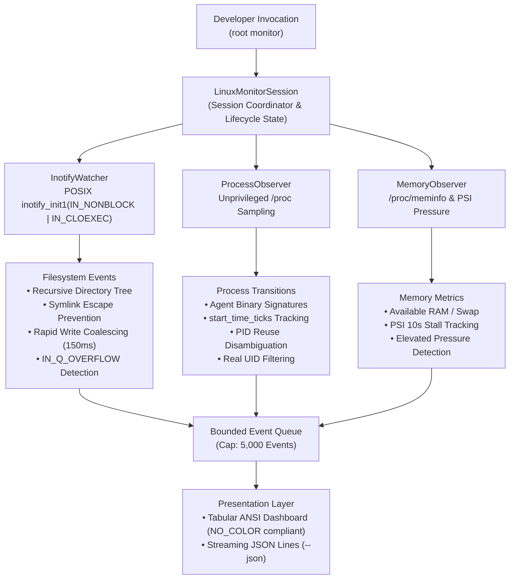
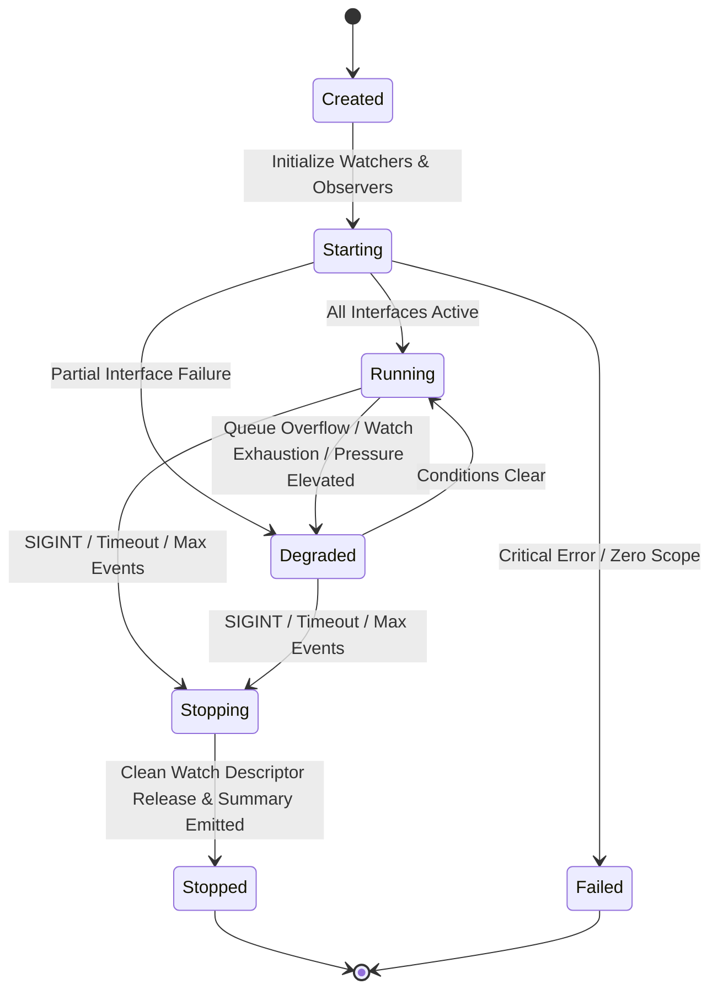

# Root Lightweight Live Event Monitoring Architecture (Mode C)

## 1. Architectural Mission & Invariants

Root provides three distinct operational modes to accommodate varying developer workflows:
- **Mode A (On-Demand CLI)**: Ad-hoc terminal inspections invoked directly by the developer (`root inspect`, `root discover`, `root scan`).
- **Mode B (Scheduled Inspections)**: Periodic, autonomous, strictly read-only inspections triggered by systemd user timers (`root schedule`).
- **Mode C (Live Monitoring)**: Real-time, event-driven observation of filesystem mutations, process lifecycle changes, and memory pressure during active development sessions (`root monitor`).

Mode C is governed by foundational architectural invariants:
1. **Explicit Activation**: Monitoring never starts automatically. It requires explicit user activation specifying an observable target scope (`--path`, `--agent`, `--processes`, or `--memory`).
2. **Disabled by Default**: No monitoring services, hooks, or watchers run upon installation or in the background. Mode C runs only while the interactive CLI session or bounded duration is active.
3. **Strictly Read-Only Guarantee**: Monitoring is purely observational. Under no circumstances does Mode C quarantine files, delete resources, prune directories, or send process termination signals. Root Guardian unconditionally denies all mutations during monitoring.
4. **Zero Permanent Background Daemons**: Root does not deploy an always-on resident background daemon or privileged system service. Mode C runs as an interactive foreground process or finite duration session, terminating immediately on `SIGINT` (Ctrl+C) or timeout.
5. **Least Privilege & Native Linux Interfaces**: Mode C operates entirely in unprivileged user space. It avoids `sudo`, superuser privileges, and kernel tracing runtimes (e.g. eBPF) by relying strictly on standard unprivileged Linux kernel interfaces: POSIX non-blocking `inotify(7)`, `/proc` virtual filesystem tables, and `/proc/pressure/memory` (PSI).
6. **Bounded Resource Footprint**: Memory usage, file watch descriptor counts, queued event buffers, and polling intervals are strictly constrained to prevent monitoring from competing with development tools for workstation resources.
7. **Privacy by Design**: File contents, developer credentials, tokens, session transcripts (`transcript.jsonl`), and process command-line arguments or environment variables are never opened, read, logged, or emitted.

---

## 2. Kernel Interfaces & Subsystem Architecture

Mode C coordinates three observational subsystems managed by a central state coordinator:



---

## 3. Inotify Filesystem Monitoring Subsystem

The filesystem watcher (`InotifyWatcher`) provides real-time event notifications for directory trees associated with supported AI coding agents and development workspaces.

### 3.1. File Descriptor Lifecycle & Security Directives
- **Non-Blocking Descriptor**: Opened using `inotify_init1(libc::IN_NONBLOCK | libc::IN_CLOEXEC)`. Non-blocking mode guarantees polling operations never hang the main event loop, while `IN_CLOEXEC` ensures descriptor isolation across process forks.
- **Monitored Event Mask**:
  ```c
  IN_CREATE | IN_DELETE | IN_MODIFY | IN_MOVED_FROM | IN_MOVED_TO
  | IN_DELETE_SELF | IN_MOVE_SELF | IN_DONT_FOLLOW | IN_EXCL_UNLINK
  ```
- **`IN_DONT_FOLLOW`**: Crucial security directive instructing the Linux kernel not to follow symbolic links when registering watches, eliminating symlink traversal hijacking.
- **`IN_EXCL_UNLINK`**: Instructs the kernel not to generate events for unlinked children, reducing event storm overhead.

### 3.2. Recursive Directory Watching & Symlink Jail Enforcement
In Linux, `inotify` watches are non-recursive by design. To observe an entire workspace tree:
1. **Initial Traversal**: `InotifyWatcher` recursively walks directory entries up to `max_depth` (default: 16) and registers individual directory watch descriptors.
2. **Symlink Escape Prevention**: Before adding a watch to any subdirectory, the watcher inspects `std::fs::symlink_metadata`. If the entry is a symbolic link (`file_type().is_symlink() == true`), it is strictly skipped. Watches are never placed on symlinks, preventing attackers or rogue build scripts from redirecting watches outside approved targets.
3. **Dynamic Child Directory Watching**: When an `IN_CREATE` event flags `IN_ISDIR`, the watcher immediately registers an inotify watch on the newly created subdirectory, dynamically maintaining recursive coverage.
4. **Watch Descriptor Cleanup**: When a watched directory is removed (`IN_DELETE_SELF`) or moved (`IN_MOVE_SELF`), its watch descriptor is unlinked from internal tracking maps (`watches` and `paths`).

### 3.3. Rapid Write Event Coalescing
Compilers, bundlers, language servers, and AI coding agents often emit hundreds of modification writes per second to the same file. Emitting an event for every write creates terminal jitter and exhausts memory buffers.
- `InotifyWatcher` maintains an internal map of `(PathBuf, (LiveFsEventKind, Instant))`.
- If an incoming `Modified` event targets a file that experienced a `Modified` event within the preceding **150 milliseconds**, the event is coalesced and suppressed.
- `Created`, `Deleted`, and movement events are never suppressed, ensuring accurate structural lifecycle reporting.

### 3.4. Kernel Queue Overflow Handling (`IN_Q_OVERFLOW`)
The Linux kernel maintains a per-inotify-instance event queue (configurable via `/proc/sys/fs/inotify/max_queued_events`, typically 16,384 entries). Under extreme filesystem churn, this queue can overflow:
- The kernel signals an overflow by emitting an event with watch descriptor `wd == -1` and mask `IN_Q_OVERFLOW`.
- Upon detecting `IN_Q_OVERFLOW`, Root does not crash or exit silently. Instead:
  1. The session immediately transitions to `MonitorSessionState::Degraded`.
  2. `DegradedReason::QueueOverflow` is appended to the session status.
  3. A diagnostic warning is emitted to `stderr` (or as a JSON Lines degraded event) informing the user that kernel event loss occurred.

---

## 4. Process Lifecycle Observation & PID Reuse Resilience

The process observer (`ProcessObserver`) periodically surveys `/proc` to detect the spawning, execution, and exit of processes belonging to supported AI coding agents (`antigravity`, `claude`, `codex`, `gemini`, `aider`).

### 4.1. Unprivileged `/proc` Sampling
- Surveys numeric directory entries in `/proc` corresponding to active process IDs.
- Inspects `/proc/[pid]/status` to extract the real UID (`Uid: <ruid>`), skipping processes belonging to other users to uphold least-privilege boundaries.
- Resolves `/proc/[pid]/exe` via POSIX `read_link` to identify the canonical binary path without opening process memory.
- Matches process names against known agent signatures.

### 4.2. PID Reuse Disambiguation via `start_time_ticks`
A classic vulnerability in Linux process monitoring is **PID recycling**: a process terminates, and a short time later the kernel assigns the identical PID to a completely unrelated new process. Relying solely on PID leads to ghost transitions and incorrect telemetry.
- Root extracts field 22 (`starttime`) from `/proc/[pid]/stat`.
- `starttime` represents the time the process started after system boot, measured in kernel clock ticks (jiffies). This value is permanently immutable for the lifetime of that specific process.
- Active processes are indexed internally by `(pid, start_time_ticks)`:
  - If a poll reveals a known PID whose `start_time_ticks` does not match the cached record, Root recognizes that the previous process died and a new process was assigned the recycled PID.
  - An `Exited` event is emitted for the prior process, followed immediately by a `Spawned` event for the newly created process.

---

## 5. Memory & Pressure Observation Subsystem

The memory observer (`MemoryObserver`) samples system-wide memory telemetry and kernel Pressure Stall Information (PSI):
- **`/proc/meminfo` Parsing**: Samples total RAM, available RAM, reclaimable cache, free RAM, and swap consumption.
- **Kernel PSI Pressure (`/proc/pressure/memory`)**: Samples `some` and `full` memory stall percentages across 10-second, 60-second, and 300-second windows.
- **Elevated Pressure Detection**: If the 10-second memory stall percentage exceeds 40.0%, the monitor session flags `DegradedReason::MemoryPressureElevated`, alerting the developer that active agent workloads are inducing memory thrashing.

---

## 6. Target Scope & Path Safety Invariants

To prevent accidental scanning of system infrastructure or denial-of-service vulnerabilities, `MonitorScope` strictly validates user-supplied paths:
1. **Explicit Target Required**: Refuses to launch if no paths, agent filters, or subsystem flags are provided.
2. **Root Filesystem Rejection**: Refuses to monitor the root filesystem `/`.
3. **Pseudo-Filesystem Rejection**: Refuses paths residing within `/proc`, `/sys`, or `/dev`.
4. **System Directory Rejection**: Refuses system root directories (`/etc`, `/usr`, `/var`, `/bin`, `/sbin`, `/lib`, `/boot`).
5. **Control Character Rejection**: Refuses paths containing newlines (`\n`), carriage returns (`\r`), or null bytes.

---

## 7. Degraded State Transition Model

Mode C models monitoring health as an explicit, observable state machine:



### Supported Degraded Reasons (`DegradedReason`):
- `QueueOverflow`: Kernel inotify event queue experienced buffer exhaustion.
- `WatchLimitExceeded`: Active watch count reached configured budget (`max_watches`).
- `PermissionDenied`: Insufficient permissions to access a directory or process entry.
- `WatchedDirectoryRemoved`: A watched target root was deleted or unmounted.
- `KernelInterfaceUnavailable`: System lacks PSI support or inotify capabilities.
- `ResourceBudgetExceeded`: Event queue exceeded maximum capacity (`max_queued_events`).
- `MemoryPressureElevated`: Workstation memory stall percentage exceeded 40.0%.

---

## 8. Resource Budgets & Bounded Execution

To ensure Root never degrades workstation responsiveness:
- **Watch Descriptor Limit (`max_watches`)**: Default 512 watches. When reached, further directory recursion is halted, and `DegradedReason::WatchLimitExceeded` is logged.
- **Queued Event Cap (`max_queued_events`)**: Default 5,000 events. If the presentation consumer falls behind, the oldest events are dropped to prevent unbounded memory growth.
- **Maximum Monitored Paths (`max_monitored_paths`)**: Default 32 paths per session.
- **Sampling Interval Boundary**: Minimum process/memory polling interval of 250 milliseconds.
- **Duration Budget (`--duration <secs>`)**: Automatic session termination after elapsed duration.

---

## 9. Concurrency & Coexistence Model

Root's operational modes operate with complete concurrency independence:
- **Locking Independence**: Mode C live monitoring does **not** acquire `$XDG_STATE_HOME/root/schedule.lock`. That advisory lock is reserved exclusively for Mode B scheduled runs to prevent overlapping scheduled scans.
- **Coexistence**: A developer can run `root monitor` in a terminal window while Mode B scheduled timers trigger `root schedule run` in the background. Both operations execute independently without lock contention or deadlocks.
- **Multi-Session Support**: Multiple independent `root monitor` instances can observe distinct target paths concurrently.

---

## 10. Privacy Guarantees

Mode C adheres strictly to Root's zero-leakage privacy invariants:
- **Zero File Content Reading**: `InotifyWatcher` operates strictly on path metadata and event bitmasks. File bytes, conversation transcripts (`transcript.jsonl`), tokens, encryption keys, and credentials are never opened or read.
- **Zero Process Memory Reading**: `ProcessObserver` inspects metadata via `/proc/[pid]/status` and `/proc/[pid]/stat`. Memory dumps, stack traces, and environment variables (`/proc/[pid]/environ`) are strictly forbidden.
- **Command-Line Redaction**: Process command lines are sanitized to redact credentials and tokens prior to emission.

---

## 11. Presentation Layer & Streaming Interfaces

Mode C provides dual presentation interfaces:
1. **Interactive ANSI Dashboard**:
   - Tabular layout displaying elapsed time, event badge (`CREATE`, `MODIFY`, `DELETE`, `SPAWN`, `EXIT`, `SAMPLE`), and middle-truncated resource path or process name.
   - Respects the `NO_COLOR` environment variable: suppresses ANSI color codes when `NO_COLOR` is present or when `stdout` is not an interactive terminal.
   - Clean summary table emitted upon session termination.
2. **Streaming JSON Lines (`--json`)**:
   - Newline-delimited JSON objects streamed directly to `stdout`.
   - Each event contains a timestamp, tagged variant (`fs`, `process`, `memory`, `state_change`), and structured metadata.
   - Cleanly parsable by log processors, external tooling, or IDE plugins.
