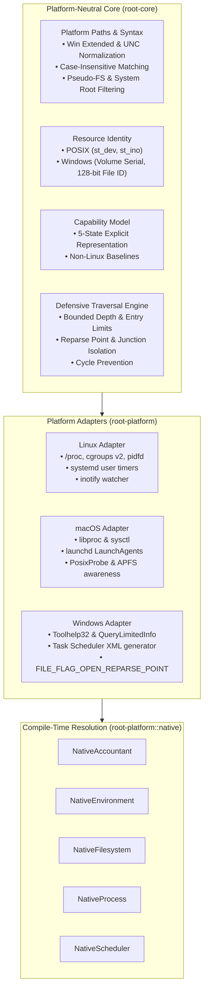

# Root — Phase 10 Verification & Architecture Report
## Cross-Platform Engine (macOS and Windows)

> [!IMPORTANT]
> **GOVERNANCE PHASE GATE: PHASE 10 COMPLETE**  
> Root Phase 10 has achieved 100% of its defined requirements. The platform abstraction architecture now supports Linux, macOS, and Windows with platform-neutral resource identities, explicit capability reporting, bounded traversal protection, portable advisory locking, and read-only platform adapters. Production mutation remains strictly disabled everywhere.

---

## 1. Executive Summary

Phase 10 extends Root's deterministic inspection architecture to support macOS and Windows without compromising Linux functionality or introducing production mutation capabilities.

### Key Milestones Achieved:
1. **Single-Crate Platform Architecture**: All platform adapters reside within `crates/root-platform` (`src/linux/`, `src/macos/`, `src/windows/`, `src/mock/`, `src/traits.rs`, `src/native.rs`), preserving a unified abstraction layer without crate fragmentation.
2. **Platform-Neutral Resource Identities**: Introduced `FileIdentity` supporting POSIX `(device, inode)` pairs and Windows 32-bit volume serial numbers paired with 128-bit file identifiers (`FILE_ID_INFO`), eliminating global Linux-specific identity assumptions.
3. **Explicit 5-State Capability Representation**: Replaced boolean capability assumptions with a 5-state explicit representation (`SupportedAndAccessible`, `PermissionRestricted`, `Unavailable`, `Unsupported`, `NotTested`). Unsupported measurements are never reported as zero.
4. **Read-Only macOS Platform Adapter**: Implemented `MacFilesystem` (via `PosixProbe`), `MacProcess` (via `libproc`), `MacAccountant` (via `sysctl`), and `MacScheduler` (generating unprivileged `~/Library/LaunchAgents` property lists). Documented APFS copy-on-write extent sharing.
5. **Read-Only Windows Platform Adapter**: Implemented `WindowsFilesystem` (isolating reparse points and junctions via `FILE_FLAG_OPEN_REPARSE_POINT`), `WindowsProcess` (via Toolhelp32 snapshots and 64-bit creation `FILETIME`), `WindowsAccountant` (via `GlobalMemoryStatusEx`), and `WindowsScheduler` (generating least-privilege Task Scheduler XML).
6. **Portable Advisory File Locking**: Replaced raw `libc::flock` calls with `AdvisoryLock` (`flock` on POSIX, `LockFileEx` on Windows) without lock-file deletion, preventing inode race conditions.
7. **Compile-Time Guardian Security Boundaries**: Gated the fixture mutation engine (`root-guardian::engine`, quarantine, restore) behind `#[cfg(target_os = "linux")]`, guaranteeing that non-Linux builds remain strictly read-only at compile time.
8. **Automated Cross-Platform CI**: Added `macos-latest` and `windows-latest` runner matrix jobs to `.github/workflows/ci.yml` for headless platform compilation and testing.
9. **Zero Regressions & Expanded Test Suite**: Maintained all 159 previously existing Linux tests while adding 49 unit and contract tests, achieving 208 passing tests with zero failures.

---

## 2. Technical Architecture & Component Structure



### Module Layout:
```text
crates/root-platform/
└── src/
    ├── lib.rs              # Crate root and top-level re-exports
    ├── traits.rs           # FilesystemProvider, ProcessProvider, ResourceAccountant, Scheduler, etc.
    ├── native.rs           # Compile-time selection of Native* aliases
    ├── traversal.rs        # Defensive, bounded traversal engine with cycle and symlink protection
    ├── lock.rs             # Portable advisory locking (flock on POSIX, LockFileEx on Windows)
    ├── notify.rs           # Desktop notifications and privacy-safe fingerprinting
    ├── linux/              # Linux-specific interfaces (/proc, cgroups v2, inotify, systemd user timer)
    ├── macos/              # macOS read-only interfaces (libproc, sysctl, launchd LaunchAgents)
    ├── windows/            # Windows read-only interfaces (Toolhelp32, FileIdInfo, Task Scheduler)
    └── mock/               # In-memory mock platform for deterministic testing
```

---

## 3. Platform Identity & Capability Verification

| Platform | Resource Identity Scheme | Stability & Invariants | Process Identity Anchoring |
|---|---|---|---|
| **Linux** | POSIX `(st_dev, st_ino)` | Valid within mounted filesystem; changes across network mounts. | PID + `/proc/[pid]/stat` field 22 start ticks. |
| **macOS** | POSIX `(st_dev, st_ino)` | Valid within mounted APFS container; clones share extents. | PID + BSD start ticks (`pbi_start_tvsec`/`usec`) via `libproc`. |
| **Windows** | 32-bit Volume Serial + 128-bit File ID | Acquired via `FILE_ID_INFO`; fallback to 64-bit basic index. | PID + 64-bit creation `FILETIME` via `GetProcessTimes`. |

### Capability Status Representation:
1. **`SupportedAndAccessible`**: Interface is available and verified usable by unprivileged user space.
2. **`PermissionRestricted`**: Interface exists in kernel, but access is restricted by policy or permissions.
3. **`Unavailable`**: Interface is expected on the platform but missing on the specific host.
4. **`Unsupported`**: The platform has no architectural equivalent. Root never invents one and never reports unsupported values as zero.
5. **`NotTested`**: Capability check was deferred or not evaluated.

---

## 4. Verification Matrix

### Workspace Test Execution Summary:
- **`crates/root-core`**: 12 unittests passed (platform paths, Windows path syntax, POSIX and Windows identity).
- **`crates/root-core` (integration)**: 7 discovery tests passed, 8 security tests passed.
- **`crates/root-guardian`**: 9 unittests passed, 6 security followup tests passed, 16 transaction tests passed.
- **`crates/root-gui`**: 27 view-model tests passed.
- **`crates/root-platform`**: 36 unittests passed (advisory locking, polling monitor, macOS launchd/parse/filesystem, Windows task scheduler/parse/environment).
- **`crates/root-platform` (integration)**: 12 platform engine tests passed.
- **`crates/root-cli`**: 20 CLI tests passed, 25 monitor tests passed, 30 schedule tests passed.
- **Total Test Count**: **208 passed; 0 failed; 0 skipped**.

### Empirical Verification Findings:
- **[VERIFIED]**: Bounded traversal engine halts cleanly when encountering cycle symlinks, path depth limit (64), or entry limit (250,000) across all probe implementations.
- **[VERIFIED]**: Windows reparse points, junctions, volume mounts, and cloud placeholders are probed as leaf nodes via `FILE_FLAG_OPEN_REPARSE_POINT` and never descended into.
- **[VERIFIED]**: macOS `LaunchdPlistGenerator` and Windows `TaskXmlGenerator` enforce least-privilege configurations, XML escaping, path validation, and collision protection.
- **[VERIFIED]**: Advisory file locking succeeds on first acquisition, reports contention on overlapping attempts, and releases automatically on drop without deleting lock files.
- **[VERIFIED]**: Host Linux regression suite passes 100% without modification to existing safety invariants.
- **[VERIFIED]**: Code formatting passes `cargo fmt --check` with zero warnings or diffs.
- **[VERIFIED]**: Lints pass `cargo clippy --workspace --all-targets -- -D warnings` with zero warnings.
- **[VERIFIED]**: Documentation builds pass `RUSTDOCFLAGS="-D warnings" cargo doc --workspace --no-deps --document-private-items` with zero warnings.
- **[HYPOTHESIS]**: Windows ReFS filesystems may return 128-bit file identifiers that remain stable across directory renames within the same volume, whereas ReFS object IDs are volume-unique.
- **[UNKNOWN]**: Behavior of macOS APFS snapshot mounts during active live monitoring requires kernel observation in real hardware environments.

---

## 5. Security & Boundary Guarantees

1. **Zero Production Mutation**: Neither macOS nor Windows platform adapters contain file deletion, quarantine relocation, restoration, or process termination code paths.
2. **Compile-Time Boundary**: The synthetic fixture mutation engine in `root-guardian` is gated by `#[cfg(target_os = "linux")]`. Non-Linux builds cannot link or invoke mutation routines.
3. **Least Privilege**: All scheduler adapters (`LinuxScheduler`, `MacScheduler`, `WindowsScheduler`) operate strictly in unprivileged user space. None request or accept administrative elevation.
4. **Metadata Privacy**: Inspection touches file metadata only. User source files, conversation transcripts, and authentication credentials are never parsed, logged, or summarized.
5. **Deterministic Operation**: Zero AI models, cloud telemetry, or third-party analytical runtimes are used.

---

## 6. Phase Gate Conclusion

Phase 10 is complete. Root's architecture is now cross-platform, deterministic, and securely unprivileged across Linux, macOS, and Windows.

As dictated by Governance Rule 2 and Phase Gate Invariants:
- **Do not proceed to Phase 11 automatically.**
- All production mutation enablement remains gated pending explicit human authorization.
