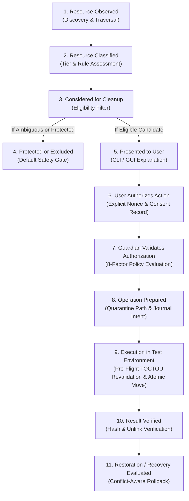
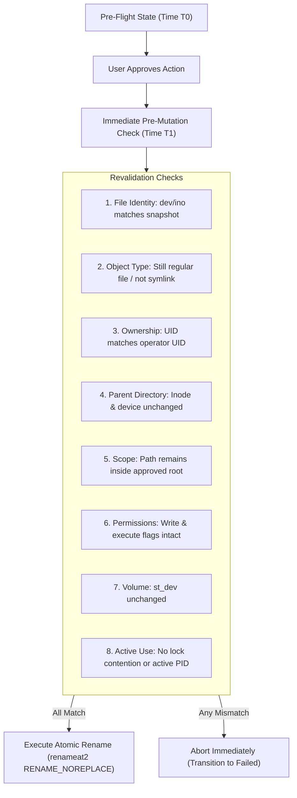

# Root — Phase 11 Authorization & Eligibility Model
## Multi-Factor Authorization, Consent Binding, and Identity Revalidation

> [!IMPORTANT]
> **GOVERNANCE INVARIANT: ELIGIBILITY DOES NOT EQUAL AUTHORIZATION**  
> In Root, discovering that a resource is eligible for consideration never automatically authorizes its mutation. Every mutation requires explicit multi-factor verification, strict identity binding, and non-replayable consent. Production mutation remains disabled.

---

## 1. The 11-Stage Decision Pipeline

Root separates resource observation from mutation through an explicit 11-stage decision pipeline. A candidate can be rejected or protected at any stage:

### Decision Stage Descriptions:
1. **Resource Observed**: Read-only metadata scanning acquires path, size, timestamps, and `FileIdentity`.
2. **Resource Classified**: Catalog of 12 deterministic discovery rules evaluates provenance and assigns an initial `ProtectionTier`.
3. **Considered for Cleanup**: Evaluates candidate against lifecycle markers and project boundaries.
4. **Protected or Excluded**: Resources that are unknown, active, shared, or uncommitted are permanently excluded (`StrictlyProtected`).
5. **Presented to User**: Candidate is displayed with exact nominal path, apparent size, allocated size, classification tier, rule evidence, and consequences. No action is taken.
6. **User Authorizes Specific Action**: Operator grants consent for an individual resource. Produces a structured `ConsentRecord` containing a unique nonce, creation timestamp, and strict expiration TTL (e.g., 300s).
7. **Guardian Validates Authorization**: `AuthorizationEngine` validates the request across all 8 security criteria, issuing an immutable `AuthorizationReceipt`.
8. **Operation Prepared**: Destination path in isolated staging is allocated with collision checks; journal records transaction intent (`Prepared`) and syncs to disk.
9. **Execution in Test Environment**: Immediate pre-mutation revalidation confirms file identity, parent directory identity, and ownership before invoking same-filesystem atomic relocation (`RENAME_NOREPLACE`).
10. **Result Verified**: Destination file content hash, size, and source path absence are verified. Transitions to `Verified` or `RecoveryRequired`.
11. **Restoration or Recovery Evaluated**: Rollback capability is confirmed against destination conflict checks and journal records.

---

## 2. Protection Policy & Tier Invariants

Root enforces four strict protection tiers:

| Protection Tier | Eligibility for Consideration | Mutation Allowed | Requirements |
|---|---|---|---|
| **`StrictlyProtected`** (Tier 1) | Never eligible | Unconditionally Prohibited | Automatically assigned to source code, dirty Git repos, user documents, credentials, API keys, SSH keys, active agent sessions, browser profiles, and shared dependency stores (`pnpm-store`, `cargo/registry`). |
| **`NonActionable`** | Never eligible | Unconditionally Prohibited | Assigned to resources with unknown lifecycle, ambiguous provenance, or missing presence markers. Default state for all unclassified items. |
| **`UserConfirmRequired`** (Tier 2) | Eligible for consideration | Requires Interactive Consent | Assigned to dormant build artifacts (`target/`, `node_modules/`, `__pycache__/`) where clean Git status is confirmed. Requires explicit user authorization. |
| **`SafeRecoverable`** (Tier 3) | Eligible for consideration | Requires Interactive Consent | Assigned to confirmed temporary log files, diagnostic dumps, and agent scratch worktrees in isolated sandbox fixtures. Still requires explicit user authorization. |

### Absolute Invariant:
A resource is **never** classified as safe to delete solely because:
- It is old or has not been accessed recently.
- It is large or consumes significant disk space.
- It has a hidden filename (starts with `.`).
- Its owning process or parent process is not currently running.
- It has an unfamiliar or hash-like name.
- It resembles a cache or temporary folder.

---

## 3. Eight-Factor Authorization Model

To receive authorization, an operation must satisfy all eight factors:

1. **Exact Resource Identity**: The nominal path and `FileIdentity` (POSIX `st_dev` + `st_ino`; Windows volume serial + 128-bit file ID) must be non-empty and well-formed.
2. **Verified Ownership**: Resource UID must match the invoking operator UID (`candidate.ownership.uid == invoking_uid`), preventing confused-deputy access to other users' files.
3. **Verified Filesystem Identity & Symlink Non-Follow**: Target must not be a symbolic link (`!meta.is_symlink()`), and current disk metadata must match the candidate snapshot.
4. **Permitted Protection Tier**: Must be `UserConfirmRequired` or `SafeRecoverable`; `StrictlyProtected` and `NonActionable` are unconditionally rejected.
5. **Supported Operation**: In Phase 11, only sandboxed quarantine is supported; direct permanent deletion, directory pruning, and process signaling are rejected.
6. **Scope Boundary Containment**: Target canonical path must reside entirely within an approved workspace root or synthetic sandbox directory.
7. **Valid Consent Record**: Consent must be explicit, match the resource ID, possess an unconsumed nonce, and be within its active expiration window (TTL).
8. **Durable Transaction Binding**: Authorization is bound to an individual transaction identifier (`tx_...`), preventing replay across multiple executions.

---

## 4. Multi-Factor Identity Revalidation

Immediately before executing an atomic move, Root revalidates 8 physical invariants via `AuthorizationEngine::revalidate_before_mutation`:

### Revalidation Protocol:
- If a target is replaced by a symlink: **Aborted with `SymlinkJailEscape`**.
- If a target inode changes (file unlinked and recreated): **Aborted with `FilesystemIdentityChanged`**.
- If a target parent directory was replaced: **Aborted with `ParentDirectoryChanged`**.
- If target ownership changes: **Aborted with `OwnershipMismatch`**.
- If destination path exists: **Kernel returns `EEXIST` (RENAME_NOREPLACE); aborted with `DestinationCollision`**.
