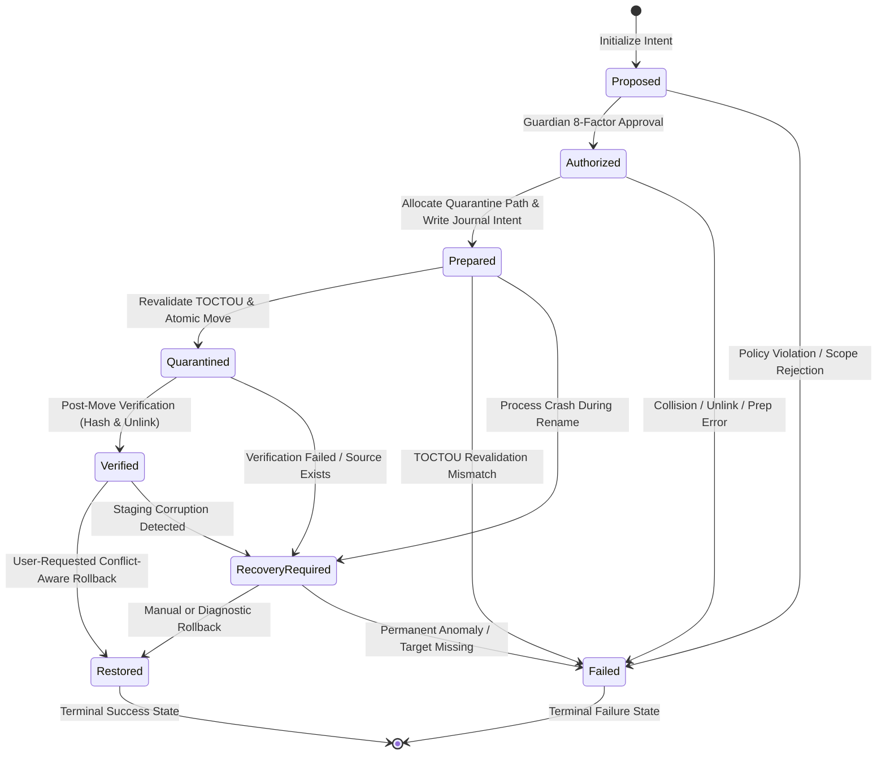
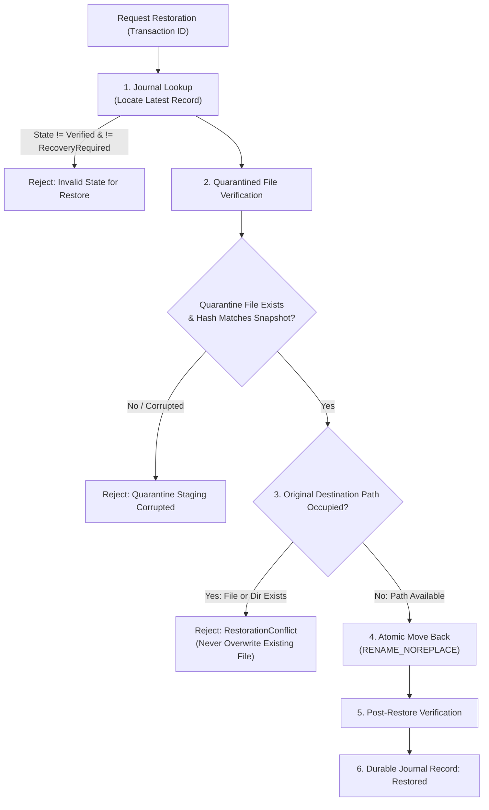

# Root — Phase 11 Transaction Guarantees & Recovery Protocol
## State Machine Invariants, Journal Durability, and Conflict-Aware Restoration

> [!IMPORTANT]
> **GOVERNANCE INVARIANT: REVERSIBILITY AND INTEGRITY FIRST**  
> Every mutating operation in Root follows an immutable 8-state transaction state machine. Transactions are crash-consistent, non-overwriting, and fully recoverable from append-only cryptographic journals.

---

## 1. Transaction State Machine & Invariants

Root models resource mutation as an explicit finite state machine with 8 distinct lifecycle states:



### Transition Enforcement Rules:
1. **Self-Transitions Prohibited**: A state cannot transition into itself (e.g. `Prepared -> Prepared` is illegal).
2. **Terminal State Immutability**: States `Restored` and `Failed` are terminal. No transitions out of terminal states are permitted.
3. **No Skipping States**: Bypassing states (e.g., jumping from `Proposed` directly to `Quarantined`) is strictly rejected by `TransactionState::can_transition_to`.
4. **Failure Capture**: A failure at any intermediate stage transitions cleanly to `Failed` (or `RecoveryRequired` if an action took place on disk) and records the failure reason in the journal.
5. **Idempotence**: Re-executing an already completed or failed transaction is blocked; duplicate IDs are rejected.

---

## 2. Ordered Journal Durability Protocol

To prevent inconsistent filesystem state in the event of an abrupt process crash, power loss, or kernel panic, Root mandates an exact 7-stage write order:

```text
Step 1: In-Memory Validation
        Verify resource identity, ownership, and protection tier.
        Generate unique transaction ID and nonce.

Step 2: Durable Intent Recording (Prepared)
        Compute source file SHA-256 and stat snapshot.
        Allocate non-colliding destination path in quarantine staging.
        Append `Prepared` record to `recovery_journal.jsonl`.
        Invoke `file.sync_data()` and sync parent directory.
        [CRASH SAFETY: If process dies here, source is untouched on disk.]

Step 3: Immediate Pre-Mutation Revalidation (TOCTOU Defense)
        Revalidate source file identity (st_dev, st_ino, st_uid).
        Revalidate parent directory identity and symlink non-existence.
        If mismatch detected: record `Failed` and abort without moving files.

Step 4: Atomic Relocation
        Execute single-syscall atomic rename (`SYS_renameat2` with `RENAME_NOREPLACE`).
        Source and destination must share same `st_dev`.
        [CRASH SAFETY: Filesystem driver guarantees rename is all-or-nothing.]

Step 5: Post-Mutation Anomaly Check
        Verify that original source path no longer exists on disk.
        If source still exists: transition to `RecoveryRequired` immediately.

Step 6: Integrity Verification in Staging
        Compute streaming SHA-256 hash over file in quarantine staging.
        Verify size and hash match pre-flight snapshot.
        If hash mismatch: transition to `RecoveryRequired` for investigation.

Step 7: Durable Completion Recording (Verified)
        Append `Verified` record to `recovery_journal.jsonl`.
        Invoke `file.sync_data()` and sync parent directory.
        Transaction is now safely verified and eligible for future restoration.
```

---

## 3. Conflict-Aware Restoration Guarantees

Restoration is treated as a separate, first-class security transaction subject to conservative conflict checks:



### Restoration Invariants:
1. **Never Overwrite**: If any file, directory, symlink, or socket occupies the original path, restoration aborts immediately with `RootError::RestorationConflict`.
2. **Hash Revalidation**: Quarantined data is re-hashed before touching the original path. If staging was corrupted while in quarantine, restoration is refused.
3. **Parent Directory Reconstruction**: If intermediate parent directories were unlinked while the file was in quarantine, Root creates parent directories with default unprivileged permissions (`0755` on POSIX).
4. **Permission Preservation**: Original file mode permissions (`0644`, `0755`) are preserved exactly throughout quarantine and restoration.

---

## 4. Streaming Content Integrity Guarantees

File integrity verification uses a memory-bounded streaming SHA-256 engine:

- **Bounded Memory**: Buffers data in 64 KiB chunks rather than reading entire files into RAM, supporting arbitrary file sizes without memory pressure.
- **Sparse File Extent Verification**: Hashes logical zero bytes in sparse file holes deterministically, guaranteeing that hole structures produce matching cryptographic digests.
- **Identity Consistency**: Probes `FileIdentity` before and after streaming to verify that the file descriptor remained bound to the same inode throughout the computation.
- **Integrity Scope**: A valid SHA-256 digest proves that file contents in quarantine match the candidate observed at $T_0$; it does not replace kernel identity checks or process attribution.
