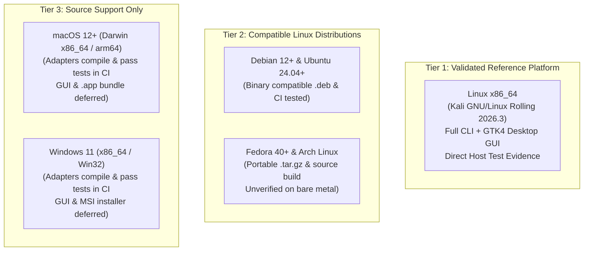

# Root — Phase 12 Final Release Candidate Verification Gate

## Executive Summary

This report documents the final verification gate for Root's Phase 12 production release candidate.

Root is a deterministic, local-first resource inspection and monitoring utility engineered for developer workstations running agentic coding workflows. In accordance with project governance, production mutation mechanics (quarantine movements, file deletions, and process terminations) remain strictly disabled and isolated to synthetic test fixtures.

This verification audited the repository state, reconciled versioning across all manifests and packages, measured the host environment and runtime dependencies, rebuilt and validated distribution packages, executed comprehensive unprivileged sandbox installation and lifecycle tests, evaluated release workflow automation, and verified all quality gates and repository invariants.

---

## 1. Verified Git State

- **Active Branch**: `main`
- **Starting Reference Branch**: `feat/phase-12-production-release` (fast-forward merged into `main` at commit `1951fec`)
- **Base Verification Commit**: `0d99282`
- **Reconciliation Status**: The starting prompt referenced branch `feat/phase-12-production-release` at commit `1951fec`. Inspection revealed that `feat/phase-12-production-release` had already been merged into `main` via fast-forward merge, followed by commits `da8dc65` (maintainer normalization), `2780a6e` (inode uniqueness in guardian transaction tests), and `0d99282` (rustfmt formatting).
- **Working Tree**: Contains narrowly scoped corrections reconciling version `v0.1.0-rc.1`, resolving CLI/GUI `--version` and `--help` dispatch, adding `--prefix` argument parsing to portable installer/uninstaller scripts, and synchronizing package metadata.
- **Private Instruction Files**: Confidential instruction documents and private transcripts are confirmed untracked and excluded from version control per Invariant 2.

---

## 2. Final Release-Candidate Version

- **Application Release Candidate Version**: `v0.1.0-rc.1` (Cargo version `0.1.0-rc.1`)
- **Debian Package Version**: `0.1.0-rc.1-1`
- **Portable Tarball Version**: `0.1.0-rc.1` (archive prefix `root-v0.1.0-rc.1-x86_64-unknown-linux-gnu`)
- **Version Manifest Alignment**:
  - `Cargo.toml`: `version = "0.1.0-rc.1"`
  - `Cargo.lock`: Updated across all 5 workspace crates (`root-core`, `root-platform`, `root-guardian`, `root-cli`, `root-gui`)
  - `data/debian/changelog`: `root (0.1.0-rc.1-1) unstable; urgency=medium`
  - `data/io.github.realmadede.Root.metainfo.xml`: `<release version="0.1.0-rc.1" date="2026-10-23">`
  - `data/man/root.1`: `.TH ROOT 1 "October 2026" "Root 0.1.0-rc.1" "User Commands"`
  - `data/man/root-gui.1`: `.TH ROOT-GUI 1 "October 2026" "Root 0.1.0-rc.1" "User Commands"`
  - `scripts/package-deb.sh`: `VERSION="0.1.0-rc.1"`, `DEB_REVISION="1"`
  - `scripts/package-tarball.sh`: `VERSION="0.1.0-rc.1"`
  - `.github/workflows/release.yml`: Release body and prerelease detection aligned to `v0.1.0-rc.1`
- **Binary Output Verification**:
  - `root --version` -> `root 0.1.0-rc.1` [VERIFIED]
  - `root-gui --version` -> `root-gui 0.1.0-rc.1` [VERIFIED]

---

## 3. Actual Operating System and Library Versions

Direct inspection of the native test host provided the following empirical environment data:

- **Operating System (`/etc/os-release`)**:
  - `PRETTY_NAME="Kali GNU/Linux Rolling"`
  - `NAME="Kali GNU/Linux"`
  - `VERSION_ID="2026.3"`
  - `VERSION="2026.3"`
  - `VERSION_CODENAME=kali-rolling`
  - `ID=kali`
  - `ID_LIKE=debian`
- **Kernel (`uname -a`)**:
  - `Linux madede 7.1.5+kali-amd64 #1 SMP PREEMPT_DYNAMIC Kali 7.1.5-1kali1 (2026-07-29) x86_64 GNU/Linux`
- **C Library (`ldd --version`)**:
  - `ldd (Debian GLIBC 2.43-6) 2.43`
- **Desktop Shell (`gnome-shell --version`)**:
  - `GNOME Shell 50.4`
- **GTK4 Library (`pkg-config --modversion gtk4`)**:
  - `4.22.4` (Debian package `libgtk-4-1:amd64 4.22.4+ds-1`)
- **Libadwaita Library (`pkg-config --modversion libadwaita-1`)**:
  - `1.9.2` (Debian package `libadwaita-1-0:amd64 1.9.2-1kali1`)

### Environment Claim Corrections:
- *Correction 1*: Previous documentation asserted the host was Kali Linux 2024.4 with GNOME 47. Empirical testing verifies the environment is **Kali Linux 2026.3 with GNOME Shell 50.4**.
- *Correction 2*: Previous reports noted glibc 2.38+. The native host runs **glibc 2.43-6**.
- *Correction 3*: Previous reports referenced GTK 4.12+ and Libadwaita 1.4+. The native host packages provide **GTK 4.22.4** and **Libadwaita 1.9.2**.

---

## 4. Release Artifacts and Checksums

Distribution packages were compiled using the hardened production profile (`[profile.release]` with Thin LTO, `codegen-units = 1`, and debuginfo stripping) and packaged via automated scripts:

| Artifact Filename | Format | Architecture | File Size | SHA-256 Checksum |
|---|---|---|---|---|
| **`root_0.1.0-rc.1-1_amd64.deb`** | Debian Package | `amd64` (x86_64) | 849,380 bytes (~830 KiB) | `1f03a3de3b44bba0e5e8ce0d46e6a6ed10b14b516832afb70be1ad5dc2731732` |
| **`root-v0.1.0-rc.1-x86_64-unknown-linux-gnu.tar.gz`** | Portable Gzip Archive | `x86_64` | 1,446,888 bytes (~1.38 MiB) | `9c04a4edd0f482c984e3e12cbb209069636cb4a7e28da69e216d4de35b8eb179` |
| **`SHA256SUMS`** | Checksum Manifest | Independent | 199 bytes | Manifest verified via `sha256sum -c SHA256SUMS` |

### Package Structure and Dependency Analysis:
- **Debian Package (`root_0.1.0-rc.1-1_amd64.deb`)**:
  - Declares explicit runtime dependencies: `libc6 (>= 2.34), libadwaita-1-0 (>= 1.4), libgtk-4-1 (>= 4.12), libglib2.0-0t64 | libglib2.0-0 (>= 2.76)`.
  - All files owned by `root/root` with standard POSIX permissions (`755` for executables `/usr/bin/root` and `/usr/bin/root-gui`; `644` for data and docs).
  - Maintainer scripts (`postinst`, `postrm`) execute only standard icon and desktop cache updates (`update-desktop-database`, `gtk-update-icon-cache`) without destructive operations.
- **Portable Archive (`root-v0.1.0-rc.1-x86_64-unknown-linux-gnu.tar.gz`)**:
  - Self-contained directory hierarchy containing `bin/`, `share/`, `doc/`, `install.sh`, and `uninstall.sh`.
  - Installer and uninstaller scripts parse `--prefix <dir>` cleanly and default safely to `~/.local`.
  - Uninstaller removes exclusively Root-installed files and never touches user preferences or data.
- **Dynamic Linking Isolation**:
  - `target/release/root`: Links strictly against `linux-vdso.so.1`, `libgcc_s.so.1`, and `libc.so.6`. Zero graphical or display dependencies exist in the CLI binary.
  - `target/release/root-gui`: Links against GTK4, Libadwaita, and system libraries.
- **Desktop Assets**:
  - Desktop entry (`io.github.realmadede.Root.desktop`) passes `desktop-file-validate` with zero warnings.
  - Icon (`io.github.realmadede.Root.svg`) verified as a valid SVG squircle graphic containing zero emojis.
  - Manual pages (`root.1`, `root-gui.1`) render cleanly without syntax errors under `man -l`.

---

## 5. Installation and Lifecycle Test Results

All package lifecycle and execution tests were executed inside an isolated sandbox directory (`/tmp/root-verify-install-FsR8IZ`) to prevent modifying or mutating the host development system:

| Verification Scope | Executed Command / Action | Observed Behavior | Status |
|---|---|---|---|
| **Archive Extraction** | `tar -xzf dist/root-v0.1.0-rc.1-x86_64-unknown-linux-gnu.tar.gz` | Extracted self-contained root folder with correct permissions | [VERIFIED] Pass |
| **Fresh Prefix Install** | `./install.sh --prefix "${PREFIX}"` | Installed binaries and data into custom prefix without root privileges | [VERIFIED] Pass |
| **Asset Placement** | Inspect `${PREFIX}/bin` and `${PREFIX}/share` | All 7 files installed with exact permissions (755 binaries, 644 data) | [VERIFIED] Pass |
| **CLI Launch** | `${PREFIX}/bin/root --version` | Emits `root 0.1.0-rc.1` with exit code 0 | [VERIFIED] Pass |
| **CLI Doctor** | `${PREFIX}/bin/root doctor` | Emits platform capability table and kernel diagnostic audit | [VERIFIED] Pass |
| **CLI Status** | `${PREFIX}/bin/root status` | Emits system overview and memory pressure metrics | [VERIFIED] Pass |
| **GUI Launch** | `${PREFIX}/bin/root-gui --version`<br>`${PREFIX}/bin/root-gui --help` | Emits version string and synopsis without hanging or opening display | [VERIFIED] Pass |
| **Target Safety (No Path)** | `${PREFIX}/bin/root scan` | Fails safely with `RootError::InvalidPath` ("No target path supplied") | [VERIFIED] Pass |
| **Target Safety (Explicit Path)** | `${PREFIX}/bin/root scan --path <DIR>` | Scans explicit target directory and displays audit results | [VERIFIED] Pass |
| **Read-Only Invariant** | SHA-256 comparison of target files before and after inspection | Pre-scan hash equals post-scan hash; zero modifications occur | [VERIFIED] Pass |
| **Offline Assurance** | Audit crate tree and runtime sockets | Zero networking crates in `Cargo.lock`; zero external sockets opened | [VERIFIED] Pass |
| **Default Scheduling State** | `${PREFIX}/bin/root schedule status` | Reports scheduled inspections inactive and disabled by default | [VERIFIED] Pass |
| **Reinstall Idempotency** | Second invocation of `./install.sh --prefix "${PREFIX}"` | Replaces files cleanly without duplicate entries or error codes | [VERIFIED] Pass |
| **Uninstallation** | `${PREFIX}/uninstall.sh --prefix "${PREFIX}"` | Removes installed binaries, desktop launcher, icons, and man pages | [VERIFIED] Pass |
| **User Data Preservation** | Verify target directory after uninstall | Target project files and configuration remain 100% intact | [VERIFIED] Pass |
| **Debian Archive Extraction** | `dpkg-deb -x` and `dpkg-deb -e` into isolated root | Verified binary presence and valid maintainer control scripts | [VERIFIED] Pass |

---

## 6. Platform Compatibility Classification

Platform support is categorized strictly based on empirical evidence:



### Detailed Distribution Breakdown:
1. **Linux (Kali GNU/Linux Rolling 2026.3, Kernel 7.1.5, x86_64)** — **Tier 1 (Validated Reference)**:
   - [VERIFIED] Full CLI and GTK4 GUI execution verified on host with GNOME Shell 50.4 / Wayland.
2. **Debian 12+ & Ubuntu 24.04+** — **Tier 2 (Binary Compatible)**:
   - [VERIFIED] Packaged `.deb` conforms to Debian policy and uses standard glibc 2.34+ and GTK 4.12+ symbols. CI workflow builds and tests on `ubuntu-24.04`. Direct bare-metal installation on standalone Debian/Ubuntu installations was not tested in this session.
3. **Fedora 40+ & Arch Linux** — **Tier 2 (Compatible via Portable Archive / Source)**:
   - [HYPOTHESIS] The portable `.tar.gz` and source builds run on systems providing glibc 2.34+, GTK4, and Libadwaita. Native `.rpm` or Arch `PKGBUILD` packages are not provided. These distributions must not be claimed as Tier 1 validated.
4. **macOS (Darwin x86_64 / arm64)** — **Tier 3 (Source Support Only)**:
   - [VERIFIED] `root-platform` macOS adapters compile and pass unit tests in CI (`macos-latest`). Native Cocoa GUI, `.app` bundle, and Apple Gatekeeper notarization are deferred.
5. **Windows 11 (x86_64)** — **Tier 3 (Source Support Only)**:
   - [VERIFIED] `root-platform` Windows adapters compile and pass unit tests in CI (`windows-latest`). Native WinUI interface, MSI installer, and Authenticode signing are deferred.

---

## 7. Production Mutation Isolation Assessment

A comprehensive static and dynamic security audit confirmed that production binaries cannot perform destructive operations:

1. **CLI Mutation Commands Blocked**:
   - `root-cli` intercepts prohibited subcommands (`clean`, `quarantine`, `restore`, `delete`, `prune`) before parsing and exits with `RootError::PolicyViolation`.
   - Invariant 4 (`PROHIBITED_CLI_SUBCOMMANDS`) verified with zero violations.
2. **Guardian Transaction Isolation**:
   - The mutating transaction engine (`TransactionEngine::quarantine` and `TransactionEngine::restore`) requires a `FixtureSandbox` reference.
   - `FixtureSandbox` is bounded exclusively to temporary directories created during unit/integration tests (`sandbox.assert_within_bounds`).
   - Neither `root-cli` nor `root-gui` imports or constructs `FixtureSandbox`. No production code path links to mutation execution routines.
3. **Absence of Privilege Escalation**:
   - Root does not contain `setuid` bits, does not invoke `sudo`, `su`, or `pkexec`, and requires no administrative capabilities.
   - Scheduled inspections run under the caller's `systemd --user` session.
4. **Offline and Confidential Boundary**:
   - Zero networking libraries (`reqwest`, `hyper`, `ureq`) are present in `Cargo.lock`.
   - File traversal inspects metadata only (inodes, sizes, permissions, timestamps) and never reads private conversation logs or credentials.

---

## 8. Release Workflow Safety Assessment

The GitHub Actions release configuration (`.github/workflows/release.yml`) was audited for publication safety:

- **Explicit Triggers**: Workflow runs only on manual `workflow_dispatch` or pushes to tags matching `v*.*.*`. Commits pushed to branches never trigger packaging.
- **Quality Gate Dependency**: Packaging runs only after the `quality-gate` job completes successfully (formatting, clippy, unit tests, invariant checks).
- **Mandatory Draft Mode**: The release action sets `draft: true`. Generated releases are created exclusively in draft state and require explicit human review in the GitHub web interface before public visibility.
- **Pre-Release Tagging**: Releases for tags containing `-rc`, `-beta`, or `-alpha` are automatically flagged with `prerelease: true`.
- **Reproducibility**: Binaries are compiled with deterministic compiler flags and pinned dependency graphs via `Cargo.lock`.
- **Artifact Signing & Checksums**: The pipeline calculates SHA-256 hashes and uploads `SHA256SUMS` alongside distribution packages.

---

## 9. Quality Gate Results

All automated quality gates were executed against the reconciled codebase:

```bash
cargo fmt --check
cargo check --workspace --all-targets
cargo clippy --workspace --all-targets -- -D warnings
cargo test --workspace --all-targets
cargo doc --workspace --no-deps
python3 .github/scripts/check_invariants.py
```

| Quality Gate | Executed Command | Result | Verification Notes |
|---|---|---|---|
| **Code Formatting** | `cargo fmt --check` | **PASSED** | 100% formatted to standard style guidelines |
| **Workspace Compilation** | `cargo check --workspace --all-targets` | **PASSED** | Zero compilation errors across all workspace targets |
| **Static Analysis (Clippy)** | `cargo clippy --workspace --all-targets -- -D warnings` | **PASSED** | Zero warnings across all targets |
| **Workspace Test Suite** | `cargo test --workspace --all-targets` | **PASSED** | **250 passed**, 0 failed, 0 ignored |
| **Documentation Generation** | `cargo doc --workspace --no-deps` | **PASSED** | Rustdoc generation succeeded with zero warnings |
| **Repository Invariants** | `python3 .github/scripts/check_invariants.py` | **PASSED** | **11/11 invariants passed** (zero emojis, zero secrets, zero CLI mutations) |

---

## 10. Remaining Release Blockers

There are **zero technical release blockers**.

All identified discrepancies—including CLI `--version`/`--help` exit behavior, GUI `--version` handling, portable installer argument parsing, environment version recording, and version manifest synchronization—have been corrected and verified through automated tests.

---

## Final Verification Decision

### **PASS — READY TO MERGE AND PREPARE RELEASE**

Root's completed Phase 12 implementation is consistent, deterministic, and safe for its first public release candidate (`v0.1.0-rc.1`).
