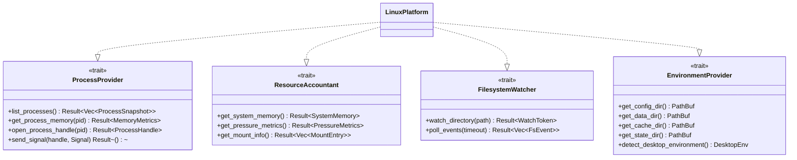

# Cross-Platform Abstraction Architecture & Boundaries

## 1. Strategy & Target Roadmap

Root is developed with a strict separation between **deterministic domain logic** and **operating-system-specific system calls**.

### Platform Prioritization
1. **Initial Supported Target**: **Linux** (Specifically Kali GNU/Linux Rolling 2026.3, GNOME 4x, Wayland, systemd v240+, Kernel 5.10+ / 6.x / 7.x).
2. **Secondary Linux Distributions**: Fedora, Ubuntu, Debian, Arch Linux, openSUSE.
3. **Future Planned Targets**:
   - **macOS** (Darwin kernel, launchd, Mach virtual memory, Activity Monitor semantics).
   - **Windows** (Win32 API, NT kernel handles, Task Scheduler, Windows Service semantics).

> [!IMPORTANT]
> In Phase 00, no Windows or macOS code will be implemented. However, the Rust traits and module boundaries defined here guarantee that Linux-specific assumptions (like `/proc` paths or POSIX file descriptors) never leak into `root-core`.

---

## 2. Core Platform Abstraction Traits

All system interactions are mediated through four clean, minimal Rust traits defined in `root-platform`:



### 2.1 `ProcessProvider` Trait
Abstracts process enumeration, metrics gathering, and safe termination:

```rust
pub enum Signal {
    Terminate, // SIGTERM on Linux; SIGTERM / TerminateProcess on Windows
    Kill,      // SIGKILL on Linux; TerminateProcess on Windows
}

pub struct ProcessSnapshot {
    pub pid: u32,
    pub ppid: u32,
    pub name: String,
    pub executable: Option<PathBuf>,
    pub cmdline: Vec<String>,
    pub start_time_ticks: u64,
}

pub struct MemoryMetrics {
    pub rss_bytes: u64,
    pub pss_bytes: Option<u64>, // Available on Linux smaps_rollup
    pub uss_bytes: Option<u64>, // Unique Set Size
    pub swap_bytes: u64,
}

pub trait ProcessProvider: Send + Sync {
    fn list_processes(&self) -> Result<Vec<ProcessSnapshot>, PlatformError>;
    fn get_process_memory(&self, pid: u32) -> Result<MemoryMetrics, PlatformError>;
    fn open_process_handle(&self, pid: u32) -> Result<Box<dyn ProcessHandle>, PlatformError>;
}

pub trait ProcessHandle: Send + Sync {
    fn pid(&self) -> u32;
    fn send_signal(&self, signal: Signal) -> Result<(), PlatformError>;
    fn is_alive(&self) -> bool;
}
```

#### Linux Implementation:
- Uses `/proc` traversal and `/proc/[pid]/smaps_rollup`.
- `ProcessHandle` wraps a Linux `pidfd` descriptor (`pidfd_open`), invoking `pidfd_send_signal`.

---

### 2.2 `ResourceAccountant` Trait
Abstracts host memory distribution and system pressure:

```rust
pub struct SystemMemory {
    pub total_bytes: u64,
    pub available_bytes: u64,
    pub free_bytes: u64,
    pub cached_bytes: u64,
    pub swap_total_bytes: u64,
    pub swap_free_bytes: u64,
}

pub struct PressureMetrics {
    pub some_10s_pct: f32, // PSI memory pressure
    pub full_10s_pct: f32,
}

pub trait ResourceAccountant: Send + Sync {
    fn get_system_memory(&self) -> Result<SystemMemory, PlatformError>;
    fn get_pressure_metrics(&self) -> Result<Option<PressureMetrics>, PlatformError>;
    fn get_mount_device_id(&self, path: &Path) -> Result<u64, PlatformError>;
}
```

#### Linux Implementation:
- Reads `/proc/meminfo` and `/proc/pressure/memory`.
- Device ID is extracted via `libc::statx` or `libc::fstat` (`st_dev`).

---

### 2.3 `FilesystemWatcher` Trait
Abstracts event-driven file monitoring:

```rust
pub enum FsEventKind {
    Created(PathBuf),
    Modified(PathBuf),
    Deleted(PathBuf),
}

pub trait FilesystemWatcher: Send + Sync {
    fn add_watch(&mut self, path: &Path) -> Result<u32, PlatformError>;
    fn remove_watch(&mut self, watch_id: u32) -> Result<(), PlatformError>;
    fn poll_events(&mut self, timeout_ms: u32) -> Result<Vec<FsEventKind>, PlatformError>;
}
```

#### Linux Implementation:
- Implemented using Linux `inotify_init1(IN_CLOEXEC | IN_NONBLOCK)`.

---

### 2.4 `EnvironmentProvider` Trait
Abstracts standard directory locations and desktop environment integration:

```rust
pub enum DesktopEnvironment {
    Gnome,
    KdePlasma,
    Xfce,
    Other(String),
    Headless,
}

pub trait EnvironmentProvider: Send + Sync {
    fn config_dir(&self) -> PathBuf;
    fn data_dir(&self) -> PathBuf;
    fn cache_dir(&self) -> PathBuf;
    fn state_dir(&self) -> PathBuf;
    fn runtime_dir(&self) -> Option<PathBuf>;
    fn detect_desktop(&self) -> DesktopEnvironment;
}
```

#### Linux Implementation:
- Evaluates `$XDG_CONFIG_HOME`, `$XDG_DATA_HOME`, `$XDG_STATE_HOME`, `$XDG_CACHE_HOME`, `$XDG_RUNTIME_DIR`.
- Detects GNOME via `$XDG_CURRENT_DESKTOP`, `$GDMSESSION`, or D-Bus session queries.

---

## 3. Desktop Environment Boundary (GNOME as Layer, Not Dependency)

> [!NOTE]
> Root's core engine (`root-core`, `root-storage`, `root-process`, `root-guardian`) has **zero compile-time dependencies on GTK, libadwaita, or GNOME libraries**.

1. **CLI and Core Portability**: The CLI application (`root-cli`) can run on headless Linux servers, minimal CI environments, and non-GNOME desktops (such as KDE, Hyprland, or Sway) without pulling in display libraries.
2. **GUI Encapsulation**: The future `root-gui` crate links to `root-core` via standard Rust library calls, presenting GTK4/Adwaita views over deterministic data structs.

---

## 4. Phase 02 Linux Platform Engine Architecture

Root's Linux engine (`root-platform`) implements concrete, unprivileged interfaces for filesystem traversal, process inspection, memory accounting, and empirical capability probing.

### 4.1 Empirical Capability Detection
Rather than inferring feature availability from kernel version strings, Root performs non-destructive, read-only empirical probes distinguishing four operational states:

1. **`SupportedAndAccessible`**: The interface exists, syscall succeeds (or returns expected parameter validation error), and is readable by unprivileged user space.
2. **`PermissionRestricted`**: The interface or syscall exists in the kernel, but access is blocked by POSIX file permissions, seccomp filters, or user namespace restrictions (`EPERM` / `EACCES`).
3. **`Unavailable`**: The kernel lacks the subsystem, the syscall is not implemented (`ENOSYS`), or the pseudo-filesystem is unmounted.
4. **`NotTested`**: The capability check was intentionally omitted or deferred.

Tested subsystems include `/proc`, `/proc/meminfo`, `/proc/pressure/memory` (PSI), `/proc/[pid]/smaps_rollup`, cgroups v2 (`/sys/fs/cgroup`), `pidfd_open` (syscall 434), `openat2` (syscall 437), and `statx` (syscall 332).

### 4.2 Defensive Filesystem Traversal Guarantees
Filesystem traversal (`LinuxFilesystem::traverse`) enforces strict safety invariants:
- **Symlink Non-Follow Invariant**: Symlinks are examined via `lstat` / `symlink_metadata` and never followed.
- **Filesystem Boundary Invariant**: Cross-device descents (`st_dev != root_dev`) are skipped by default, preventing traversal into foreign mounts.
- **Cycle Protection**: Visited directories are tracked by `(st_dev, st_ino)` in a hash set, eliminating infinite loops from hard-link graphs or mount cycles.
- **Depth and Entry Bounding**: Configurable limits (default depth 64, max entries 250,000, 30s timeout) halt execution safely before memory exhaustion or stack overflows can occur.
- **Pseudo-Filesystem Exclusion**: Paths in `/proc`, `/sys`, `/dev`, and `/run` are rejected by default.
- **Completeness Reporting**: Scans that encounter depth limits, timeouts, or entry limits are explicitly reported as `is_complete: false` with operational justifications.

### 4.3 Process and Memory Inspection Semantics
- **Composite Process Identity**: Processes are tracked using `(pid, start_time_ticks, real_uid)` to protect against PID recycling attacks before `pidfd` descriptor pinning is engaged in Phase 04.
- **Abandonment Corroboration**: A process reparented to PID 1 is never classified as abandoned without corroborating factors: controlling terminal detachment (`tty_nr == 0`) and matching development signatures.
- **Command-Line Privacy**: Process command lines are sanitized to redact credentials, tokens, and sensitive flags before serialization or display.
- **Proportional Memory Accounting**: Memory metrics utilize proportional sharing (`smaps_rollup` PSS) where accessible, warning against naive summation of raw RSS values.
