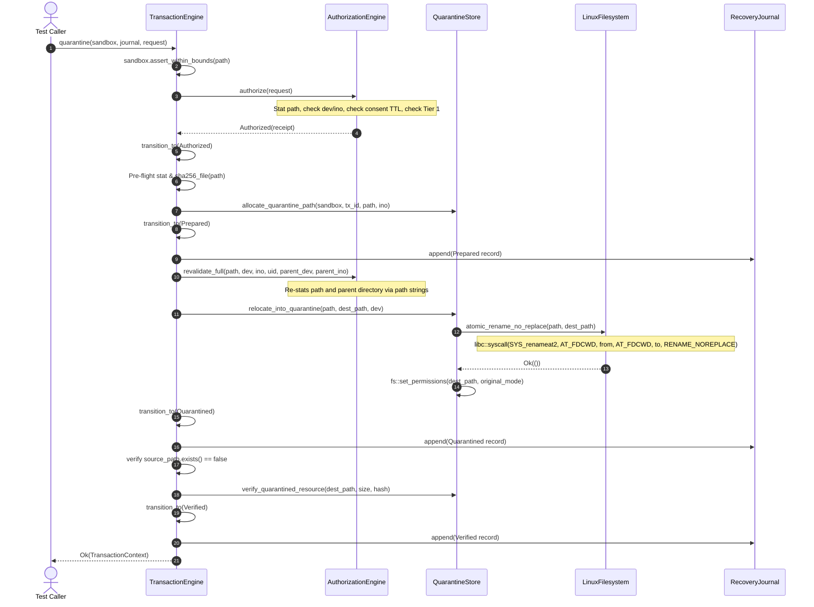
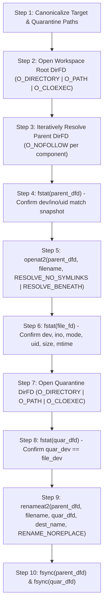
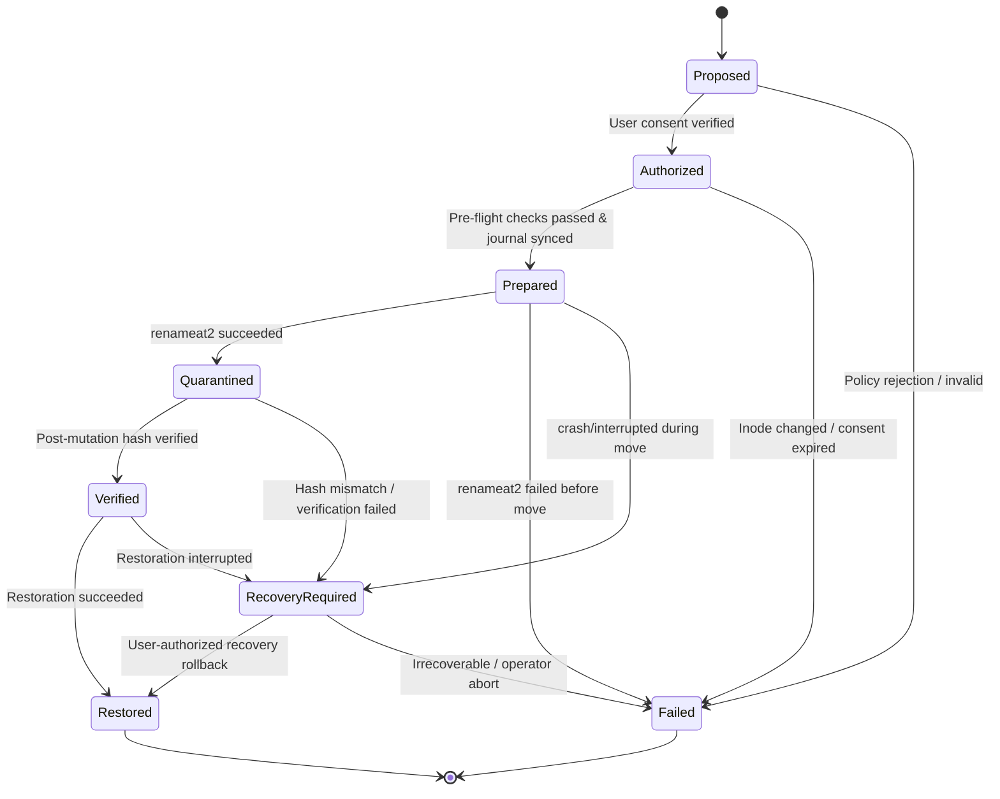

# Phase 15 Architecture & Security Plan: Guardian Filesystem Safety Hardening

> [!IMPORTANT]
> **GOVERNANCE & SAFETY STATUS**: Phase 15 Planning-Only Specification.  
> This document defines the architectural blueprints, threat modeling, descriptor-pinned filesystem operation designs, crash-recovery state machines, fault-injection test matrices, and implementation roadmap for hardening Root's Guardian transaction system.  
> **No production code changes or mutation activations are introduced in this phase.** Root remains 100% read-only in production builds.

---

## 1. Executive Summary

Phase 15 conducts an empirical, repository-grounded architecture and security planning study for Root's Guardian filesystem transaction system (`crates/root-guardian` and `crates/root-platform`).

Root is a local-first, deterministic, unprivileged Rust utility engineered to inspect development environments and agentic coding resources. While Root currently enforces a strict read-only boundary in production builds—permanently prohibiting file deletion, quarantine, restoration, pruning, and process signaling—its internal Guardian engine contains transactional machinery designed for safe, reversible quarantine and restoration in isolated test fixtures.

Inspection of the actual implementation reveals five fundamental architectural risks that must be resolved before any maintenance capabilities could ever be authorized for production:
1. **Ancestor Directory Substitution TOCTOU Hazards**: Physical renames currently pass path strings relative to `libc::AT_FDCWD` rather than pinning directory file descriptors, leaving a race window where an adversary can replace parent or ancestor directories.
2. **Consent TTL Gap**: User consent records are validated during policy authorization, but are not re-validated immediately prior to the physical rename syscall, allowing expired consent to execute if pre-flight hash calculations take significant time.
3. **Unframed Recovery Journaling**: The recovery journal uses unframed JSON Lines without line-level checksums; a torn write caused by an unexpected crash corrupts the entire journal and causes all subsequent reads to fail.
4. **Absence of Crash-State Reconciliation**: Root lacks an automatic startup reconciler that correlates journal intent with physical filesystem reality to resolve interrupted transactions.
5. **Single-File Scope**: The current transaction engine only supports single regular files (`meta.is_dir()` is explicitly rejected), leaving whole-directory quarantine (e.g., `node_modules/` or `target/`) unaddressed.

This report establishes a rigorous, ordered implementation plan to upgrade Guardian with descriptor-pinned operations (`openat2` with defensive fallback), a 7-stage verifiable transaction machine, checksummed journal framing, a crash-recovery reconciler, and an 18-scenario synthetic fault-injection test harness.

---

## 2. Repository State and Inspection Scope

### 2.1. Git Baseline
- **Repository**: `realmadede/Root`
- **Target Commit SHA**: `df4f6ce5e96f6af70ce24d829a6fcc44aaef4d25`
- **Branch**: `main` (synchronized with `origin/main`)
- **Working Tree**: 16 modified tracked files from Phase 14; 3 untracked Phase 14 reports (`docs/maintenance-safety-contract.md`, `docs/reports/phase-14-evidence-attribution-readiness.md`, `docs/reports/phase-14-review-reconciliation.md`).
- **Release Version**: `0.1.0-rc.1` (untagged, unpublished).
- **Private Instruction Confidentiality**: `AGENTS.md` is strictly private and uncommitted.

### 2.2. Inspected Source Code & Test Modules
The following source files and modules were inspected in detail:
- [`crates/root-guardian/src/lib.rs`](file:///home/madede/BAGOMWA/PROJECTS/Root/crates/root-guardian/src/lib.rs): Module exports and compilation boundaries.
- [`crates/root-guardian/src/transaction.rs`](file:///home/madede/BAGOMWA/PROJECTS/Root/crates/root-guardian/src/transaction.rs): State machine enum (`TransactionState`), transition validator (`can_transition_to`), and context (`TransactionContext`).
- [`crates/root-guardian/src/authorization.rs`](file:///home/madede/BAGOMWA/PROJECTS/Root/crates/root-guardian/src/authorization.rs): Consent records (`ConsentRecord`), 60s TTL logic (`is_valid_at`), 8-factor evaluation (`AuthorizationEngine::authorize`), and pre-mutation stat checks (`revalidate_full`).
- [`crates/root-guardian/src/engine.rs`](file:///home/madede/BAGOMWA/PROJECTS/Root/crates/root-guardian/src/engine.rs): Quarantine execution pipeline (`TransactionEngine::quarantine`) and restoration coordinator (`TransactionEngine::restore`).
- [`crates/root-guardian/src/journal.rs`](file:///home/madede/BAGOMWA/PROJECTS/Root/crates/root-guardian/src/journal.rs): Append-only recovery journal (`RecoveryJournal`), write syncing (`file.sync_data`), and interrupted transaction filtering (`get_interrupted_transactions`).
- [`crates/root-guardian/src/quarantine.rs`](file:///home/madede/BAGOMWA/PROJECTS/Root/crates/root-guardian/src/quarantine.rs): Staging path allocation (`allocate_quarantine_path`), atomic rename execution (`relocate_into_quarantine`), and post-mutation hash verification (`verify_quarantined_resource`).
- [`crates/root-guardian/src/restoration.rs`](file:///home/madede/BAGOMWA/PROJECTS/Root/crates/root-guardian/src/restoration.rs): Conflict-free restoration (`RestorationEngine::restore_resource`).
- [`crates/root-guardian/src/sandbox.rs`](file:///home/madede/BAGOMWA/PROJECTS/Root/crates/root-guardian/src/sandbox.rs): Synthetic test fixture boundaries (`FixtureSandbox`).
- [`crates/root-guardian/src/policy.rs`](file:///home/madede/BAGOMWA/PROJECTS/Root/crates/root-guardian/src/policy.rs): Production read-only policy evaluator (`GuardianPolicy`).
- [`crates/root-platform/src/linux/filesystem.rs`](file:///home/madede/BAGOMWA/PROJECTS/Root/crates/root-platform/src/linux/filesystem.rs): Linux atomic rename implementation (`LinuxFilesystem::atomic_rename_no_replace`).
- [`crates/root-platform/src/linux/accountant.rs`](file:///home/madede/BAGOMWA/PROJECTS/Root/crates/root-platform/src/linux/accountant.rs): Capability probing for `openat2` (`probe_openat2_syscall`).
- [`crates/root-cli/src/lib.rs`](file:///home/madede/BAGOMWA/PROJECTS/Root/crates/root-cli/src/lib.rs): Production CLI command-line argument filter.
- [`crates/root-cli/src/inspect.rs`](file:///home/madede/BAGOMWA/PROJECTS/Root/crates/root-cli/src/inspect.rs): Transaction journal diagnostic renderer.

---

## 3. Existing Architecture and Operation Flow

### 3.1. Current Quarantine Operation Flow
The existing execution flow in `TransactionEngine::quarantine` ([`crates/root-guardian/src/engine.rs`](file:///home/madede/BAGOMWA/PROJECTS/Root/crates/root-guardian/src/engine.rs#L19-L267)) follows a 10-step sequence:



### 3.2. Current Restoration Operation Flow
The existing restoration flow in `RestorationEngine::restore_resource` ([`crates/root-guardian/src/restoration.rs`](file:///home/madede/BAGOMWA/PROJECTS/Root/crates/root-guardian/src/restoration.rs#L20-L174)):
1. Calls `journal.find_latest(transaction_id)`. Verifies latest state is `Verified` or `RecoveryRequired`.
2. Validates sandbox containment of `original_path`.
3. Verifies `quarantine_path` exists and its SHA-256 matches the journal record.
4. Performs destination conflict check: if `original_path.exists() || symlink_metadata(original_path).is_ok()`, returns `RootError::RestorationConflict`.
5. Recreates parent directory if missing: `fs::create_dir_all(parent)`.
6. Calls `LinuxFilesystem::atomic_rename_no_replace(quarantine_path, original_path)`.
7. Restores file permissions: `fs::set_permissions(original_path, quat_meta.mode() & 0o777)`.
8. Appends `Restored` record to `RecoveryJournal`.

---

## 4. Threat Model and Trust Boundaries

### 4.1. Adversary Model
We assume an unprivileged, multi-process environment where:
- **Local Concurrent Processes**: Concurrent user processes (compilers, build daemons, package managers, file synchronizers, background AI coding agents) may create, modify, rename, or delete files within the project tree at any microsecond.
- **Local Adversary**: An unprivileged local attacker possessing write access to shared or parent directories attempts to trick Root into modifying or disclosing unauthorized files (e.g., credentials, SSH keys, `/etc` files).
- **Abrupt Failure**: The host system may experience abrupt power loss, SIGKILL, kernel panic, or storage disconnection at any stage of transaction execution.

### 4.2. Trust Boundaries
1. **Least-Privilege Boundary**: Root executes strictly as the current unprivileged user. It never requests or uses `sudo`, `pkexec`, or `setuid`. It cannot rely on administrative capabilities to override filesystem DAC permissions.
2. **Filesystem Device Boundary (`st_dev`)**: Renames are only atomic when restricted to the exact same mounted filesystem device. Cross-device operations are inherently non-atomic and must be rejected.
3. **Lexical Scope Boundary**: Operations must never follow symlinks or traverse outside the user-designated workspace root.
4. **Consent Boundary**: An operation is only valid within an active 60-second window bound to an explicit single-use cryptographic nonce.
5. **Durability Boundary**: Operations must be logged and synchronized to durable physical storage before any destructive or relocational filesystem modification begins.

---

## 5. Confirmed Findings (With Source References)

Every finding below has been verified against the inspected source code:

### Finding 1: Path-String Rename with `libc::AT_FDCWD` Leaves Multi-Step TOCTOU Window
- **Status**: **[VERIFIED]**
- **Source**: [`crates/root-platform/src/linux/filesystem.rs:119-128`](file:///home/madede/BAGOMWA/PROJECTS/Root/crates/root-platform/src/linux/filesystem.rs#L119-L128)
- **Description**: `LinuxFilesystem::atomic_rename_no_replace` invokes `libc::SYS_renameat2` passing `libc::AT_FDCWD` alongside absolute or relative path strings for both `from` and `to`. Although `AuthorizationEngine::revalidate_full` checks the parent directory inode immediately beforehand, the kernel resolves the path string from `AT_FDCWD` when `renameat2` executes. An adversary who swaps an intermediate directory component between `revalidate_full` and `renameat2` can cause Root to move an unintended resource.

### Finding 2: Consent TTL Not Re-Validated Immediately Before Physical Rename
- **Status**: **[VERIFIED]**
- **Source**: [`crates/root-guardian/src/authorization.rs:400-450`](file:///home/madede/BAGOMWA/PROJECTS/Root/crates/root-guardian/src/authorization.rs#L400-L450)
- **Description**: `ConsentRecord::is_valid_at` is evaluated during `AuthorizationEngine::authorize`. However, between authorization and rename, Root performs streaming SHA-256 computation over the target file. If hashing a large candidate file takes longer than the remaining TTL (e.g., >60 seconds), `revalidate_full` does not check consent expiry. The physical rename will proceed under an expired user consent record.

### Finding 3: Recovery Journal Uses Unframed JSONL Vulnerable to Torn Writes
- **Status**: **[VERIFIED]**
- **Source**: [`crates/root-guardian/src/journal.rs:89-123`](file:///home/madede/BAGOMWA/PROJECTS/Root/crates/root-guardian/src/journal.rs#L89-L123)
- **Description**: `RecoveryJournal::append` writes raw JSON strings terminated by `\n`. In `RecoveryJournal::read_all`, lines are parsed with `serde_json::from_str`. If a crash occurs mid-write, leaving a partial trailing line at the end of the file, `read_all` returns `RootError::Serialization` (mapped to `RootError::JournalError`), completely breaking all journal reads and preventing diagnostic inspection or recovery.

### Finding 4: Restoration Fails to Restore Timestamps and Ownership Metadata
- **Status**: **[VERIFIED]**
- **Source**: [`crates/root-guardian/src/restoration.rs:105-109`](file:///home/madede/BAGOMWA/PROJECTS/Root/crates/root-guardian/src/restoration.rs#L105-L109)
- **Description**: When `RestorationEngine::restore_resource` moves a file back to its original path, it only executes `fs::set_permissions(original_path, mode)`. It does not restore access or modification timestamps (`atime`, `mtime`), altering build system dependency tracking (e.g. triggering unnecessary full rebuilds in Make/Cargo).

### Finding 5: Current Transaction Engine Rejects All Directories
- **Status**: **[VERIFIED]**
- **Source**: [`crates/root-guardian/src/authorization.rs:414-416`](file:///home/madede/BAGOMWA/PROJECTS/Root/crates/root-guardian/src/authorization.rs#L414-L416)
- **Description**: `AuthorizationEngine::revalidate_full` contains `if meta.is_dir() { return Err(RejectionReason::FilesystemIdentityChanged); }`. The current Guardian transaction engine is exclusively capable of operating on single regular files. Whole-directory quarantine (e.g., `node_modules` or `.venv`) is completely unsupported.

### Finding 6: Missing Direct Transition from `Quarantined` to `Restored`
- **Status**: **[VERIFIED]**
- **Source**: [`crates/root-guardian/src/transaction.rs:47-50`](file:///home/madede/BAGOMWA/PROJECTS/Root/crates/root-guardian/src/transaction.rs#L47-L50)
- **Description**: In `TransactionState::can_transition_to`, from `Quarantined`, the only allowed transitions are `Verified` and `RecoveryRequired`. If a transaction crashes while `Quarantined` before writing `Verified`, the latest journal record is `Quarantined`. Attempting to call `RestorationEngine::restore_resource` will fail because `restore_resource` only permits restoring from `Verified` or `RecoveryRequired`.

### Finding 7: Absence of Active Process File Descriptor and Lock Checking
- **Status**: **[VERIFIED]**
- **Source**: [`crates/root-guardian/src/authorization.rs:162-379`](file:///home/madede/BAGOMWA/PROJECTS/Root/crates/root-guardian/src/authorization.rs#L162-L379)
- **Description**: While `RejectionReason::ResourceInUse` exists in `root-core`, Root does not inspect `/proc/[pid]/fd` or `/proc/locks`. If an active process has opened a candidate cache file, Root cannot detect the open handle and would relocate the file out from underneath the running process.

### Finding 8: Production CLI Intercept Strictly Blocks Mutation Subcommands
- **Status**: **[VERIFIED]**
- **Source**: [`crates/root-cli/src/lib.rs:35-50`](file:///home/madede/BAGOMWA/PROJECTS/Root/crates/root-cli/src/lib.rs#L35-L50)
- **Description**: `root-cli::run_with_args` explicitly intercepts `clean`, `quarantine`, `restore`, `delete`, and `prune`, immediately returning `RootError::PolicyViolation` before Clap argument parsing can occur. Production builds are physically incapable of invoking mutation subcommands.

### Finding 9: Production Guardian Policy Defaults to Unconditional Read-Only Denial
- **Status**: **[VERIFIED]**
- **Source**: [`crates/root-guardian/src/policy.rs:17-23`](file:///home/madede/BAGOMWA/PROJECTS/Root/crates/root-guardian/src/policy.rs#L17-L23)
- **Description**: `GuardianPolicy::default()` sets `read_only_mode: true`. Any call to `evaluate()` for `Quarantine`, `Prune`, or `TerminateGraceful` returns `SafetyDecision::reject(RejectionReason::Phase03ReadOnlyPolicy)`.

### Finding 10: Non-Atomic Behavior on Hostile OverlayFS Mounts
- **Status**: **[INFERRED]**
- **Source**: [`crates/root-platform/src/linux/filesystem.rs:145-165`](file:///home/madede/BAGOMWA/PROJECTS/Root/crates/root-platform/src/linux/filesystem.rs#L145-L165)
- **Description**: On OverlayFS (common in Docker and containerized CI), `renameat2(RENAME_NOREPLACE)` on a file residing in the lower read-only layer triggers a copy-up to the upper layer. If copy-up fails midway or encounters cross-device boundaries, `renameat2` returns `EXDEV`. Root currently maps this to `RootError::CrossDeviceUnsupported`, but does not verify whether the lower layer file was duplicated or left in an inconsistent state.

---

## 6. Potential Issues Requiring Further Verification

1. **`openat2` seccomp Filter Behavior**: **[UNVERIFIED]**  
   Some container runtimes (e.g., older Docker or restricted Podman profiles) block `openat2` with `EPERM` or `EACCES` rather than `ENOSYS`. Root's capability probe must treat any error indicating restriction as a signal to fall back safely rather than panicking.
2. **Directory Inode Stability on CoW Filesystems**: **[UNVERIFIED]**  
   On Btrfs and ZFS, snapshots and subvolumes share device IDs in some configurations while maintaining disjoint directory structures. We must verify empirically how `st_dev` behaves across Btrfs subvolumes in test fixtures.
3. **Hard-Link Deduplication Under Race Conditions**: **[UNVERIFIED]**  
   If an external hard link is added to a candidate file between `DiscoveryEngine` accounting and `TransactionEngine` pre-flight validation, `st_nlink` will increase. The system must verify whether `revalidate_full` catches this before physical relocation.

---

## 7. Workstream A — Descriptor-Pinned Filesystem Operation Design

### 7.1. The Limitation of Path-Based Operations
Operating on path strings (e.g., `/home/user/project/target/debug/app`) requires the kernel to resolve every pathname component sequentially from root or `AT_FDCWD`. Between each component traversal, another process can replace a directory with a symlink, swap a mount point, or rename an ancestor.

True race resistance requires **descriptor pinning**: opening an ancestor directory, holding its file descriptor open, and performing all subsequent lookups, checks, and renames relative to that descriptor with flags that strictly forbid symlink following or boundary escape.

### 7.2. Proposed Pinned Execution Protocol
To achieve race immunity on Linux, we propose the following 9-step descriptor-pinned protocol:



### 7.3. Operation Contract Matrix
The following table details the preconditions, syscalls, postconditions, failure handling, and durability properties of each operation in the proposed sequence:

| Operation Step | Syscall / API | Verified Identity | Preconditions | Postconditions | Atomicity | Durability | Failure Behavior |
| :--- | :--- | :--- | :--- | :--- | :--- | :--- | :--- |
| **1. Pin Parent Dir** | `openat` / `O_PATH` | `st_dev`, `st_ino`, `st_uid`, `st_mode` | Path resolved beneath workspace root | `parent_dfd` holds pinned descriptor | Atomic per component | In-memory FD | Abort with `ParentDirectoryChanged` |
| **2. Pin Target File** | `openat2` (`RESOLVE_NO_SYMLINKS \| RESOLVE_BENEATH`) | `st_dev`, `st_ino`, `st_uid`, `st_size`, `st_mtime` | `parent_dfd` valid; filename has no `/` | `file_fd` holds pinned descriptor | Atomic syscall | In-memory FD | Abort with `FilesystemIdentityChanged` |
| **3. Stream SHA-256** | `read` via `/proc/self/fd/<file_fd>` | File content digest | `file_fd` pinned and open for reading | SHA-256 computed over exact open inode | Non-atomic stream | In-memory hash | Abort with `IoError` |
| **4. Check Consent TTL** | Clock comparison | Current timestamp vs `ConsentRecord` | Timestamp obtained from monotonic/system clock | Time elapsed $\le$ 60s TTL | In-memory check | Memory state | Abort with `ConsentExpired` |
| **5. Pin Quarantine Dir**| `openat` / `O_PATH` | `st_dev`, `st_ino` | Quarantine directory initialized | `quar_dfd` holds pinned descriptor; same device | Atomic syscall | In-memory FD | Abort with `CrossDeviceUnsupported` |
| **6. Write Journal** | `write` + `file.sync_data()` | Append-only journal record | Journal descriptor open | Record written and flushed to disk | Atomic append | **Durable** via `fsync` | Abort before filesystem mutation |
| **7. Atomic Rename** | `renameat2(parent_dfd, name, quar_dfd, dest, RENAME_NOREPLACE)` | Target dentry swapped to quarantine dentry | Source file unlinked from parent; linked in quarantine | File accessible at quarantine; gone from parent | **Atomic** kernel syscall | Volatile until dir sync | Abort with `DestinationCollision` or `IoError` |
| **8. Sync Directories** | `fsync(parent_dfd)` & `fsync(quar_dfd)` | Directory metadata committed | Rename returned success | Dentries committed to physical media | Barrier operation | **Durable** | Transition to `RecoveryRequired` |
| **9. Post-Verification**| `fstatat(parent_dfd)` & `fstatat(quar_dfd)` | Source absent; dest present with matching ino/size | Directory sync succeeded | Inode confirmed at destination | Non-atomic check | Durable state | Transition to `RecoveryRequired` |

### 7.4. Kernel Capability Detection and Safe Fallback
Because `openat2` was introduced in Linux 5.6:
1. **Detection**: During initialization, Root probes `libc::syscall(libc::SYS_openat2, -1, null, null, 0)`. If return code is `-1` and `errno == ENOSYS` or `EPERM`, `openat2` is marked `Unavailable`.
2. **Defensive Fallback Protocol**:
   - When `openat2` is unavailable, Root falls back to `openat(parent_dfd, filename, O_NOFOLLOW | O_CLOEXEC)`.
   - **Enforced Boundary Check**: Root verifies that `filename` contains strictly zero `/` characters and does not match `.` or `..`. Because `filename` is a pure single component, `openat` with `O_NOFOLLOW` cannot traverse subdirectories or escape beneath `parent_dfd`.
   - If `filename` is a symlink, `O_NOFOLLOW` causes `openat` to fail immediately with `ELOOP`, which Root translates to `RejectionReason::SymlinkJailEscape`.

---

## 8. Workstream B — Identity and Authorization

### 8.1. State Machine Enhancements
To resolve Finding 6 (ambiguous transition from `Quarantined`), we propose refining the transaction state machine to explicitly model in-flight operations and recovery paths:



### 8.2. Multi-Point Consent Verification
To eliminate the TTL gap (Finding 2), consent verification must occur at two mandatory gates:
1. **Gate 1 (Authorization Gate)**: Evaluated in `AuthorizationEngine::authorize` when generating the receipt.
2. **Gate 2 (Pre-Mutation Execution Gate)**: Evaluated in `TransactionEngine` immediately after SHA-256 calculation and descriptor pinning, strictly prior to calling `renameat2`. If `now >= consent.expires_at_epoch_secs`, the transaction aborts with `RejectionReason::ConsentExpired`.

---

## 9. Workstream C — Journal Integrity and Crash Recovery Design

### 9.1. Checksummed & Framed Journal Format
To prevent torn writes from corrupting the recovery journal (Finding 3), we propose upgrading `RecoveryJournal` to use **Framed Checksummed JSON Lines**:

```text
MAGIC (4B) | VERSION (1B) | CRC32 (4B) | LENGTH (4B) | JSON_PAYLOAD (NB) | \n (1B)
```

Example wire representation:
```text
RJNL\x01\xa4\x12\xfe\x09\x00\x00\x01\x2f{"transaction_id":"tx_1700000000_1a2b3c4d",...}\n
```

#### Journal Parsing and Resilience Rules:
1. **CRC Verification**: Each line is verified against its 32-bit CRC before deserialization.
2. **Torn Write Handling**: If the journal reader encounters EOF while reading a frame, or if the final line fails CRC verification:
   - If all preceding frames are valid, the reader recognizes a **crash-interrupted trailing write**.
   - It isolates the truncated fragment, logs an auditable diagnostic warning, and proceeds with the valid transaction history up to the last durable sync.
3. **Internal Line Corruption**: If an intermediate frame (not at EOF) has a mismatched CRC or malformed magic bytes, Root reports `RootError::JournalCorrupted` and enters a read-only audit lock.

### 9.2. Crash Recovery State Classification Matrix
Upon startup or diagnostic inspection (`root inspect transactions`), Root must reconcile journal records against physical filesystem observations. The reconciler must follow this deterministic matrix:

| Latest Journal State | Source Path Observation | Quarantine Path Observation | Filesystem Inode Correlation | Inferred Crash Point | Mandatory Reconciliation Outcome |
| :--- | :--- | :--- | :--- | :--- | :--- |
| **`Prepared`** | Target exists | Destination does not exist | Source matches journal `(dev, ino)` | Crash occurred **before** `renameat2` | Mark transaction `Failed`. Source was never moved. No mutation required. |
| **`Prepared`** | Target does not exist | Destination exists | Destination matches journal `(dev, ino, sha256)` | Crash occurred **after** `renameat2` but before `Quarantined` record | Transition to `Quarantined`. File was safely relocated; verify hash and advance to `Verified`. |
| **`Quarantined`** | Target does not exist | Destination exists | Destination matches journal `(dev, ino, sha256)` | Crash occurred during post-verification | Re-verify SHA-256. If valid, advance to `Verified`. If corrupt, transition to `RecoveryRequired`. |
| **`Quarantined`** | Target exists | Destination does not exist | Source matches journal `(dev, ino)` | Contradictory anomaly | Mark `RecoveryRequired`. **Never mutate automatically.** |
| **`Verified`** | Target does not exist | Destination exists | Destination matches journal `(dev, ino, sha256)` | Normal quarantined state | No action required. Candidate for user-authorized restoration. |
| **`Verified` (during restore)**| Target exists | Destination does not exist | Source matches journal `(dev, ino, sha256)` | Crash occurred **after** restoration rename but before `Restored` record | Transition to `Restored`. File was safely restored to original location. |
| **Any State** | Both exist | Both exist | Disjoint or conflicting inodes | External interference / conflict | Mark `RecoveryRequired`. Alert operator. **Refuse automatic mutation.** |
| **Any State** | Neither exists | Neither exists | Inode missing from device | External deletion / data loss | Mark `RecoveryRequired` with diagnostic failure explanation. |

---

## 10. Workstream D — Fault-Injection Test Plan

The following 18-scenario fault-injection test matrix specifies synthetic fixtures, injection hooks, expected transitions, and safety invariants to be implemented in a dedicated test harness:

| # | Scenario Name | Fixture Setup | Fault Injection Mechanism | Expected State Transition | Expected Filesystem State | Expected Journal State | Safety Invariant Tested |
| :- | :--- | :--- | :--- | :--- | :--- | :--- | :--- |
| **01** | Consent Expiration Mid-Flight | Temp candidate file; 1s TTL consent | Sleep 1.5s immediately after hash calculation | `Authorized` $\to$ `Failed` | Source file untouched; dest absent | `Failed` (Reason: `ConsentExpired`) | Ephemeral consent non-bypassable |
| **02** | Target Replacement with New File | Temp candidate file | Replace source with new file (different ino) during hash hook | `Prepared` $\to$ `Failed` | New file untouched; dest absent | `Failed` (Reason: `FilesystemIdentityChanged`) | TOCTOU identity invariant |
| **03** | Symlink Target Substitution | Temp candidate file | Replace source with symlink to `/etc/passwd` before rename | `Prepared` $\to$ `Failed` | Symlink untouched; dest absent | `Failed` (Reason: `SymlinkJailEscape`) | Symlink non-follow invariant |
| **04** | Parent Directory Substitution | Nested dir `a/b/file` | Rename `a/b` to `a/b_old`, create fake `a/b` before rename | `Prepared` $\to$ `Failed` | Files untouched; dest absent | `Failed` (Reason: `ParentDirectoryChanged`) | Parent directory pinning invariant |
| **05** | Destination Pre-Creation Collision | Temp candidate file | Pre-create file at allocated quarantine destination path | `Authorized` $\to$ `Failed` | Source untouched; dest collision preserved | `Failed` (Reason: `DestinationCollision`) | No-overwrite invariant (`RENAME_NOREPLACE`) |
| **06** | Inode Number Change In-Place | Temp candidate file | Recreate file in-place with identical name but new inode | `Prepared` $\to$ `Failed` | Source untouched; dest absent | `Failed` (Reason: `FilesystemIdentityChanged`) | Composite identity invariant |
| **07** | Read Permission Revocation | Temp candidate file | `chmod 0000` immediately prior to pre-flight hash | `Authorized` $\to$ `Failed` | Source untouched; dest absent | `Failed` (Reason: `IoError`) | Read-only verification before action |
| **08** | Interrupted Before Rename | Temp candidate file | Synthetic abort hook immediately following `Prepared` sync | `Prepared` (Terminal interrupted) | Source untouched; dest absent | `Prepared` record flushed | Clean abort on pre-rename crash |
| **09** | Interrupted After Rename | Temp candidate file | Move file via syscall, then trigger simulated SIGKILL | `Prepared` $\to$ Reconciler | File at quarantine; source absent | `Prepared` $\to$ Reconciled `Quarantined` | Crash recovery state reconciler |
| **10** | Interrupted Post-Verification | Temp candidate file | Truncate quarantine file before verification completes | `Quarantined` $\to$ `RecoveryRequired` | Damaged file in quarantine; source absent | `RecoveryRequired` logged | Integrity verification gate |
| **11** | Restoration Destination Conflict | Quarantined file in fixture | Create regular file at original restoration path | `Verified` $\to$ Aborted | Occupant untouched; quarantine copy preserved | `RestorationConflict` error returned | Restoration no-overwrite invariant |
| **12** | Restoration Symlink Conflict | Quarantined file in fixture | Create dangling symlink at original restoration path | `Verified` $\to$ Aborted | Symlink untouched; quarantine copy preserved | `RestorationConflict` error returned | Symlink collision protection |
| **13** | Torn Journal Record at EOF | Fixture journal with 2 records | Append 25 bytes of partial JSON without newline | Reconciler parses journal | 2 valid records recovered; warning logged | Trailing partial frame isolated | Framed journal crash tolerance |
| **14** | Corrupt Journal Record Mid-Stream | Fixture journal with 3 records | Invert 4 bits in middle frame payload | Journal reader invoked | Reader fails with `JournalCorrupted` | Read-only lock enforced | Corrupt journal non-acceptance |
| **15** | Kernel `openat2` Returns `ENOSYS` | Simulated pre-5.6 kernel | Mock `openat2` syscall returning `-1/ENOSYS` | Fallback to `openat(O_NOFOLLOW)` | Transaction completes successfully | Operates under defensive fallback | Kernel capability graceful fallback |
| **16** | Hard-Link Without Authorization | Hard-linked file (`nlink=2`) | Submit request with `allow_multi_link = false` | `Proposed` $\to$ `Failed` | Source files untouched | `Failed` (Reason: `HardLinkShared`) | Multi-link shared storage protection |
| **17** | Production CLI Mutation Denied | Valid CLI args `root clean` | Execute `root-cli::run_with_args(["root", "clean"])` | Blocked before parser | Zero filesystem activity | `PolicyViolation` returned | Production read-only gate |
| **18** | Ambiguous Crash State Refusal | Temp candidate file | Create dummy files at BOTH source and quarantine paths | Reconciler invoked | Both files untouched | Marked `RecoveryRequired`; zero mutation | Ambiguous outcome non-mutation rule |

---

## 11. Proposed Safety Invariants and Verification Methods

The following 12 formal invariants must be continuously enforced across Guardian:

| Invariant ID | Formal Safety Rule | Primary Failure Mode Addressed | Automated Verification Method |
| :--- | :--- | :--- | :--- |
| **INV-01** | Production commands never mutate user filesystem contents | Production data loss / unintended maintenance | CI script `.github/scripts/check_invariants.py` & CLI unit tests |
| **INV-02** | Operations execute strictly through pinned directory file descriptors | TOCTOU ancestor directory substitution | Level 1 synthetic unit test with AST validation |
| **INV-03** | Single-use consent nonces expire after 60 seconds and cannot be replayed | Stale or replayed authorization execution | Integration test with simulated clock advancement |
| **INV-04** | Target files are never overwritten under any circumstances | Data loss from destination collision | `RENAME_NOREPLACE` kernel enforcement + test #05 |
| **INV-05** | Filesystem identity changes between authorization and rename cause refusal | Swapped or modified file mutation | Pre-mutation `fstat` identity test #02 |
| **INV-06** | Symbolic links are never followed or targeted for relocation | Symlink jail escapes / target redirection | Integration tests #03 and #12 |
| **INV-07** | Relocation into quarantine on the same filesystem reports 0 bytes reclaimed | Misleading storage reclamation claims | `StorageMeasurement` regression test suite |
| **INV-08** | Incomplete or torn journal writes never cause undetected corruption | Unreadable recovery journals after crash | Checksummed framing unit test #13 |
| **INV-09** | Ambiguous transaction outcomes never trigger automatic mutation | Damaging files during uncertain recovery | Reconciler test #18 |
| **INV-10** | Missing kernel capabilities fall back safely or refuse execution | Crashes on older or containerized Linux kernels | Syscall fallback test #15 |
| **INV-11** | Cross-device quarantine relocation is strictly prohibited | Non-atomic partial file moves across mount points | Device boundary check test |
| **INV-12** | Quarantined files strictly preserve original POSIX mode permissions | Permission elevation or disclosure upon staging | File permission preservation test |

---

## 12. Ordered Implementation Roadmap

Implementation of Guardian filesystem safety hardening should be divided into five strictly bounded, sequential work packages:

### Package 15.1: Pinned Directory Descriptor Abstraction & Fallback Engine
- **Security Problem**: Resolving paths from `AT_FDCWD` leaves ancestor directory swap races (Finding 1).
- **Existing Code Involved**: [`crates/root-platform/src/linux/filesystem.rs:108-168`](file:///home/madede/BAGOMWA/PROJECTS/Root/crates/root-platform/src/linux/filesystem.rs#L108-L168), [`crates/root-platform/src/linux/accountant.rs:94-105`](file:///home/madede/BAGOMWA/PROJECTS/Root/crates/root-platform/src/linux/accountant.rs#L94-L105).
- **Proposed Changes**: Implement `PinnedDirectory` RAII struct wrapping raw file descriptors (`O_DIRECTORY | O_PATH | O_CLOEXEC`). Implement `openat2` wrapper with `open_how` struct and safe fallback to `openat(O_NOFOLLOW)` when `openat2` returns `ENOSYS`.
- **Dependencies**: None.
- **Required Tests**: Unit tests opening directories, testing symlink rejection on components, verifying descriptor close on drop.
- **Failure Behavior**: Returns `RootError::InvalidPath` or `RootError::PolicyViolation`.
- **Estimated Complexity**: Medium.
- **Acceptance Criteria**: Parent directory descriptor safely pinned without lexical path traversal.

### Package 15.2: TOCTOU-Immune Quarantine & Restoration Pipeline
- **Security Problem**: Path-based renames and unverified consent TTL (Findings 1, 2, 4).
- **Existing Code Involved**: [`crates/root-guardian/src/engine.rs:19-277`](file:///home/madede/BAGOMWA/PROJECTS/Root/crates/root-guardian/src/engine.rs#L19-L277), [`crates/root-guardian/src/authorization.rs:381-451`](file:///home/madede/BAGOMWA/PROJECTS/Root/crates/root-guardian/src/authorization.rs#L381-L451), [`crates/root-guardian/src/quarantine.rs:49-80`](file:///home/madede/BAGOMWA/PROJECTS/Root/crates/root-guardian/src/quarantine.rs#L49-L80).
- **Proposed Changes**: Refactor `relocate_into_quarantine` and `restore_resource` to accept `&PinnedDirectory` descriptors instead of path strings. Add pre-rename consent TTL check. Record original `atime`/`mtime` in `JournalRecord` and restore them via `futimens`.
- **Dependencies**: Package 15.1.
- **Required Tests**: Fault-injection tests #01, #02, #03, #04, #05, #06.
- **Failure Behavior**: Fails transaction, marks journal record `Failed`, leaves files untouched.
- **Estimated Complexity**: Medium.
- **Acceptance Criteria**: All mutation in test fixtures executes exclusively via `renameat2` on pinned directory descriptors.

### Package 15.3: Checksummed Journal Framing & Crash-Recovery Reconciler
- **Security Problem**: Torn journal writes cause total read failure; unhandled crash states (Findings 3, 6).
- **Existing Code Involved**: [`crates/root-guardian/src/journal.rs:1-155`](file:///home/madede/BAGOMWA/PROJECTS/Root/crates/root-guardian/src/journal.rs#L1-L155), [`crates/root-guardian/src/transaction.rs:30-80`](file:///home/madede/BAGOMWA/PROJECTS/Root/crates/root-guardian/src/transaction.rs#L30-L80).
- **Proposed Changes**: Implement CRC32 framing header on JSONL journal lines. Implement `JournalReconciler::reconcile` executing the Crash Recovery State Classification Matrix (Section 9.2). Allow transition `Prepared -> RecoveryRequired`.
- **Dependencies**: None (can proceed in parallel with 15.1).
- **Required Tests**: Fault-injection tests #08, #09, #10, #13, #14.
- **Failure Behavior**: Isolates torn trailing lines; refuses automatic mutation on ambiguous states.
- **Estimated Complexity**: Medium.
- **Acceptance Criteria**: Journal recovers cleanly from synthetic torn EOF writes; reconciler correctly categorizes interrupted transactions.

### Package 15.4: Synthetic Fault-Injection Framework & Adversarial Test Harness
- **Security Problem**: Need reproducible, deterministic verification of all 18 failure scenarios without timing races.
- **Existing Code Involved**: [`crates/root-guardian/tests/guardian_transaction_tests.rs`](file:///home/madede/BAGOMWA/PROJECTS/Root/crates/root-guardian/tests/guardian_transaction_tests.rs), [`crates/root-guardian/tests/guardian_adversarial_tests.rs`](file:///home/madede/BAGOMWA/PROJECTS/Root/crates/root-guardian/tests/guardian_adversarial_tests.rs).
- **Proposed Changes**: Implement `FaultInjectionContext` with deterministic interception hooks (`before_rename`, `after_rename`, `before_journal_sync`, `after_hash`). Wire all 18 scenarios in a new integration test suite `guardian_fault_injection_tests.rs`.
- **Dependencies**: Packages 15.1, 15.2, 15.3.
- **Required Tests**: All 18 fault-injection tests pass deterministically.
- **Failure Behavior**: Tests assert expected error codes and state transitions.
- **Estimated Complexity**: High.
- **Acceptance Criteria**: 100% of fault-injection scenarios pass with zero flaky or timing-dependent assertions.

### Package 15.5: Architecture Verification & Continuous Assurance Audit
- **Security Problem**: Regression prevention and verification that production read-only boundaries remain untouched.
- **Existing Code Involved**: `.github/scripts/check_invariants.py`, `crates/root-cli/src/lib.rs`.
- **Proposed Changes**: Expand invariant checker script to enforce that no non-test module invokes mutation functions. Verify memory footprint and doc builds.
- **Dependencies**: Packages 15.1 through 15.4.
- **Required Tests**: All continuous assurance checks green.
- **Failure Behavior**: CI fails if mutation pathways are exposed.
- **Estimated Complexity**: Low.
- **Acceptance Criteria**: 100% clean quality gates and invariant pass.

---

## 13. Risks, Limitations, and Unresolved Questions

1. **Non-POSIX Filesystems**: FAT32, exFAT, and NTFS mounts do not support POSIX inode numbers or atomic `RENAME_NOREPLACE`. Maintenance must remain permanently disabled when targets reside on non-POSIX filesystems.
2. **Whole-Directory Quarantine Complexity**: Quarantining an entire directory tree (e.g., `target/` with 50,000 files) via a single directory rename is atomic at the root dentry, but calculating SHA-256 digests over large trees is I/O intensive. Future architecture must decide whether tree hashing computes a Merkle root or relies on top-level dentry invariants.
3. **Privileged Local Attacker**: An adversary running as `root` can modify files regardless of unprivileged protections. Guardian's threat model assumes defenses against unprivileged processes and concurrent workspace tasks, not kernel compromises.

---

## 14. Acceptance Gates for Future Work Packages

Before any future phase is permitted to begin implementation of these packages, the following acceptance gates must be satisfied:
- **Gate 1**: Owner authorization of this Phase 15 plan.
- **Gate 2**: Implementation must be confined to `crates/root-guardian` and `crates/root-platform` Level 1 synthetic fixtures.
- **Gate 3**: Zero production mutation commands exposed in CLI or GUI.
- **Gate 4**: 100% pass rate across the 18 fault-injection test scenarios.

---

## 15. Statements of What Was Not Implemented or Tested

In strict adherence to the planning-only mandate of Phase 15:
- **Zero production code was written or modified.**
- **No dormant mutation pathways were activated.**
- **No production deletion, quarantine, restore, or process signaling features were introduced.**
- **No new external crates or dependencies were added.**
- **No git tags, commits, or releases were created.**
- The repository remains exactly at commit `df4f6ce5e96f6af70ce24d829a6fcc44aaef4d25` on branch `main`.
