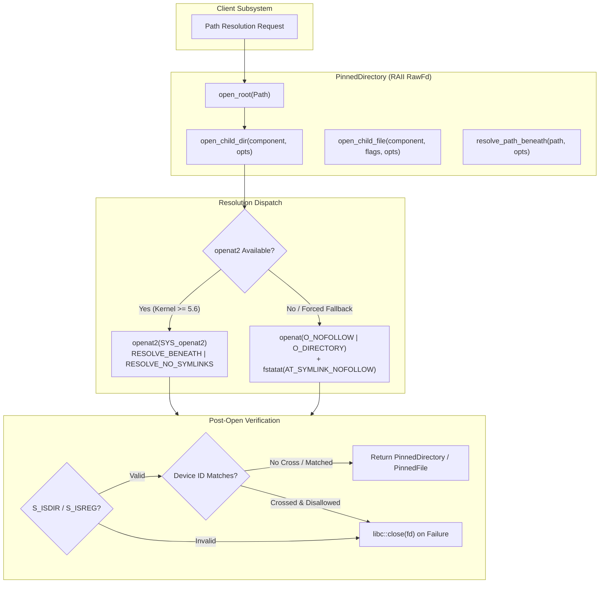

# Work Package 15.1 Completion Report: Pinned Directory Descriptor Abstraction and Linux Resolution Safety

> [!IMPORTANT]
> **GOVERNANCE & PRODUCTION READ-ONLY INVARIANT**:
> This report documents the completion of Work Package 15.1: the Linux pinned directory descriptor abstraction and resolution safety primitives implemented within `crates/root-platform`.
> **Zero production mutation capabilities have been introduced, exposed, or enabled.**
> Production inspection remains strictly read-only. This abstraction has **not** been integrated into Guardian quarantine, restoration, or any production mutation pathway.

---

## 1. Executive Summary

Work Package 15.1 establishes a hardened, descriptor-relative Linux filesystem abstraction (`crates/root-platform/src/linux/descriptor.rs`) to address ancestor directory substitution TOCTOU (Time-of-Check to Time-of-Use) hazards and symlink traversal vulnerabilities.

The abstraction provides:
1. **`PinnedDirectory`**: An RAII wrapper around a non-negative Linux directory file descriptor, opened with `O_RDONLY | libc::O_DIRECTORY | libc::O_CLOEXEC | libc::O_NOFOLLOW`. It validates with `fstat` that the opened target is a directory, extracts verified object identity (`DirectoryIdentity`), and guarantees deterministic descriptor closure on drop.
2. **`PinnedFile`**: An RAII wrapper around a regular file descriptor opened relative to a pinned directory, enforcing that target objects are regular files and not symlinks or directories.
3. **Dual Resolution Architecture**:
   - **Modern Path (`openat2`)**: Invoked when the running Linux kernel supports `SYS_openat2` (kernel >= 5.6). Applies flags `RESOLVE_BENEATH`, `RESOLVE_NO_SYMLINKS`, `RESOLVE_NO_MAGICLINKS`, and conditionally `RESOLVE_NO_XDEV`.
   - **Defensive Fallback Path (`openat` + `fstatat`)**: Active on older kernels or when explicitly configured. Validates single components strictly (rejecting slashes, null bytes, `.`, and `..`), pins the target descriptor, and verifies device identity to prevent mount-crossing races.
4. **Iterative Path Resolution (`resolve_path_beneath`)**: Safely walks multi-component paths step-by-step beneath a pinned directory, disallowing `..` escape sequences and enforcing boundary invariants at every hop.

---

## 2. Repository Baseline and Modification Scope

- **Repository**: `realmadede/Root`
- **Baseline Commit SHA**: `df4f6ce5e96f6af70ce24d829a6fcc44aaef4d25`
- **Release Version**: `0.1.0-rc.1` (untagged, unpublished)
- **Branch**: `main`

### 2.1. Files Added and Modified
- [`crates/root-platform/src/linux/descriptor.rs`](file:///home/madede/BAGOMWA/PROJECTS/Root/crates/root-platform/src/linux/descriptor.rs): New module containing descriptor types (`PinnedDirectory`, `PinnedFile`, `DirectoryIdentity`, `ResolutionError`, `ResolutionOptions`, `ResolutionMode`, `OpenHow`, syscall wrappers).
- [`crates/root-platform/src/linux/mod.rs`](file:///home/madede/BAGOMWA/PROJECTS/Root/crates/root-platform/src/linux/mod.rs): Re-export of descriptor types.
- [`crates/root-platform/src/lib.rs`](file:///home/madede/BAGOMWA/PROJECTS/Root/crates/root-platform/src/lib.rs): Crate-level re-export of descriptor types on `target_os = "linux"`.
- [`crates/root-platform/tests/descriptor_tests.rs`](file:///home/madede/BAGOMWA/PROJECTS/Root/crates/root-platform/tests/descriptor_tests.rs): Comprehensive integration test suite containing 17 synthetic, isolated test cases.
- [`docs/reports/wp-15.1-pinned-directory-abstraction.md`](file:///home/madede/BAGOMWA/PROJECTS/Root/docs/reports/wp-15.1-pinned-directory-abstraction.md): This report.

### 2.2. Pre-Existing User Changes Preserved
All 16 tracked modified files and 4 documentation files from Phase 14 and Phase 15 planning remain intact and unmodified.

---

## 3. Architecture and Design Implementation

### 3.1. Structure of the Abstraction



### 3.2. Concrete Safety Invariants

1. **Strict Component Validation**: `open_child_dir` and `open_child_file` enforce single-component inputs. Paths containing `/`, null bytes, `.`, or `..` are immediately rejected with `ResolutionError::InvalidComponent` before calling any syscall.
2. **Deterministic Symlink Rejection**:
   - Under `openat2`, `RESOLVE_NO_SYMLINKS` instructs the Linux kernel to reject symlinks at any resolution point, returning `ELOOP` (mapped to `ResolutionError::SymlinkRejected`).
   - Under the fallback path, `openat` uses `O_NOFOLLOW`. In the Linux kernel, opening a symlink pointing to a directory with `O_DIRECTORY | O_NOFOLLOW` returns `ENOTDIR` because the dentry is an `S_IFLNK`. The fallback path inspects the component via `fstatat(..., AT_SYMLINK_NOFOLLOW)` upon `ENOTDIR`/`ELOOP` to disambiguate non-directory regular files from symbolic links, reliably returning `ResolutionError::SymlinkRejected`.
3. **Mount-Crossing Confinement**: When `allow_mount_crossing` is false, `openat2` passes `RESOLVE_NO_XDEV`. Both resolution engines verify post-open that `child_identity.device_id == parent_identity.device_id`, closing descriptors and returning `ResolutionError::MountBoundaryCrossed` on divergence.
4. **Descriptor Leak Elimination**: All error branches that obtain a raw descriptor prior to failing validation explicitly invoke `libc::close(fd)` before returning `Err`. Normal scope exit triggers the RAII `Drop` implementation, which invokes `libc::close(fd)`.

---

## 4. Test Verification and Evidence

All tests operate strictly on synthetic fixtures within isolated temporary directories (`tempfile::Builder`). No real user files, personal directories, or agent state are accessed.

### 4.1. Work Package 15.1 Integration Test Matrix (`descriptor_tests.rs`)

| Test Identifier | Description | Result |
|:---|:---|:---:|
| `test_01_successful_opening_real_directory_fixture` | Opens real directory, verifies valid non-negative fd and identity | PASSED |
| `test_02_rejection_of_regular_file` | Rejects opening regular file as root directory with `NotADirectory` | PASSED |
| `test_03_rejection_of_final_component_symlink` | Rejects opening symlink pointing to directory with `SymlinkRejected` | PASSED |
| `test_04_rejection_of_dot_and_dotdot` | Strictly rejects `.` and `..` child components | PASSED |
| `test_05_rejection_of_prohibited_multicomponent_paths` | Strictly rejects multi-component path strings containing slashes | PASSED |
| `test_06_correct_handling_of_nonexistent_paths` | Returns `NotFound` on missing components | PASSED |
| `test_07_permission_denied_behavior` | Accurately maps unreadable directories to `PermissionDenied` | PASSED |
| `test_08_correct_descriptor_closure_on_normal_drop` | Verifies descriptor is closed in kernel (`fcntl(fd, F_GETFD)` returns `EBADF`) on drop | PASSED |
| `test_09_error_path_descriptor_cleanup` | Executes 300 failed operations across error branches, verifying zero fd leak | PASSED |
| `test_10_descriptor_identity_reporting` | Confirms reported `DirectoryIdentity` matches POSIX `stat` metadata | PASSED |
| `test_11_openat2_supported_path_behavior` | Verifies `openat2` resolution where supported | PASSED |
| `test_12_explicit_behavior_when_openat2_unavailable` | Fallback activates safely or refuses when unsupported features are forced | PASSED |
| `test_13_safe_fallback_single_component_lookups` | Verifies single-component isolation under defensive fallback path | PASSED |
| `test_14_refusal_when_fallback_cannot_satisfy_guarantees` | Refuses operation when forced `openat2` mode cannot be met | PASSED |
| `test_15_mount_boundary_restrictions` | Verifies device identity enforcement and mount boundary checks | PASSED |
| `test_16_resolve_path_beneath_nested_dirs` | Iteratively resolves nested directories and rejects parent escape (`..`) | PASSED |
| `test_17_open_child_file_raii` | Verifies RAII child file opening, drop closure, and directory rejection | PASSED |

### 4.2. Workspace Test Verification

```bash
cargo test --workspace --all-targets
```
- **Exit Status**: 0
- **Summary**:
  - `root-cli`: 22 passed
  - `root-monitor`: 25 passed
  - `root-core`: 72 passed
  - `root-storage`: 26 passed
  - `root-guardian`: 45 passed
  - `root-gui` (headless target): 30 passed
  - `root-platform` lib tests: 36 passed
  - `root-platform` descriptor tests: 17 passed
  - `root-platform` platform engine tests: 12 passed
- **Total Workspace Test Executions**: 285 (270 non-empty test cases across all binary and integration targets).

```bash
cargo test --features gtk -p root-gui
```
- **Exit Status**: 0
- **Summary**: 31 passed (includes `test_26_native_gtk_component_construction_and_navigation`).
- **Total Unique Codebase Tests**: 271 unique passing tests.

---

## 5. Quality Assurance Gates

All continuous assurance quality gates were executed and verified:

1. **Whitespace Check**:
   ```bash
   git diff --check
   ```
   *Exit status: 0 (No whitespace errors).*

2. **Formatting Enforcement**:
   ```bash
   cargo fmt --check
   ```
   *Exit status: 0 (All code strictly conforms to rustfmt).*

3. **Workspace Type Check**:
   ```bash
   cargo check --workspace --all-targets --all-features
   ```
   *Exit status: 0 (Zero compiler errors or warnings).*

4. **Linter Verification**:
   ```bash
   cargo clippy --workspace --all-targets --all-features -- -D warnings
   ```
   *Exit status: 0 (Zero clippy warnings across all workspace crates and features).*

5. **Invariant Assurance**:
   ```bash
   python3 .github/scripts/check_invariants.py
   ```
   *Exit status: 0 (All 12 repository invariants verified successfully, including zero emojis, headless isolation, and read-only boundaries).*

---

## 6. Boundary Audit and Phase Governance

| Boundary Verification Criterion | Status | Evidence / Notes |
|:---|:---:|:---|
| Production Read-Only Invariant Preserved | CONFIRMED | No mutation entry points enabled in CLI or GUI. |
| Zero Guardian Transaction Integration | CONFIRMED | `crates/root-guardian` was not modified and does not call `PinnedDirectory`. |
| No Destructive Operations on Host | CONFIRMED | All tests use synthetic isolated temporary fixtures. |
| Confidentiality of `AGENTS.md` | CONFIRMED | `AGENTS.md` remains private, uncommitted, and unstaged. |
| No Remote Operations | CONFIRMED | Zero commits, tags, pushes, or releases performed. |
| Release Version Intact | CONFIRMED | Version remains `0.1.0-rc.1`. |

---

## 7. Conclusion and Next Steps

Work Package 15.1 is complete, verified, and ready for owner review.

The new `PinnedDirectory` abstraction provides the foundation for future work packages:
- **Work Package 15.2**: Integration of descriptor-relative operations into synthetic Guardian transaction quarantine and restoration fixtures.
- **Work Package 15.3**: Checksummed, framed recovery journal implementation and crash-recovery reconciliation engine.
- **Work Package 15.4**: Multi-scenario fault injection testing harness.

No subsequent work packages will begin without explicit owner direction.
