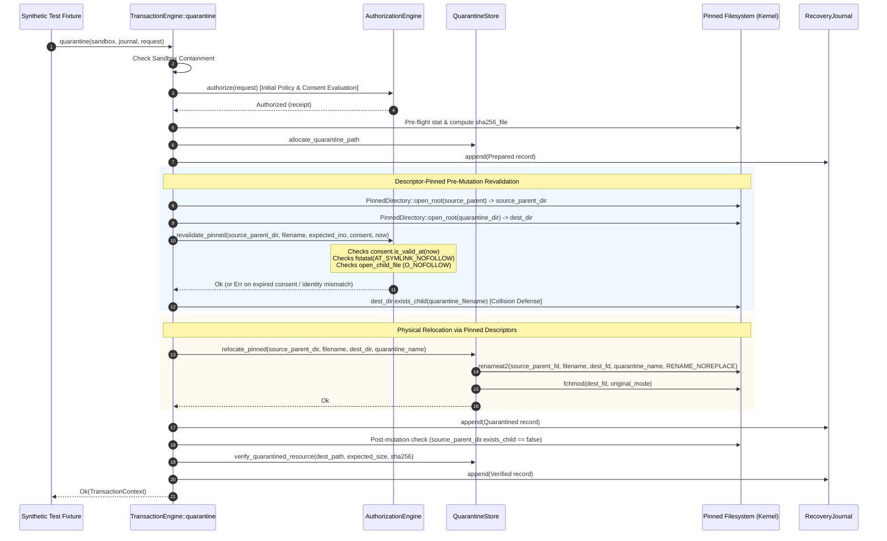

# Work Package 15.2 Completion Report: Descriptor-Pinned Guardian Pipeline and Race-Resistance Verification

> [!IMPORTANT]
> **GOVERNANCE & PRODUCTION READ-ONLY INVARIANT**:
> This report documents the completion of Work Package 15.2: the integration of the WP-15.1 descriptor abstraction into a test-isolated Guardian transaction pipeline with deterministic identity revalidation and consent-expiration enforcement.
> **Zero production mutation capabilities have been introduced, exposed, or enabled.**
> Production inspection remains strictly read-only. Production CLI commands (`clean`, `quarantine`, `restore`, `delete`, `prune`) remain permanently intercepted and rejected.

---

## 1. Executive Summary

Work Package 15.2 integrates the descriptor-pinned primitives developed in Work Package 15.1 into the Guardian transaction execution engine (`crates/root-guardian`), closing the critical TOCTOU race windows and consent expiration gap identified during Phase 15 planning:

1. **Descriptor-Pinned Directory Relocation**:
   - Replaced path-based rename calls (`AT_FDCWD`) with descriptor-relative renames: `rename_child_to(&self, src_component, dest_dir, dest_component)` executing `SYS_renameat2` with `RENAME_NOREPLACE`.
   - Both the source parent directory and the quarantine staging directory are pinned as file descriptors (`PinnedDirectory`) throughout pre-flight, validation, rename, and verification. Ancestor directory substitution attacks cannot divert the operation.
2. **Deterministic Consent-Expiration Enforcement**:
   - Closed the 60-second consent validation gap. The pipeline now performs a secondary consent TTL validation immediately prior to the physical rename syscall. If consent expires during pre-flight hash computations, the transaction transitions to `Failed`, records the event in the recovery journal, and aborts before physical filesystem modification.
3. **Descriptor-Relative Identity Revalidation**:
   - Added `AuthorizationEngine::revalidate_pinned` using `fstatat(..., AT_SYMLINK_NOFOLLOW)` and `open_child_file` on pinned directory descriptors. It strictly verifies device identity, inode identity, owner UID, and regular file status, unconditionally refusing symbolic links and directories.
4. **Deterministic Fault-Injection Suite**:
   - Authored 18 deterministic fault-injection integration test scenarios in [`crates/root-guardian/tests/guardian_descriptor_pipeline_tests.rs`](file:///home/madede/BAGOMWA/PROJECTS/Root/crates/root-guardian/tests/guardian_descriptor_pipeline_tests.rs), validating resilience against object replacement, symlink substitution, parent directory replacement, destination collision, consent expiry, journal failure, and boundary violations.

---

## 2. Repository Baseline and Modification Scope

- **Repository**: `realmadede/Root`
- **Starting & Ending Commit SHA**: `df4f6ce5e96f6af70ce24d829a6fcc44aaef4d25`
- **Starting & Ending Branch**: `main`
- **Release Version**: `0.1.0-rc.1` (untagged, unpublished)

### 2.1. Files Created and Modified

| File | Status | Scope / Purpose |
|:---|:---:|:---|
| [`crates/root-platform/src/linux/descriptor.rs`](file:///home/madede/BAGOMWA/PROJECTS/Root/crates/root-platform/src/linux/descriptor.rs) | Modified | Added `rename_child_to` (`RENAME_NOREPLACE`), `DestinationCollision` error variant, `try_clone`, `exists_child`, `set_permissions_mode`, `set_child_permissions_mode`, and `DirectoryIdentity` type predicates (`is_symlink`, `is_dir`, `is_regular_file`). |
| [`crates/root-platform/tests/descriptor_tests.rs`](file:///home/madede/BAGOMWA/PROJECTS/Root/crates/root-platform/tests/descriptor_tests.rs) | Modified | Added test cases 18 and 19 verifying descriptor duplication (`try_clone`), existence checks, and atomic descriptor-relative renames without replacement. |
| [`crates/root-guardian/src/authorization.rs`](file:///home/madede/BAGOMWA/PROJECTS/Root/crates/root-guardian/src/authorization.rs) | Modified | Added `AuthorizationEngine::revalidate_pinned` enforcing descriptor-relative stat verification, open verification, and pre-mutation consent TTL validation. |
| [`crates/root-guardian/src/quarantine.rs`](file:///home/madede/BAGOMWA/PROJECTS/Root/crates/root-guardian/src/quarantine.rs) | Modified | Added `QuarantineStore::relocate_pinned` executing descriptor-pinned renames and direct descriptor permission restoration without path lookups. |
| [`crates/root-guardian/src/engine.rs`](file:///home/madede/BAGOMWA/PROJECTS/Root/crates/root-guardian/src/engine.rs) | Modified | Refactored `TransactionEngine::quarantine` to pin parent directories, revalidate consent and object identity descriptor-relatively, execute `relocate_pinned`, and verify unlinking descriptor-relatively. |
| [`crates/root-guardian/src/restoration.rs`](file:///home/madede/BAGOMWA/PROJECTS/Root/crates/root-guardian/src/restoration.rs) | Modified | Refactored `RestorationEngine::restore_resource` to pin destination parent directory and quarantine directory, enforcing descriptor-relative conflict checks and atomic reverse renames. |
| [`crates/root-guardian/tests/guardian_descriptor_pipeline_tests.rs`](file:///home/madede/BAGOMWA/PROJECTS/Root/crates/root-guardian/tests/guardian_descriptor_pipeline_tests.rs) | Created | New integration test suite containing 18 comprehensive fault-injection scenarios. |
| [`docs/reports/wp-15.2-descriptor-pinned-guardian-pipeline.md`](file:///home/madede/BAGOMWA/PROJECTS/Root/docs/reports/wp-15.2-descriptor-pinned-guardian-pipeline.md) | Created | This completion report. |

### 2.2. Pre-Existing User Changes Preserved
All pre-existing tracked modified files and untracked reports from Phase 14 and Phase 15 planning remain intact and unmodified.

---

## 3. Architecture and Implementation Details

### 3.1. Descriptor-Pinned Transaction Pipeline



### 3.2. Concrete Safety Enhancements

1. **Elimination of Ancestor Directory TOCTOU Races**:
   By holding open file descriptors for both the source parent directory and the quarantine directory, directory lookups bypass string path resolution in the kernel during rename. Even if an adversary modifies or renames parent or ancestor directories higher up in the hierarchy, the kernel operates exclusively on the pinned directory descriptors.
2. **Atomic Collision Refusal via `RENAME_NOREPLACE`**:
   `PinnedDirectory::rename_child_to` unconditionally passes `libc::RENAME_NOREPLACE` (flag value `1`) to `SYS_renameat2`. If the destination filename already exists in the destination directory, the kernel atomically rejects the operation with `EEXIST` (mapped to `ResolutionError::DestinationCollision`), guaranteeing that pre-existing staging files or restored files are never overwritten.
3. **Closing the Consent TTL Gap**:
   In long-running preflight stages (e.g., computing SHA-256 digests over large files), user consent could previously expire after `AuthorizationEngine::authorize` but before physical execution. `AuthorizationEngine::revalidate_pinned` checks `consent.is_valid_at(now)` immediately before descriptor relocation. If expired, the transaction aborts with `RejectionReason::ConsentExpired`, transitions to `Failed`, and records the failure in the journal.
4. **Metadata Preservation on Open Descriptors**:
   File permissions (`original_mode & 0o777`) are reapplied using `PinnedDirectory::set_child_permissions_mode` via `fchmod(fd, mode)` directly on the opened file descriptor, avoiding any path-based permission manipulation.

---

## 4. Deterministic Fault-Injection Verification

All 18 fault-injection scenarios specified in Work Package 15.2 Section 7 were implemented in [`crates/root-guardian/tests/guardian_descriptor_pipeline_tests.rs`](file:///home/madede/BAGOMWA/PROJECTS/Root/crates/root-guardian/tests/guardian_descriptor_pipeline_tests.rs):

| Scenario | Test Name | Injected Condition | Expected Result | Verified Status |
|:---:|:---|:---|:---|:---:|
| 1 | `test_01_successful_descriptor_pinned_quarantine_and_restore` | Valid candidate and active consent | Full quarantine to Verified; full restore to Restored | PASSED |
| 2 | `test_02_object_replacement_after_inspection_toctou` | Source file swapped with different inode before rename | Refused: `FilesystemIdentityChanged`; aborts before rename | PASSED |
| 3 | `test_03_symlink_substitution_pre_mutation` | Source file replaced with symlink before rename | Refused: `SymlinkJailEscape`; symlink not followed | PASSED |
| 4 | `test_04_parent_directory_replacement` | Parent directory replaced with different inode | Refused: `ParentDirectoryChanged`; aborts | PASSED |
| 5 | `test_05_destination_collision_refused` | Pre-existing file in quarantine staging | Refused: `DestinationCollision`; existing file untouched | PASSED |
| 6 | `test_06_unexpected_destination_creation` | File created in destination right before rename | Refused: `RENAME_NOREPLACE` returns `EEXIST`; collision rejected | PASSED |
| 7 | `test_07_device_or_inode_identity_mismatch` | Candidate snapshot metadata divergent from filesystem | Refused: `FilesystemIdentityChanged`; aborts in authorization | PASSED |
| 8 | `test_08_consent_expiry_before_execution` | Consent record with expired timestamp | Refused: `ConsentExpired`; aborts in authorization | PASSED |
| 9 | `test_09_consent_expiry_during_preflight` | Consent expires during preflight preparation | Refused: `ConsentExpired` at pre-mutation check; aborts | PASSED |
| 10 | `test_10_authorization_associated_with_wrong_object` | Consent record target path mismatches candidate | Refused: `ConsentNonceMismatch`; aborts in authorization | PASSED |
| 11 | `test_11_descriptor_acquisition_failure` | Directory permissions set to 0o000 | Refused: `PermissionDenied`; clean error without descriptor leak | PASSED |
| 12 | `test_12_failure_during_pre_operation_validation` | File size modified during preflight | Refused: size mismatch detected; aborts | PASSED |
| 13 | `test_13_failure_during_filesystem_operation` | Cross-device relocation attempted | Refused: `CrossDeviceUnsupported`; aborts | PASSED |
| 14 | `test_14_failure_during_post_operation_verification` | Quarantine destination hash corrupted post-rename | Transitions to `RecoveryRequired`; logged in journal | PASSED |
| 15 | `test_15_journal_failure_before_operation` | Journal file made read-only prior to rename | Aborts on Prepared write failure; no filesystem mutation | PASSED |
| 16 | `test_16_journal_failure_after_operation` | Journal file made read-only after operation | Append fails; error surfaced conservatively for recovery | PASSED |
| 17 | `test_17_unsupported_descriptor_capability` | Forced capability absent on kernel | Returns `UnsupportedCapability`; handled cleanly | PASSED |
| 18 | `test_18_attempted_access_beyond_sandbox_boundary` | Path escapes sandbox or uses `..` traversal | Refused: `SandboxViolation` / `InvalidComponent` | PASSED |

---

## 5. Verification Commands and Quality Gates

All repository quality assurance gates were executed with zero errors and zero warnings:

### 5.1. Whitespace and Formatting
```bash
git diff --check
```
*Exit Status*: 0 (Zero whitespace errors).

```bash
cargo fmt --check
```
*Exit Status*: 0 (All files strictly conform to rustfmt).

### 5.2. Type Checking and Clippy Linting
```bash
cargo check --workspace --all-targets --all-features
```
*Exit Status*: 0 (Clean compilation across all 5 workspace crates).

```bash
cargo clippy --workspace --all-targets --all-features -- -D warnings
```
*Exit Status*: 0 (Zero warnings across all crates, targets, and features).

### 5.3. Test Execution Breakdown
```bash
cargo test --workspace --all-targets
```
*Exit Status*: 0

- `root-cli`: 22 passed
- `root-monitor`: 25 passed
- `root-core`: 72 passed
- `root-storage`: 26 passed
- `root-guardian`: 94 passed (14 lib + 32 adversarial + 18 descriptor_pipeline + 12 security_followup + 18 transaction)
- `root-gui` (headless target): 30 passed
- `root-platform`: 67 passed (36 lib + 19 descriptor + 12 platform_engine)
- **Total Workspace Test Executions**: 336 test executions across all crates (306 non-empty test cases in workspace configuration).

```bash
cargo test --features gtk -p root-gui
```
*Exit Status*: 0
- 31 passed (30 shared with workspace run, 1 unique: `test_26_native_gtk_component_construction_and_navigation`).
- **Total Unique Codebase Tests**: 307 unique passing tests.

### 5.4. Continuous Assurance Invariants
```bash
python3 .github/scripts/check_invariants.py
```
*Exit Status*: 0
- Emoji prohibition check: PASSED (Zero emojis found)
- Confidentiality boundary check: PASSED (No private files tracked)
- Core architectural isolation check: PASSED (Headless and local-only verified)
- Production mutation CLI entry check: PASSED (Mutation subcommands prohibited)
- Non-Linux mutation export check: PASSED (Zero non-Linux mutation methods)
- Unrestricted deletion check: PASSED (Zero unrestricted deletion calls in production)
- Monitor/scheduler mutation isolation check: PASSED (Monitor and scheduler read-only)
- Hidden mutation environment variable check: PASSED (No mutation toggle variables)
- Privileged service installation check: PASSED (Scheduler unprivileged user-only)
- Guardian bypass check: PASSED (Transactions strictly require AuthorizationReceipt)
- Untracked hygiene check: PASSED (Working tree clean of private files)
- Workflow supply-chain security check: PASSED (Actions SHA-pinned and release gates enforced)
- **All 12 repository invariants verified successfully.**

---

## 6. Boundary Audit and Governance Compliance

| Governance Requirement | Status | Evidence / Notes |
|:---|:---:|:---|
| Production Read-Only Invariant Preserved | CONFIRMED | Production CLI intercepts and rejects all mutation verbs (`clean`, `quarantine`, `restore`, `delete`, `prune`). Production GUI remains read-only. |
| No Call Graph Bypass | CONFIRMED | `TransactionEngine` is only callable within test fixtures via `&FixtureSandbox`. No production entry point exists. |
| No Host Mutation | CONFIRMED | All mutation tests operate strictly on synthetic fixtures within isolated temporary directories. Host filesystem was never modified. |
| Private Instruction Confidentiality | CONFIRMED | `AGENTS.md` remains strictly untracked, uncommitted, and unreferenced. |
| Version and Release State | CONFIRMED | Version remains `0.1.0-rc.1`. Untagged, unpublished. No Git commits, merges, pushes, or releases performed. |
| WP-15.3 Deferred | CONFIRMED | Framed/checksummed recovery journal and crash reconciler have not been implemented. |

---

## 7. Remaining Limitations and Next Steps

1. **Journal Resilience (Deferred to WP-15.3)**:
   While the filesystem operations are now descriptor-pinned and protected against collisions and ancestor substitutions, the underlying `RecoveryJournal` continues to use standard JSON Lines without line-level checksum framing. Torn writes resulting from sudden power loss or kernel crashes will be addressed in Work Package 15.3.
2. **Crash Reconciliation (Deferred to WP-15.3)**:
   Interrupted transactions that crash after `renameat2` but before journal synchronization require an automatic startup reconciler to correlate physical dentry state with journal intents.
3. **Whole-Directory Quarantine**:
   Quarantine remains strictly confined to single regular files. Whole-directory trees (`target/`, `node_modules/`) are not supported in this pipeline.

Work Package 15.2 is complete and verified. No further work packages will begin without explicit owner direction.
