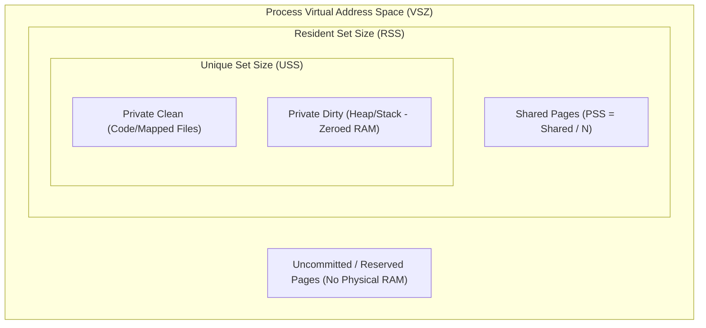

# Linux Resource Management Research

## 1. Executive Overview

This document provides foundational research on Linux kernel resource management, virtual filesystem interfaces, process tracking mechanisms, and user-space storage conventions. Root's architectural decisions derive from these kernel realities.

A core premise of Root is that **high RAM usage does not indicate wasted memory**, and **aggressive cache clearing is detrimental to system performance**. Linux utilizes available physical memory for caching; reclamation must be surgical, deterministic, and respectful of the kernel's virtual memory subsystem.

---

## 2. Linux Memory Subsystems

### 2.1 Physical vs. Virtual Memory Architecture

In Linux, the virtual memory manager (VMM) presents each process with a contiguous 64-bit address space (on `x86_64`), isolated via hardware page tables managed by the Memory Management Unit (MMU).

- **Page Size**: Standard architecture uses 4 KiB pages (with support for HugePages: 2 MiB and 1 GiB).
- **Virtual Memory Allocation (`mmap`, `brk`)**: When a process requests memory (e.g. via `malloc()` calling `brk()` or `mmap()`), the kernel allocates virtual address ranges (Virtual Memory Areas, or VMAs). Physical page frames (`struct page`) are **not** committed until the memory is first accessed (Demand Paging via Page Fault exception `do_page_fault`).
- **Overcommit & OOM**: Linux defaults to heuristic overcommit (`vm.overcommit_memory = 0`). The Out-Of-Memory (OOM) killer intervenes only when physical memory and swap are exhausted and pages cannot be reclaimed from caches.

### 2.2 Process Memory Accounting: Metrics Breakdown

Standard utilities often report ambiguous metrics. Root must distinguish between the following metrics:

| Metric | Full Name | Definition | Relevance to Root |
|---|---|---|---|
| **VSS / VSZ** | Virtual Set Size | Total virtual address space mapped (code, data, shared libs, allocated unmapped heap). | **Misleading.** A process allocating 8 GiB via `mmap(MAP_ANONYMOUS)` but touching 10 MiB has VSZ = 8 GiB. Never use VSZ for cleanup decisions. |
| **RSS** | Resident Set Size | Number of physical RAM pages currently mapped into the process's page table. | **Flawed for Shared Memory.** Includes shared libraries (`libc.so`, GTK, WebKit) mapped by multiple processes, leading to double-counting. |
| **PSS** | Proportional Set Size | RSS scaled by the number of processes sharing each page. If 4 processes share a 4 MiB library, each gets 1 MiB PSS. | **Optimal General Metric.** Accurately reflects true memory footprint of multi-process agent workloads (e.g. Node.js + LSPs). Available in `/proc/[pid]/smaps_rollup`. |
| **USS** | Unique Set Size | Physical memory mapped *exclusively* to this process (Private Clean + Private Dirty). | **True Reclaimable RAM.** The exact physical memory freed immediately if this specific process terminates. Derived from `/proc/[pid]/smaps`. |



### 2.3 Page Cache, Buffers, and Kernel Reclaim

- **Page Cache (`Cached` in `/proc/meminfo`)**: Stores file-backed pages in RAM to accelerate disk I/O.
- **Buffers (`Buffers` in `/proc/meminfo`)**: Stores raw block device I/O buffers (e.g., superblock and filesystem metadata).
- **Kernel Eviction Mechanism**: Managed via the Two-List Least-Recently-Used (LRU) algorithm (Active List and Inactive List). When memory pressure rises, the kernel (`kswapd`) reclaims clean page cache frames at microsecond latency with zero data loss.
- **Root Policy on `drop_caches`**:
  > [!IMPORTANT]
  > Root **strictly forbids** invoking `sysctl vm.drop_caches` or `echo 3 > /proc/sys/vm/drop_caches`. 
  > Clearing the page cache:
  > 1. Requires `root` / `CAP_SYS_ADMIN` privileges (violating least privilege).
  > 2. Forces active applications to synchronously read files from disk, causing massive I/O spikes and UI freezing.
  > 3. Does not free memory for user workloads; it merely discards useful cached data that the kernel would evict automatically if needed.

### 2.4 Swap, zswap, and zram

- **Disk Swap**: Paged-out anonymous memory written to block devices or swap files.
- **zswap**: Compressed cache in RAM before writing to swap disk.
- **zram**: Compressed RAM block device used as swap (common in modern distributions like Fedora and Kali).
- **Root Monitoring Role**: Root tracks `VmSwap` per process from `/proc/[pid]/status` to detect leaked memory that has been paged out to swap, degrading I/O when brought back into memory.

---

## 3. Process Lifecycle, Trees, and State Management

### 3.1 Process Hierarchy & Inheritance

Every process in Linux is spawned via `fork()` (or `clone()`) and `execve()`.
- **PPID (Parent PID)**: Establishes a strict hierarchical process tree.
- **Process Groups (PGRP) & Sessions (SID)**: Terminal sessions attach processes to a session leader (`setsid()`). Background jobs, daemons, or disconnected tools frequently detach from terminals.

### 3.2 Orphaned and Zombie Processes

- **Orphaned Processes**: When a parent process dies before its children, the kernel re-parents the children to PID 1 (`systemd`), or to an explicit subreaper registered via `prctl(PR_SET_CHILD_SUBREAPER, 1)`. Coding agents frequently crash or disconnect, leaving orphan child processes (such as Node.js development servers, language servers, or headless browsers) running under PID 1.
- **Zombie Processes (`STAT = Z`, `<defunct>`)**:
  - A process that has exited via `exit_group()`, but whose parent has not yet called `waitpid()` to read its exit status code.
  - **Resource Impact**: A zombie consumes **zero physical RAM, zero swap, and zero CPU**. It only retains a slot in the kernel's task table (`struct task_struct`) to preserve its PID and exit status.
  - **Root Policy**: Zombies cannot be killed with `SIGKILL` because they are already dead. They disappear only when the parent reads their status or the parent is terminated, causing PID 1 to reap them. Root identifies zombies to inform the user of defective parent processes, but never attempts impossible signal dispatch.

### 3.3 Safe Process Identification & Signaling

#### The PID Reuse Race Condition
Linux PIDs are 16-bit to 22-bit integers (configurable via `/proc/sys/kernel/pid_max`, defaulting to 32,768 or 4,194,304). PIDs are aggressively recycled by the kernel.
- **The Threat**: Root inspects PID `41234` (an orphaned Next.js server). Two seconds later, the user requests termination. In the intervening window, PID `41234` exited, and the OS allocated PID `41234` to an active text editor or database. A naive `kill(41234, SIGTERM)` kills the wrong process!

#### Root Solution: Linux `pidfd` API
Introduced in Linux 5.3 and extended in Linux 5.4:
1. `pidfd_open(pid, 0)`: Obtains a file descriptor pinned to the specific process instance.
2. If the process terminates, the `pidfd` transitions to readable (pollable with `epoll`), but will **never** refer to a subsequent recycled process.
3. `pidfd_send_signal(pidfd, sig, NULL, 0)`: Dispatches the signal exclusively to the pinned process instance. If the process has already died, the call safely returns `-ESRCH`.

```mermaid
sequenceDiagram
    participant Root as Root Process Manager
    participant Kernel as Linux Kernel (5.3+)
    participant Target as Target Process (PID 41234)

    Root->>Kernel: pidfd_open(41234, 0)
    Kernel-->>Root: Returns pidfd (fd 7)
    Note over Target,Kernel: Target process exits; PID 41234 recycled to another app
    Root->>Kernel: pidfd_send_signal(fd 7, SIGTERM)
    Kernel-->>Root: Error -ESRCH (Target dead; new PID 41234 unharmed)
```

---

## 4. Virtual Filesystems: `/proc` and `/sys`

Root operates without root privileges by reading public kernel runtime filesystems.

### 4.1 `/proc` Interfaces for Unprivileged Resource Inspection

| Path | Purpose | Permissions | Parsing Considerations |
|---|---|---|---|
| `/proc/meminfo` | System-wide memory distribution | Read (0444) | Text format; parse key-value lines (`MemTotal`, `MemAvailable`, `Cached`, `SwapTotal`). |
| `/proc/pressure/{cpu,memory,io}` | Pressure Stall Information (PSI) | Read (0444) | Linux 4.20+; shows cumulative 10s, 60s, 300s stall percentages. Essential for detecting system thrashing. |
| `/proc/[pid]/stat` | Process status, CPU ticks, start time | Read (0444) | Space-delimited, but command name in field 2 `(comm)` can contain spaces and parentheses. Parse backwards from closing `)`. |
| `/proc/[pid]/status` | Human-readable process metrics | Read (0444) | Key-value lines: `VmRSS`, `VmSwap`, `PPid`, `Uid`, `Gid`, `State`. |
| `/proc/[pid]/cmdline` | Full execution command line | Read (0444) | NUL-byte (`\0`) separated argument list. Must handle empty args and truncated lines. |
| `/proc/[pid]/smaps_rollup` | Fast, consolidated memory summary | Read (0444) | Linux 4.14+; provides `Pss`, `Rss`, `Private_Dirty`, `Private_Clean` in a single pass without parsing thousands of individual VMAs. |
| `/proc/[pid]/fd/` | Open file descriptors symlinks | Read (0500/0700) | Readlink on `/proc/[pid]/fd/*` reveals open log files, unlinked open files, and sockets. |
| `/proc/[pid]/exe` | Symlink to executable binary | Readlink (0777) | Identifies true binary path, preventing spoofing via `argv[0]`. |

### 4.2 cgroups v2 (`/sys/fs/cgroup`)

Under systemd v240+ and Kali Linux Rolling, the unified cgroup v2 hierarchy delegates user slices to the unprivileged user session.

- **Delegated Slice Path**: `/sys/fs/cgroup/user.slice/user-<uid>.slice/user@<uid>.service/`
- **Key Inspection Files**:
  - `memory.current`: Total memory currently in use by the cgroup.
  - `memory.stat`: Granular breakdown of `anon`, `file`, `kernel`, `slab`, `shmem`.
  - `memory.swap.current`: Swap space consumed by this slice.
  - `memory.peak`: Peak memory usage recorded.
  - `pids.current`: Number of active processes/threads within the hierarchy.
  - `cgroup.procs`: PIDs of all processes assigned to the slice.
- **Significance for Root**: Root can inspect exact memory usage of application slices without reading `/proc` for every individual PID, drastically reducing scan overhead.

---

## 5. Filesystem Semantics, XDG, and Storage Lifecycles

### 5.1 XDG Base Directory Specification Compliance

Modern Linux desktop software adheres to the Freedesktop.org XDG Base Directory Specification:

| Variable | Fallback Path | Intended Purpose | Root Safety Policy |
|---|---|---|---|
| `$XDG_CONFIG_HOME` | `~/.config` | User-specific configuration files. | **STRICTLY PROTECTED**. Never touch without explicit user editing. |
| `$XDG_DATA_HOME` | `~/.local/share` | User-specific data files (databases, persistent models). | **STRICTLY PROTECTED**. May contain persistent application state. |
| `$XDG_STATE_HOME` | `~/.local/state` | Application state (logs, history, session state). | **INSPECT WITH CARE**. Contains audit logs, quarantine areas, and historical session logs. |
| `$XDG_CACHE_HOME` | `~/.cache` | Non-essential (cached) data that can be regenerated. | **CANDIDATE FOR CLEANUP** (subject to age and ownership verification). |
| `$XDG_RUNTIME_DIR` | `/run/user/<uid>` | Transient runtime sockets, pipes, IPC buffers (tmpfs). | **CLEARED ON LOGOUT**. Inspected for orphaned sockets. |

### 5.2 Temporary Filesystems (`/tmp` vs `/var/tmp`)

- `/tmp`: Typically mounted as `tmpfs` (RAM-backed) in modern distributions. Automatically cleared on reboot. Managed by `systemd-tmpfiles-clean.timer`.
- `/var/tmp`: Located on persistent disk storage. Preserved across reboots. Cleaned on a longer retention schedule (typically 30 days via `systemd-tmpfiles`).
- **Private Namespaces (`PrivateTmp=yes`)**: Many systemd services run with private `/tmp` namespaces, meaning files created by those services are isolated in `/tmp/systemd-private-.../` and inaccessible to other user processes.

### 5.3 Filesystem Boundary & Link Semantics

- **Mount Point Boundaries (`st_dev`)**: Every filesystem has a distinct device identifier (`st_dev` in `struct stat`). When recursively scanning paths, Root checks `st_dev` on each directory. Crossing onto a different `st_dev` indicates a foreign mount (e.g. NFS share, external drive, `/proc`, or `/sys`). **Root halts traversal at mount boundaries.**
- **Hard Links (`st_nlink > 1`)**: Hard links share the same inode (`st_ino`). Modifying or deleting a hard-linked file in a cache directory (such as pnpm's global store `~/.local/share/pnpm/store`) corrupts all projects referencing that inode. Root must verify `st_nlink == 1` before treating any file as uniquely recoverable.
- **Symbolic Links**:
  - Symlinks can point to arbitrary paths outside the scanned tree (Jail Escape).
  - Deleting a symlink target instead of the symlink itself causes data destruction.
  - Root uses `lstat(2)` and `O_NOFOLLOW` to inspect and manipulate symlink entities exclusively, never following symlinks blindly.

### 5.4 Open File Descriptors and Unlinked Open Files

When a file is unlinked (`unlink()`) while a running process maintains an open file descriptor (`fd`), the directory entry is removed, but the inode and data blocks remain allocated on disk.
- Disk space is **not** reclaimed until all processes close the file descriptor or exit.
- Truncating or deleting such files from user space causes confusion. Root inspects `/proc/[pid]/fd` to identify processes holding open deleted files (`(deleted)` marker in readlink).

---

## 6. Filesystem Notifications: Evaluation for Root

| Mechanism | Scope | Permission Requirement | Limitations | Root Assessment |
|---|---|---|---|---|
| **`inotify`** | Inode-based directory/file watcher | Unprivileged user space | Does not watch subtrees recursively; requires setting a watch descriptor (`wd`) on every subdirectory. Subject to system watch limit (`fs.inotify.max_user_watches`). Drops events on buffer overflow (`IN_Q_OVERFLOW`). | **Approved for targeted watch scopes** (e.g., watching specific agent log directories in Live Monitoring Mode). Not suitable for entire `$HOME`. |
| **`fanotify`** | Filesystem/Mount-wide monitor | Originally `CAP_SYS_ADMIN`; limited non-privileged mode in Linux 5.13+ (`FAN_REPORT_FID`) | Does not provide recursive directory tree notifications without elevated permissions or complex filter setups. | **Rejected**. Exceeds unprivileged security model. |
| **Directory Polling** | Path traversal at periodic intervals | Unprivileged user space | I/O intensive if run continuously; causes disk thrashing. | **Approved for Scheduled / On-Demand modes** with rate-limiting and incremental mtime checks. |
| **eBPF (`tracepoints`)** | Kernel-level syscall interception | Requires `CAP_BPF` or `CAP_SYS_ADMIN` | Heavy runtime requirement; requires root privileges to load BPF programs. | **Rejected**. Violates Root's core zero-privilege security constraint. |

---

## 7. Conclusions for Root Engine

1. **Unprivileged Operation**: Every capability required by Root (process listing, memory accounting via PSS/USS, cgroup inspection, and filesystem traversal) can be accomplished with standard user privileges.
2. **Deterministic Memory Calculation**: Use `/proc/[pid]/smaps_rollup` for fast PSS/USS extraction, avoiding both RSS over-counting and VSZ overestimation.
3. **Safe Signal Delivery**: Mandate `pidfd_open` and `pidfd_send_signal` for all process termination actions to eliminate PID reuse vulnerabilities.
4. **Filesystem Traversal Integrity**: Use `openat2` with `RESOLVE_BENEATH` and `RESOLVE_NO_SYMLINKS`, verifying `st_dev` and `st_nlink` before any proposed action.
