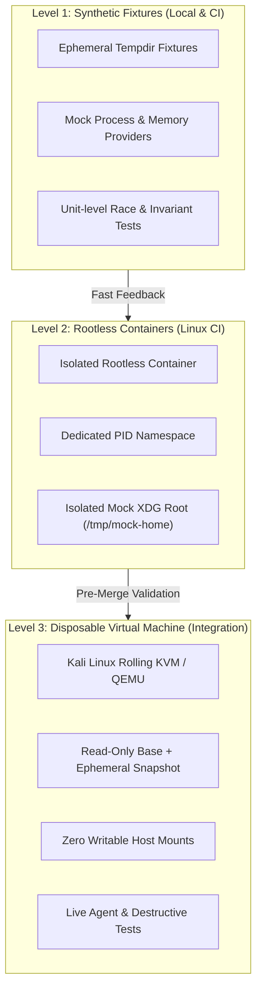

# Root Sandboxed Testing Strategy & Multi-Tier Verification

## 1. Testing Charter & Safety Mandate

Root operates on developer workstations where a single errant path resolution or misdirected signal can cause catastrophic data loss.

### The Host Isolation Rule
> [!CAUTION]
> **No destructive test may ever be executed directly on the host development machine.**
> All integration tests involving file unlinking, quarantine relocation, process signaling, or high-concurrency race condition simulations must run inside sandboxed environments.

To provide continuous, rigorous verification while maintaining absolute host safety, Root defines a **Three-Level Testing Hierarchy**.

---

## 2. The Three-Level Testing Hierarchy



---

## 3. Level 1: In-Memory & Synthetic Fixtures

### 3.1 Scope & Purpose
Fast, deterministic unit testing executed during local development (`cargo test`) and pull request CI.
- **Duration**: < 5 seconds.
- **Privilege**: Completely unprivileged.
- **Safety**: Uses ephemeral directories created via `tempfile::tempdir()` and in-memory mock traits.

### 3.2 Fixture Scenarios Tested
1. **Adversarial Filesystem Traps**:
   - Deeply nested directory structures (60+ levels).
   - Circular symbolic link loops (`dir_a/link -> dir_a`).
   - Symlinks escaping the fixture root (`dir/bad_link -> /etc`).
   - Unicode, zero-width, and non-Latin file names.
   - Files with embedded quotes, newlines, and escape sequences.
2. **Hard-Link Graphs**:
   - Generating multi-linked files (`st_nlink = 3`) to verify inode deduplication and ensure no file with `st_nlink > 1` is quarantined.
3. **Mock Trait Implementations**:
   - `MockProcessProvider`: Simulates PID recycling, zombie processes, and process trees without spawning actual OS processes.
   - `MockResourceAccountant`: Injects simulated memory pressure (high PSI values) to test throttling logic.

---

## 4. Level 2: Isolated Rootless Containers

### 4.1 Scope & Purpose
Used for verifying POSIX system calls, directory traversal concurrency, and mock agent environments without risking host user files.
- **Runtime**: Podman / Docker (Rootless mode).
- **Isolation Boundaries**:
  - `unshare` PID namespace: Container PID 1 is isolated; cannot see or signal host processes.
  - Mock Home: `$HOME` is mounted to an isolated empty directory inside the container (`/home/testuser`).
  - Read-Only Host Binds: The Root source repository is mounted **read-only** (`:ro`).
  - Network Isolation: Container runs with `--network none` during execution tests.

### 4.2 Documented Limitations of Container Isolation
Containers share the host Linux kernel. The following tests **cannot** be fully verified in Level 2:
1. **`cgroups v2` User Delegation**: Many container engines do not delegate real cgroups v2 controllers to nested rootless containers.
2. **`pidfd_open` on Systemd Slices**: Container PID namespaces do not reflect the true host process tree structure.
3. **Mount Point Devices (`st_dev`)**: Overlayfs used by Docker/Podman alters `st_dev` behavior across layers, masking standard ext4/btrfs semantics.

---

## 5. Level 3: Disposable Kali Linux Virtual Machine

### 5.1 Scope & Purpose
Level 3 is the definitive validation environment for Root. It provides complete kernel isolation, real cgroups v2 user slices, full `pidfd` lifecycle testing, and destructive recovery verification.
- **Platform**: Kali Linux Rolling (identical to the host reference environment).
- **Engine**: QEMU / KVM with `libvirt` or scriptable runner.

### 5.2 VM Safety Architecture
To ensure complete isolation from host development assets:

1. **Snapshot-Based Disposability**:
   - The VM runs on a **QCOW2 overlay snapshot** (`qemu-img create -f qcow2 -b base.qcow2 -F qcow2 snapshot.qcow2`).
   - At the conclusion of every test run, the snapshot is discarded. No mutation ever writes to the base golden image.
2. **Zero Writable Host Mounts**:
   - **Strict Rule**: The host `$HOME` directory is **never mounted into the VM**.
   - The Root binary under test is passed into the VM via a read-only 9p/virtiofs share (`mount_tag=root_bin,ro`) or transient SSH transfer.
3. **Zero Host Credential Access**:
   - The VM operates with synthetic SSH keys and isolated test credentials.
   - Host `~/.ssh`, `~/.gnupg`, and `.gitconfig` are completely inaccessible.
4. **Synthetic Test Workspaces Inside VM**:
   - The test runner clones disposable test repositories inside the VM (`/home/kalitest/workspaces/app1`).
   - Injects mock agent artifacts (`~/.gemini/antigravity-cli/brain/...`, `~/.claude/...`).
   - Spawns real background dev servers (Vite, Next.js, Node.js LSPs) inside the VM.

### 5.3 Automated Verification Lifecycle in Level 3

```bash
# Conceptual Level 3 Automated Pipeline
1. virsh snapshot-revert kali-test-vm clean-state
2. virsh start kali-test-vm
3. ssh -i id_test kalitest@vm-ip "run-live-agent-workload.sh"
4. ssh -i id_test kalitest@vm-ip "root scan --json > report.json"
5. ssh -i id_test kalitest@vm-ip "root quarantine --all-eligible"
6. ssh -i id_test kalitest@vm-ip "verify-quarantine-integrity.sh"
7. ssh -i id_test kalitest@vm-ip "root undo --all"
8. ssh -i id_test kalitest@vm-ip "verify-filesystem-identical.sh"
9. virsh destroy kali-test-vm
```

---

## 6. Implementation Rules for Testing

1. **No Production Execution in Phase 00**: Neither Level 2 containers nor Level 3 VMs will be launched or created during Phase 00.
2. **Failure Injection**: Testing must verify negative cases:
   - What happens if a file is deleted by another process during quarantine? (TOCTOU)
   - What happens if a process dies between `pidfd_open` and `pidfd_send_signal`?
   - What happens if a directory contains a circular symlink?
   - What happens if disk space is 100% full when creating quarantine rollback journals?
3. **Determinism**: Test runs must produce bit-for-bit identical results on unchanged fixtures.
