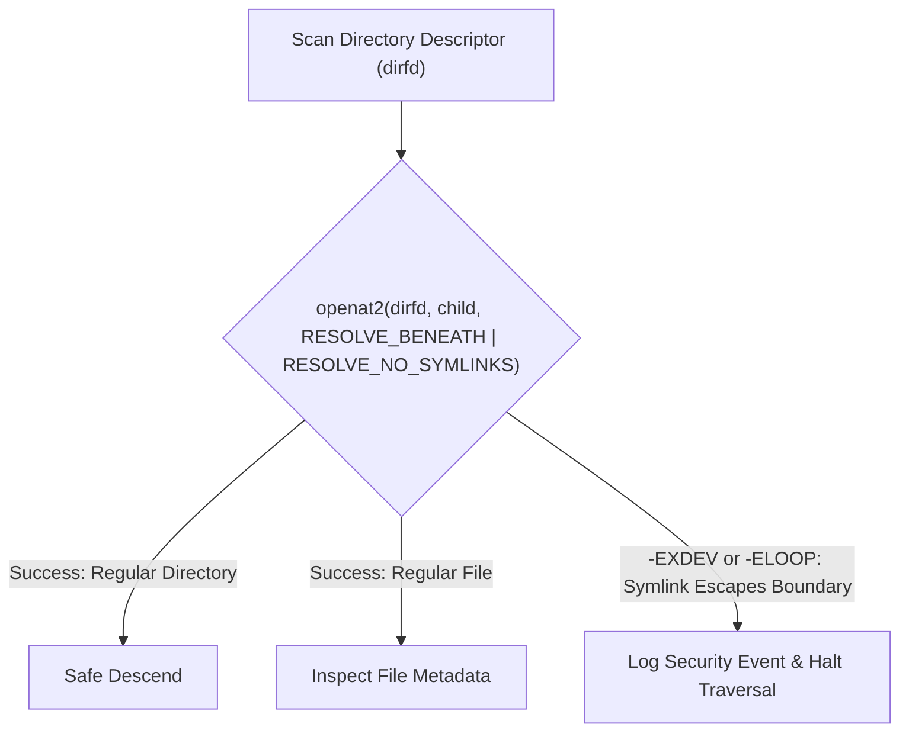

# Root Threat Model & Security Architecture

## 1. Executive Security Charter

Root is designed for developer workstations where untrusted repositories, multi-agent autonomous workloads, and third-party dependencies interact. A system utility that inspects, moves, or terminates processes operates in a high-consequence domain: a flaw in path resolution can destroy user data, and a flaw in signaling can terminate critical system services.

### Core Security Invariants
1. **Zero Elevated Privilege**: Root operates exclusively with the ambient privileges of the invoking user. It **never** requests `root`, invokes `sudo`, runs setuid binaries, or edits system files.
2. **Defensive by Default**: Any unclassified, ambiguous, or error-yielding filesystem path or process is treated as **STRICTLY_PROTECTED**.
3. **No Code Execution in Scanned Directories**: Root never executes binaries, scripts, or package managers located inside scanned project directories (e.g. it never runs `npm run clean` or `./gradlew clean` from untrusted repos).
4. **Reversible Mutations**: Deletion is implemented as an atomic move into a secure local quarantine with an auditable rollback journal.

---

## 2. Attacker Profiles & Threat Scenarios

| Threat Actor | Motivation | Attack Vector |
|---|---|---|
| **Malicious Repository** | Escaping project bounds to delete host data or execute arbitrary code. | Symlink traps inside cloned repos (`.cache -> /home/user/.ssh`), path traversal directory names (`../../etc`). |
| **Rogue / Hallucinating Agent** | Agentic tool failure creating erratic directory structures or infinite loops. | Deep directory nesting, circular symlinks, massive file floods designed to exhaust disk or memory. |
| **Local Unprivileged Attacker** | Exploiting Root's quarantine or inspection routines for local privilege escalation or data corruption. | Symlink swapping during scanning (TOCTOU), PID recycling to trick Root into killing victim processes. |
| **Flawed Upstream Software** | Incomplete cleanups leaving broken hard links or corrupted file metadata. | Inode collisions, corrupt permissions, unlinked open files. |

---

## 3. Vulnerability Analysis & Mitigations

### 3.1 Path Traversal & Jail Escapes

#### Threat:
An untrusted repository or malicious dependency introduces a path such as `node_modules/../../.bashrc` or an agent creates a path with embedded relative tokens, attempting to trick Root into deleting files outside the target boundary.

#### Mitigation:
1. **Path Canonicalization**: All targets are canonicalized via `std::fs::canonicalize()` before safety evaluation.
2. **Root Guardian Lexical Validation**: Paths must verify that the canonical target starts with the expected base directory prefix using strictly verified component boundaries (avoiding prefix match errors where `/home/user/app` matches `/home/user/app-other`).
3. **Refusal of Root Relative Tokens**: Paths containing `..` components post-canonicalization are immediately rejected.

---

### 3.2 Symlink Traps (Jail Escapes & Circular Loops)

#### Threat:
A repository creates a symlink pointing to `$HOME/.ssh`, `/etc/shadow`, or a parent directory:
```bash
ln -s ~/.ssh project/node_modules/bad_link
```
If Root recursively traverses `project/node_modules/`, it could enter `~/.ssh` and classify personal keys as temporary files.

#### Mitigation:
1. **`lstat` & `O_NOFOLLOW`**: Root uses `symlink_metadata()` (calling `lstat(2)`) rather than `metadata()`. It never implicitly follows symlinks during traversal.
2. **Linux `openat2` with Flags**: On Linux 5.6+, directory traversal uses the `openat2` syscall with flags:
   - `RESOLVE_BENEATH`: Prevents walking outside the starting directory descriptor.
   - `RESOLVE_NO_SYMLINKS`: Disallows symlink traversal across path components.
3. **Symlink Deletion Rule**: If a symlink itself is classified as obsolete, Root removes the symbolic link entity (`unlink(2)`), never the target entity.



---

### 3.3 Hard-Link Behaviors & Shared Inode Corruption

#### Threat:
Modern package managers like `pnpm` optimize storage by hard-linking files from a central store (`~/.local/share/pnpm/store/`) into project `node_modules`. Multiple projects share the identical inode (`st_ino`).
- If Root mutates or replaces a file in one project, all other projects sharing the hard link are silently corrupted.
- If Root calculates storage freed by summing file sizes with `st_nlink > 1`, it reports wildly inaccurate reclaimed space.

#### Mitigation:
1. **Inode Deduplication Tracking**: Root maintains a hash set of `(st_dev, st_ino)` pairs encountered during a scan pass.
2. **Multi-Link Detection**: Any file with `st_nlink > 1` is flagged. Root never performs in-place mutations on multi-link files.
3. **Accurate Accounting**: File size is counted toward reclaimed space only once per unique `(st_dev, st_ino)` pair.

---

### 3.4 TOCTOU (Time-Of-Check to Time-Of-Use) Race Conditions

#### Threat:
A malicious script or rapid background job swaps a benign directory with a symlink or sensitive target between the moment Root scans it and the moment the user confirms quarantine:
1. *Time of Check*: Root scans `project/cache` (empty directory).
2. *Intervention*: Attacker runs `rm -rf project/cache && ln -s /etc project/cache`.
3. *Time of Use*: Root moves `project/cache` into quarantine, affecting `/etc`.

#### Mitigation:
1. **File Descriptor Operations (`openat`, `renameat2`)**: Root anchors operations to open directory descriptors (`dirfd`).
2. **Pre-Quarantine Verification**: Immediately before quarantine movement, Root performs `fstatat(dirfd, ..., AT_SYMLINK_NOFOLLOW)` and verifies that `st_ino`, `st_dev`, and `st_mode` match the scan snapshot. If any attribute changed, the operation is aborted.
3. **Atomic Renames**: Movement into quarantine utilizes `renameat2(..., RENAME_NOREPLACE)` to prevent accidental overwrites.

---

### 3.5 Mount Point Escapes

#### Threat:
A directory contains a bind mount or secondary filesystem mount (e.g., an external drive, NFS share, or system pseudo-filesystem like `/proc` or `/sys` mounted inside a container worktree). Recursive traversal could cause infinite recursion, hang on stalled network mounts, or traverse system devices.

#### Mitigation:
1. **Device ID Checking (`st_dev`)**: Root records the `st_dev` of the root scan target.
2. **Mount Boundary Invariant**: On every directory descent, Root compares the child directory's `st_dev` with the root target's `st_dev`.
3. **Immediate Prune on Boundary**: If `child.st_dev != root.st_dev`, Root skips the directory completely and logs a boundary notice.

---

### 3.6 PID Reuse & Process Signaling Race Conditions

#### Threat:
In high-throughput Linux environments, PIDs are recycled quickly. If Root identifies an orphaned Node.js dev server on PID `88412`, prompts the user, and the process exits before the user clicks "Terminate", PID `88412` may be reassigned to an active GNOME component or editor.

#### Mitigation:
1. **`pidfd_open` (Linux 5.3+)**: Root opens a `pidfd` for every identified process candidate.
2. **`pidfd_send_signal` (Linux 5.4+)**: Signal delivery is performed via `pidfd_send_signal(pidfd, SIGTERM, NULL, 0)`.
3. **Process Start Time Verification**: As a fallback for older environments, Root records `starttime` (field 22 in `/proc/[pid]/stat`). Before signaling, it re-verifies that the PID's `starttime` matches the recorded snapshot.

---

### 3.7 Untrusted Project Directories & Code Execution

#### Threat:
Tools like `cargo-clean` or `npm cache clean` invoke project-local scripts (`scripts: { "clean": "..." }` in `package.json` or `build.rs` in Cargo). Running build commands in untrusted cloned repositories can execute arbitrary malicious shell code.

#### Mitigation:
1. **Direct Filesystem Inspection Only**: Root never invokes package managers or project build scripts during automatic scanning.
2. **Algorithmic Identification**: Root inspects standard directory patterns (`target/`, `node_modules/`, `__pycache__/`) directly on disk.
3. **Pure File Operations**: Deletions and quarantines are performed via standard POSIX system calls, completely bypassing package manager execution.

---

### 3.8 Resource Exhaustion & Denial of Service (DoS)

#### Threat:
A deeply nested directory structure (e.g. `a/a/a/...` 10,000 levels deep) or millions of empty files designed to exhaust Root's stack memory, heap, or file descriptors.

#### Mitigation:
1. **Depth Limits**: Hardcoded maximum directory traversal depth (default: 64 levels).
2. **Iterative Traversal**: Breadth-first or stack-allocated iterative traversal (avoiding deep recursive function call stacks).
3. **Bounded In-Memory Result Sets**: Streaming results through bounded channels with backpressure, preventing unconstrained memory growth during multi-million-file scans.
4. **File Descriptor Throttling**: Strict limit on concurrently held open descriptors.

---

## 4. Security Verification Checklist for Future Phases

Before any execution logic is merged in future phases, it must pass this verification matrix:

- [ ] All path operations use `lstat` / `O_NOFOLLOW`.
- [ ] No recursive functions rely on unbound thread stacks.
- [ ] Cross-filesystem traversal is halted via `st_dev` comparison.
- [ ] Process signaling uses `pidfd_open` and `pidfd_send_signal`.
- [ ] Operations inside project directories never invoke external compilers, interpreters, or scripts.
- [ ] Multi-linked files (`st_nlink > 1`) are detected and protected from corruption.
- [ ] Rollback journals log cryptographic SHA256 hashes for quarantined files.
- [ ] Quarantine directories enforce `0700` POSIX permissions.
